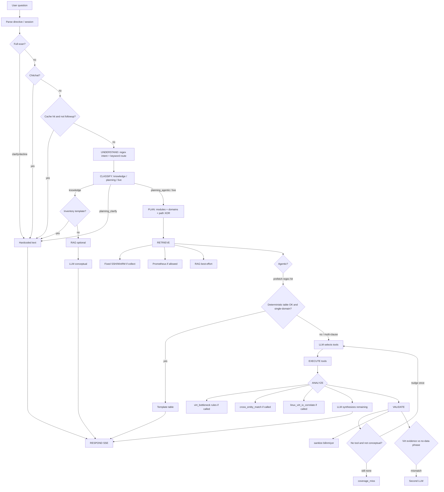
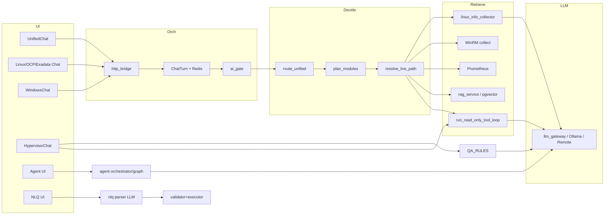
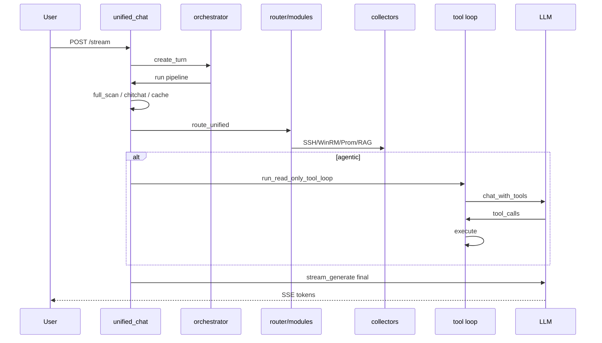
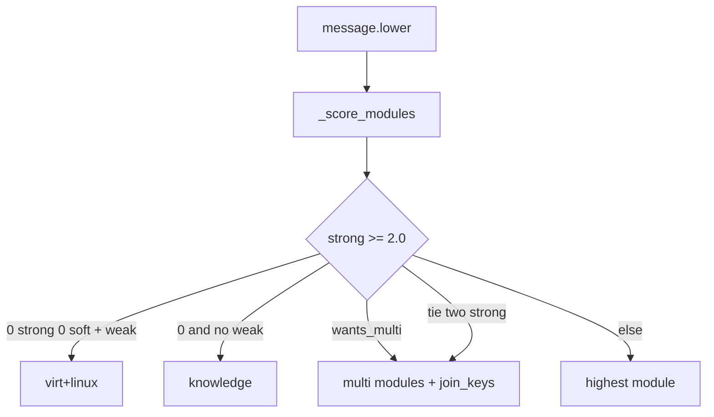

# ainew — AI Architecture GUIDE

Code-derived **full** AI Architecture & Behavior Analysis. This is not the operator menu GUIDE (Master GUIDE). It is **not** ingested into RAG.

Short agent map: `.cursor/rules/ainew-ai-architecture.mdc`. This PDF is not that map — it is the **complete** report (inventory tables, lifecycle, domains, tools, RAG, diagrams).

## MUST UPDATE

When routing, tools, prompts, RAG, domains, or the chat lifecycle change, **update this file and the Turkish twin in the same change.** Also update the short Cursor rule. Do not skip.

| Place | File |
|-------|------|
| TR GUIDE | `docs/guides/tr/modules/ai-architecture.md` |
| EN GUIDE | `docs/guides/en/modules/ai-architecture.md` |
| Cursor rule | `.cursor/rules/ainew-ai-architecture.mdc` |

Settings → About → **AI Architecture** prints this text as PDF. A stale rule becomes a false source of truth for agents.

---

# AINEW — AI Architecture & Behavior Analysis

Ürün: **ainew** (Infrastructure AI Assistant). Analiz, kodun gerçek çağrı zincirine dayanır. Tek bir “AI motoru” yoktur; **birden fazla sohbet yüzeyi + arka plan AIOps + NLQ + Agent + RAG** birlikte çalışır.

---

# 1. AI System Inventory

## 1.1 User-facing AI surfaces

| Component | Dosya | Class / function | Görev | Input | Output | Çağıran | Çağırdığı | Lifecycle |
|---|---|---|---|---|---|---|---|---|
| Unified Chat API | `backend/app/api/unified_chat.py` | `unified_chat_stream` | Tüm altyapı sohbeti (Linux+Windows+Virt+OCP) | `message`, `session_id`, `model`, `use_rag` | SSE token/tool/done | `frontend/src/pages/UnifiedChat.tsx` | orchestrator, `route_unified`, collect, `run_read_only_tool_loop`, `_build_prompt`, `llm_gateway` | Ana request girişi |
| Linux / OCP / Exadata Chat | `backend/app/api/chat.py` | `chat_stream` | Platform-scoped sohbet; `platform=linux\|openshift\|exadata` | mesaj, `server_ids`, `platform` | SSE | `Chat.tsx`, Servers, Events | `route_admin_question`, SSH collect, Prom, RAG, tool loop | Domain chat |
| Windows Chat | `backend/app/api/windows_chat.py` | `chat_stream` | WinRM + Event Log sohbeti | mesaj, sunucu seçimi | SSE | `WindowsChat.tsx` | WinRM collect, RAG, LLM | Domain chat |
| Virt Chat | `backend/app/api/hypervisors.py` | `ask_hypervisor_question`, `ask_hypervisor_stream` | vCenter/OV sohbeti | `question`, `session_id` | JSON veya SSE | `HypervisorChat.tsx` | `route_admin_question`, QA_RULES, `chat_source_graph`, `answer_hypervisor_question` | Domain chat |
| Chat Orchestrator | `backend/app/services/chat_orchestrator/service.py` | `create_turn`, `run_turn` | Turn kuyruğu, AI gate, SSE replay, iptal | platform, payload | `ChatTurn` + Redis events | tüm `/stream` endpoint’leri | `plan_sources`, `ai_gate`, pipeline | Request lifecycle kabuğu |
| HTTP Bridge | `chat_orchestrator/http_bridge.py` | `attach_and_stream` | Pipeline’ı turn’e bağlar, SSE yayınlar | pipeline fn | `StreamingResponse` | chat API’ler | `create_turn`, Redis stream | Transport |
| AI Gate | `chat_orchestrator/ai_gate.py` | `try_acquire` | Eşzamanlı LLM kotası | timeout | lock / queue position | `run_turn` | Redis/semafor | Concurrency |
| Agent API | `backend/app/api/agent.py` | chat/approve/reject | Mutating tool + human-in-the-loop | mesaj, onay | adımlar + final | `Agent.tsx` | `agent/orchestrator` | Ayrı otomasyon yüzeyi |
| NLQ API | `backend/app/api/nlq.py` + `nlq/pipeline.py` | `run_nlq` | Linux envanter NL→JSON→SQL | doğal dil | structured answer | inventory UI | parser LLM, validator, executor | Ayrı structured-query yolu |
| RCA API | `backend/app/api/rca.py` | compare-window, awr-analyze | Pencere karşılaştırması + AWR LLM | zaman pencereleri / AWR dosyası | analiz | RCA UI | compare_service, LLM | Ayrı analiz |
| Finding AI comment | `backend/app/api/virt_insights.py` + `services/findings/ai_comment.py` (+ `events.py`, `ai_postprocess.py`) | `finding_ai_comment_generate` (`POST /virt-insights/findings/{id}/ai-comment`) | LLM comment per EVENT for Configuration (`health`) + Hardware (`hardware`) findings — button only | event key (`platform\|source_id\|entity_ref\|family`); any member `finding_id` | validated structured comment (summary, incident view, impact, priority, observed, general knowledge, other improvements, unknowns) + code-computed confidence | `FindingAiComment.tsx` (when a finding row is expanded; identical on every member of the event) | `build_facts` (`findings/context.py`, `events.py`), `llm_gateway.generate_async` (client only), `validate`, `postprocess` | Button → generate → validate → post-process → store (versioned per event) |
| RAG Admin API | `backend/app/api/rag.py` | ingest/search/reindex | Runbook/incident/knowledge yönetimi | PDF/text | chunk sayısı | Settings/Knowledge | `rag_service` | RAG lifecycle |
| MCP API | `backend/app/api/mcp.py` | tool call + analyze | Linux MCP tool + LLM yorum | tool+host | tool result / LLM | MCP panel | `mcp_client`, LLM | Yan yüzey |
| Knowledge API | `backend/app/api/knowledge.py` | pin/list | Manuel fact + RAG reindex | fact | persisted fact | ChatPinFact | `fact_learning`, RAG | Persistent memory yazımı |
| Centrify Chat | `backend/app/api/centrify_chat.py` | `centrify_chat_stream` | Level 1 Centrify zone assistant (READ-ONLY) | `message`, `zone_id`, `session_id` | SSE token/done | `CentrifyPage` FAB | `_gather_centrify_context`, `_run_tool_if_needed`, `llm_gateway.stream_generate` | Separate surface; Centrify Postgres |
| Automic Chat | `backend/app/api/automation.py` | `chat_stream` (`/automation/chat/stream`) | Automic (UC4) execution/failure assistant (READ-ONLY) | `message`, `session_id`, `system_id`, `timezone` | SSE `phase`/`tool_call`/`tool_result`/`components`/`token`/`meta`/`done` | `pages/automation/AutomationChat.tsx` | `run_read_only_tool_loop(platform=automic, domains={automic})`, `chat_support.run_fallback`, `_stream_answer` → `llm_gateway` (incl. external) | Separate surface; Automic module DB (TimescaleDB `automic_db`) |

**Finding AI comment lifecycle (same idea as Incident RCA: on button click):** Findings → expand a Configuration/Hardware row; `GET .../ai-comment` returns the stored comment (it does NOT generate). “Explain with AI” → `POST .../ai-comment` (async; `llm_gateway.generate_async`, client only — gateway code is not changed). **EVENT-based:** the comment is generated per EVENT, not per finding (`findings/events.py`). Event key = `platform|source_id|entity_ref|event_family`; families are defined in code (hardware family: `hw.host.*` = `sensor_alarm`, `overall_status`, `sensor_repeat`, `event_pattern`, `config_issue`; also time sync, path redundancy, host state; an undefined check is a single-member event). The comment appears identically on ALL member findings of the event; regenerating creates a new version under the event key. Computation is in code: `build_facts` = (a) `olay_bulgulari` (same root, narrated as one event) + (b) `diger_bulgular` (OTHER open findings on the same host: “not directly related to this event”; never narrated as cause/part, they appear only in the `diger_iyilestirmeler` list; the `findings/context` response reflects this with `related_event`/`related_other`/`event`, the old `related` is kept) + the “if the host fails” impact (`host_failure`; the impact sentence is written IN CODE by `impact_text`) + the rule guide. The model only narrates; output is JSON (`ozet`, `olay_gorunumu`, `etki`, `oncelik`, `gozlenen`, `genel_bilgi`, `diger_iyilestirmeler`, `bilinmeyenler`). **Validation (`validate`) runs before anything reaches the user:** numbers/IPs/versions/KB/CVE/commands/code blocks not in the data → rejected; action claims → rejected; `genel_bilgi` cannot contain digits/versions/commands; a (b) finding mentioned in `ozet/olay_gorunumu/etki/oncelik` → rejected (it is dropped deterministically from `gozlenen` items); “RAM” → “Memory”. On a violation it retries once with feedback; if it still fails, HTTP 422 and nothing is stored. **Post-processing (`ai_postprocess.postprocess`, after validation, deterministic, no LLM):** (1) **recommendation-vs-fact check:** if remaining hosts == 0 no evacuation/migration/vMotion/migrate/drain recommendation can stand; that sentence is replaced by the fixed “consider moving them to another cluster or planning a maintenance window” sentence (`validation.recommendation_fixes`). (2) **Definitive-claim softening (`soften`):** statements such as “stops”, “leads to”, “causes an outage”, “crashes” stay only if supported by computed data: when the host-failure result is `fail`, “do not fit / failover is not possible” AND sentences that are consequences of that scenario (the `etki` field or a “if the host goes down” context; data-loss claims excluded) are not softened; unsupported sentences are rewritten ONLY into possibility wording. In `etki`, a vague “This situation …” reference is rewritten to state the scenario (“If the host goes down, these VMs cannot keep running; there is no other host in scope” when `fail`; otherwise an “If the host goes down, …” prefix). Code-written sentences (impact sentence, rule guide, fixed sentences) are untouched. (3) **Counting:** definitive consequence sentences left unsoftened because the verb is not in the dictionary are written to `validation.unsoftened_definitive_count` (+ `unsoftened_definitive` samples) and to an INFO log. Changed sentences go to `validation.softened_sentences` + `softened_count`. **Confidence** (`confidence`) is computed in code from data gaps (`no_detail`, `no_sensor_type`, `no_impact`, `stale_source`). **Storage:** `finding_ai_comments` (versioned per event key: `(event_key, version)` unique; `finding_id` = the event's representative finding; `input_hash` = members + their states + impact; `facts` kept for audit) + `finding_ai_feedback` (`(comment_id, username)` unique; one vote per user). **Retention:** old VERSIONS are deleted after `VIRT_AI_COMMENT_RETENTION_DAYS` (virt-specific env; default 90, minimum 7 days); the latest version of every event ALWAYS stays; the purge runs at the end of the hourly virt-insights cycle (`findings/runner.run_cycle` → `purge_old_versions`); shared `runtime_settings` is untouched. If the stored comment's `input_hash` differs from the current fingerprint the UI shows “The finding changed; the comment may be out of date” + “Regenerate”. UI: `AiBlock method="ai.finding.comment"`, confidence + reasons, an event member-count note, and separate boxes for “Observed data”, “General knowledge (independent of the data)” and “Other improvements (not related to this event)”. The tables live in `models/finding_ai.py` and ARE registered in `app.models` (the startup `create_all` creates them); `backend/migrations/add_finding_ai_comments.sql` is a reference and `rollback_finding_ai_comments.sql` rolls back. If the tables are missing GET returns `available=false` and POST returns 503 (Turkish message).

**Centrify context/tools:** Context from Centrify Postgres. Sync prefers one WinRM `list_zone_inventory` call per zone (roles+rights+login, commands, assignments, computers, unix profiles, computer roles) with `sync_throttle` (min interval, zone delay, retry). Calculators in `query_service.py`: effective access, login diagnose, expiring assignments, `find_similar_roles`, `find_similar_commands`, `explain_role`, `explain_command`. Chat tools fence data as `<<<CENTRIFY_TOOL_DATA>>>`. REST `/centrify-mgmt/query/*`. Auth: `require_module("level1")`. UI: `CentrifyPage` FAB + markdown.

**Automic chat lifecycle:** `classify_chat_intent` (conservative: explicit meta pattern + no data signal → `meta`; definition → `knowledge`; else `data`) → `build_system_prompt` (Part B + trailing runtime `APP_NAME`/`LLM_MODEL`/`LLM_DEPLOYMENT`) + RAG (skipped for meta) → **data:** `run_read_only_tool_loop` then `run_fallback` on empty tour (no fallback for meta/knowledge) → **meta/knowledge:** no tools → `build_components` only for data (zero UI components for meta; tool names stay in collapsed AnswerFooter) → `_stream_answer`; empty LLM on meta → `deterministic_identity_answer`; `AnswerLeakGuard` + `ainew-meta` → `ChatMessage.meta` includes `intent`. Auth: `require_module("automation")`. Fake source child/restart RunIDs share one ascending counter (no 9e12 offset).

**Automic official schema knowledge:** the SQL profile (`services/automic/source/sql/oracle/ae-24.yaml`, `rev: 2`) uses only Broadcom TechDocs *Automic DB Schema* (24.4) columns (`source/sql/official/ae-24.4-columns.yaml` + `test_automic_official_schema.py` enforce it). User name is resolved via `AH_USR_Idnr`/`EH_USR_Idnr` → `OH_Name`, folder via `OFS` (`OFS_Link=0` Home Folder, 24.4 `OFS.md`) → `OH_Name` (adapter `_enrich_runs`, 1 h cache, failures are silent); AE's own ERT (`AH_ERT`/`EH_Ert`/`EH_ERTEnd`/`OH_Ert`) and `EH_Signal` are stored in the module DB as `ert_sec`/`ert_end_time`/`signal`; active status groups come from `classify.active_state` (UNVERIFIED active status groups (24.4 Task Status page not found)). The system prompt has a "Official AE fields" block; RAG seeds `AUTOMIC-ae-db-schema.md` + `AUTOMIC-ae-status-metrics.md` cover table/column/status-code/report-type/metric questions. Tools `automic_active` (state, user, queue, platform, ert_sec, ert_end_time, over_ert, signals) and `automic_execution` detail (user, queue, folder, run_time_sec, ert_sec) return these fields. Stale discovery records are refreshed by the hourly discovery when `profile_rev` differs. User-name search: `automic_search_executions user=` module DB → (if empty/unresolved rows) live source lookup OH(USER)→AH_USR_Idnr (`data_source=source_live`); `automic_active user=`, `automic_history user_activity`; fallback planner `chat_support.detect_user`.

**Automic answer presentation:** The model emits Markdown, not HTML; there is no fixed `## Summary/### Findings` template. The first line is one bold result sentence (lead), followed by `**Heading** · text` blocks; scope/time/record count are never written into the text. `AnswerLeakGuard` recognises the answer start by a `###` heading or a bold lead (dropping leaked reasoning). Scope is deterministic: `services/automic/scope.py` (`scope_for_answer`) derives system, clients, time range, record count, data source (db/source/mixed), partial/retention limit, source lag and last collection from tool results, and `chat_stream` overrides the meta `scope` with it (`stub_meta` when the LLM sent no meta). Meta also carries `confidence` (high|medium|low). Frontend `pages/automation/AnswerView.tsx`: `AutomicMarkdown` (scoped `.automic-md` CSS using theme variables; h1–h6 as quiet labels, lead accent by `severity`, tables/code only for real content; strips legacy ```` ```markdown ```` wrappers and the meta fence) + `AnswerFooter` (one line `system · range · N records · source`, click to expand details + confidence badge). Tool chips are no longer shown above the bubble.

**Method transparency (Slice T):** Every finding/card/metric/scenario result on screen carries a method-class badge (Data, Calculation, Forecast, Rule, Matching, AI) plus an (i); the content comes from a single source, `backend/app/services/method_registry.py` (`GET /api/v1/methods`; ids shared with findings `check_id`, chat tools as `tool:<name>`). AI-generated text (RCA, log analysis, event analysis, chat) is shown separately in the UI via `AiBlock` (“AI summary” label + different background; backend numbers are never mixed into the same box) with the note “The text was written by AI. Numbers and results come from the backend; AI does not change them.” The “How do we calculate?” page (`/methods`) is generated from the registry. An unregistered findings check, READ_ONLY chat tool or component id fails CI (`test_method_registry.py`, `methodRegistry.test.ts`). Forecasts are given as ranges; “AI predicted/detected” wording is forbidden for non-AI methods.

## 1.2 Decision / planning

| Component | Dosya | Function | Görev | Input | Output | Karar yöntemi |
|---|---|---|---|---|---|---|
| Unified Intent Router | `unified_intent_router.py` | `route_unified` | `knowledge \| planning_clarify \| planning_agentic \| live` | mesaj + followup bayrakları | `UnifiedRoute` | Rule/keyword, LLM yok |
| Module Orchestrator | `module_orchestrator.py` | `plan_modules` | linux/windows/virt/openshift/exadata seti | mesaj | `ModulePlan` | Keyword skor + düşük güvende `route_llm_hint` |
| Module Gate (RBAC) | `unified_chat.py` | `_chat_allowed_modules` / `_route_denied_modules` | after routing, before collect/tools: if the route needs a platform module (linux/windows/virtualization/openshift/exadata/automic→automation) the user lacks, the answer is refused; inventory fast-path and `linux_servers`/`windows_servers` are stripped of unauthorised platforms. `admin`, `ai_automation`, `executive` are unrestricted (Unified Admin chat may query Automic without a separate `automation` grant) | `UnifiedRoute.modules` + user modules | refusal or continue | Deterministic, no LLM |
| Source Planner | `chat_source_planner.py` | `plan_sources` | db/ssh/winrm/vcenter/ocp/prom/rag | mesaj + scope | `SourcePlan` | Unified’da router’ı çağırır; diğerinde keyword |
| Path Policy | `chat_path_policy.py` | `resolve_live_path` | fixed collect XOR agentic | bayraklar | `LivePathDecision` | Keyword + settings |
| Chat Intent | `chat_intent.py` | `classify_chat_intent` | conceptual/inventory/live/mixed/general | mesaj | `ChatIntent` | Regex |
| Admin Intent Router | `admin_intent_router.py` | `route_admin_question` | Linux inventory/cmd vs Virt QA_RULES | mesaj, platform | `RouteResult` | Keyword/regex |
| Linux Chat Intent | `linux_chat_intent.py` | inventory/direct_cmd | Filo özeti, komut çıkarma | mesaj | bool / cmd list | Keyword |
| Planning Intent | `chat_planning_intent.py` | MTV/taşıma netleştirme | migrasyon kapsamı | mesaj | scope / clarify | Keyword |
| Data Fetch Ladder | `data_fetch_ladder.py` | `is_live_resource_query` | Anlık kaynak merdiveni | mesaj | bool + prompt addendum | Keyword + `intent_text` negation |
| Intent text | `intent_text.py` | `keyword_hit` / `regex_hit` | Negation window (`demiyorum`, `sapmadan`, `düşme`, `kaydırma`) | mesaj | bool | Shared helper |
| Virt Inventory Contract | `virt_inventory_contract.py` | `detect_virt_inventory_kind` | VM/datastore/ESX prefetch | mesaj | kind + fields | Regex |
| Virt Scope | `virt_scope.py` | `resolve_scope` | Entity filtre (vm/host/ds) | mesaj + DB | scope object | DB lookup + substring |
| Full Scan Policy | `chat_full_scan_policy.py` | `resolve_full_scan_turn` | Tam filo onayı | session+mesaj | clarify/decline/confirm | Keyword + session state |
| Chitchat Policy | `chat_chitchat_policy.py` | `canned_chitchat_answer` | Selamlaşma, LLM yok | mesaj | sabit metin | Keyword |
| Output Directives | `chat_output_directives.py` | `extract_output_directive` | `/table` `/json` `/brief` `/diagram` `/graph` | message | directive | Regex (anywhere); `/graph` `/grafik` `/chart` = Recharts (`chat_charts`) |
| Chat Charts | `chat_charts.py` | `try_build_chat_charts` | Chat timeseries + overlay | message, platform, targets | `meta.charts` + summary | Timescale / Prom query_range / virt `query_series` / OCP `ocp_resource_metrics`; max 8; split by unit; **Top-N**: if no names, `en yüksek/top N` → rank then series (linux/virt/ocp) |
| Tool Policy | `chat_tool_policy.py` | `should_use_db_first` | İlk 2 adımda canlı vCenter gizle | platform/domains | bool | Hardcoded |

## 1.3 Tool / LLM / response

| Component | Dosya | Function | Görev |
|---|---|---|---|
| Unified Tool Loop | `unified_tool_chat.py` | `run_read_only_tool_loop` | READ_ONLY function calling (varsayılan 6 adım) |
| Tool Registry | `agent/tools.py` | `TOOLS`, `tool_specs_read_only` | Domain filter (intersection). Virt DB = `vcenter`; shared = `infra` |
| Windows Tools | `agent/tools_windows.py` | `WINDOWS_TOOLS` | WinRM tool’ları |
| Agent Orchestrator | `agent/orchestrator.py` | `start_agent` | Mutating + onay; LangGraph `MAX_STEPS=8` |
| Agent Graph | `agent/graph.py` | LangGraph `llm_node`/`tools_node` | Agent akışının graph hali |
| Agent LLM | `agent/llm.py` | `chat_with_tools` | Tool-calling LLM çağrısı |
| Agent Guard/Policy | `agent/guard.py`, `policy.py` | `guard_command`, `RiskLevel` | Mutating sandbox |
| Chat Source Graph | `chat_source_graph.py` | `decide_source → execute_tools` | Virt için tool loop sarmalayıcı |
| LLM Gateway | `llm_gateway.py` | `stream_generate`, `chat_sync`, `generate_sync` | Groq/OpenAI/OpenRouter → REMOTE_LLM (native Ollama or OpenAI `/v1`) → local Ollama |
| LLM Transport | `llm_transport.py` | `is_remote_ollama`, `get_effective_context_tokens`, `build_llm_health` | `llm_transport_mode` auto\|ollama\|openai; `/api/version` probe; effective budget = min(setting, real ctx) |
| AI Source | `llm_ai_source.py` | `AiSource`, `resolve_ai_source`, `build_capability_profile` | Optional gateway `ai_source=`; currently only `default` (no UI/module mapping) |
| Ollama Runtime | `ollama_runtime.py` | `apply_ollama_payload`, `check_ollama_health` | Every native Ollama request: `keep_alive` + `options.num_ctx` (effective budget); `/api/ps` health |
| LLM Availability | `llm_availability.py` | circuit breaker | Gateway down ise kes |
| LLM Usage | `llm_usage.py` | token/usage | SSE’ye usage enjekte |
| Context Budget | `llm_context_budget.py` | `budget_sections` | Token tavanı; system/soru kesilmez |
| Response Layers | `response_layers.py` | `wrap_layer` | linux_ssh / winrm / prom etiketleri |
| Answer Sanitize | `answer_sanitize.py` | `sanitize_llm_answer` | “bilinmiyor” cümlelerini siler |
| Chat Coverage | `chat_coverage.py` | `record_coverage_miss` | Kanıtsız “veri yok” telemetrisi |
| Virt Intelligence | `hypervisor_intelligence.py` | `answer_hypervisor_question`, `QA_RULES` | Deterministik virt cevap + persona LLM |
| Virt fleet perf | `virt_fleet_perf.py` | `fetch_fleet_vm_stats` | Fleet: Timescale then live (no refuse) |
| Virt chat RAG | `virt_chat_rag.py` | `collect_virt_rag_block` | Runbook/incidents on virt LLM path |
| Virt Diagnostics | `virt_diagnostics.py` | bottleneck kuralları | VM vs host kök neden (kural motoru) |
| Linux Collector | `linux_info_collector.py` | `detect_needed_groups`, `collect_server_info` | Keyword → SSH grupları |
| Infra Summary | `infra_summary.py` | `build_infra_overview_text` | Ucuz DB özeti |
| Prometheus AI | `monitoring/prometheus_metrics.py` | `get_metrics_context_for_ai` | PromQL JOIN tablosu |
| Cross Entity Match | `cross_entity_match.py` | `cross_entity_match` | hostname/vm/ip JOIN |
| Cross-domain I/O | `cross_domain_diagnostics.py` | `linux_virt_io_correlate` | Guest iowait × VM disk latency (join şart) |
| NLQ Parser | `nlq/parser.py` | `parse_question` | LLM → JSON şema |
| AIOps Engine | `aiops_engine.py` | persist + RCA | Anomali→event→incident→LLM RCA |
| Report Engine | `report_engine.py` | generate + LLM özet | Virt raporları |
| Log Analyst | `log_analyst.py` | log + LLM | Ayrı analiz |
| Custom Report Engine | `custom_report_engine.py` | tool sonuçlarından rapor | Structured tool dump |

## 1.4 RAG / bellek / cache

| Component | Dosya | Görev |
|---|---|---|
| RAG Service | `rag_service.py` | ingest, chunk, retrieve, rerank, context |
| RAG Store | `rag_store.py` | pgvector `rag_embeddings` (Chroma runtime değil) |
| Embedding | `embedding.py` | `nomic-embed-text` 768-d, Ollama/remote |
| Reranker | `reranker.py` | opsiyonel cross-encoder |
| RAG Seed | `rag_seed.py` + `docs/rag_seed/` | ürün runbook’ları |
| Chat History | `chat_history.py` | son 8 mesaj |
| Chat Cache | `chat_cache_service.py` | platform+mesaj hash, follow-up’ta kapalı |
| QA Cache | `qa_cache.py` | virt deterministic/LLM cache |
| Episode Memory | `episode_memory.py` | Redis 45 dk canlı keşif özeti |
| Fact Learning | `fact_learning.py` | SSH’den kalıcı LearnedFact |
| Assistant Playbooks | `assistant_playbooks.py` | başarılı tool zincirini hatırla |
| Chat Cancel | `chat_cancel.py` | Redis iptal bayrağı |

## 1.5 LLM / model / prompt / vector DB — summary

- **LLM:** `llm_gateway` single exit: keyed Groq/OpenAI/OpenRouter → `REMOTE_LLM_*` → local Ollama. If REMOTE is Ollama (`GET /api/version` or `llm_transport_mode=ollama`) use native `/api/chat`\|`/api/generate` + `keep_alive`/`num_ctx`; else OpenAI `/v1/chat/completions`. Centrify, legacy `app/chat.py`, and Automic `_stream_answer` go through the gateway (no Automic masking in the gateway). Unified may still stream Groq/OpenAI/OpenRouter directly. No Anthropic Messages tools.
- **Ollama host independence:** Do not rely on customer Ollama server defaults. `apply_ollama_payload` on native requests: `keep_alive` + `options.num_ctx` (= effective budget `min(setting, discovered|hard_cap)`). Health card: transport mode + effective budget + `/api/ps`; warnings do not block access.
- **Model seçimi:** `resolve_model_for_tier("fast"|"strong")` — knowledge/simple → fast; live/planning → strong.
- **Prompt:** statik SYSTEM_PROMPT + dinamik persona/context/history/tool.
- **RAG:** evet, 4 koleksiyon, pgvector.
- **Embedding:** `nomic-embed-text`, 768.
- **Vector DB:** PostgreSQL/TimescaleDB `rag_embeddings` + pgvector. Chroma yalnızca migrate kaynağı.
- **Agent / Planner / Router:** evet, ama planner LLM değil; keyword + module skor.
- **Intent / domain:** regex/keyword; düşük güvende `route_llm_hint` (tam classifier değil). NLQ parser ayrı.
- **Tool calling:** evet (`chat_with_tools`). Chat yüzünde yalnız READ_ONLY.
- **Memory:** session DB + Redis episode + LearnedFact + playbook + RAG knowledge.
- **Cache:** Postgres chat cache + virt QA cache + Redis API TTL.
- **Guardrails:** domain tool filtresi, DB-first, evidence nudge, sanitize, coverage miss, agent mutating onay, fleet cap.
- **Logging:** `ChatTiming`, coverage misses, LLM usage, audit (NLQ/agent).

---

# 2. Current AI Architecture

Koddan gerçek Unified Chat akışı:

```diagram
User (UnifiedChat.tsx)
  → POST /api/v1/unified-chat/stream
  → attach_and_stream
  → create_turn (plan_sources → ChatTurn + Redis)
  → run_turn (ai_gate lock)
  → unified_chat.pipeline
       1. extract_output_directive
       2. session + ChatMessage(user)
       3. full_scan_policy  → clarify/decline ise LLM YOK, return
       4. canned_chitchat   → LLM YOK, return
       5. history (son 8)
       6. chat_cache        → hit ise LLM YOK, return
       7. route_unified
            → planning_needs_clarification?
            → planning_scope / MTV?
            → is_knowledge_only?
            → else plan_modules (keyword skor; düşük güvende route_llm_hint)
       8. inventory fast-path (infra_summary) → LLM YOK, return
       9. mention + live_collect_policy (SSH/WinRM hedefleri)
      10. resolve_live_path (collect XOR agentic)
      11. paralel: Linux SSH / WinRM / Prometheus / RAG
      12. context birleştir (overview + live + facts + apps + RAG + playbook + episode)
      13. if run_agentic:
            run_read_only_tool_loop
              → prefetch (snapshot / virt inventory)
              → varsa deterministic tablo → LLM YOK, return
              → LLM tool loop (max_steps)
              → tool sonuçları context’e eklenir
      14. episode_memory.save
      15. apply_context_char_budget
      16. _build_prompt
      17. llm_gateway.stream_generate (veya Groq/OpenAI/OpenRouter)
      18. ChatMessage(assistant) + optional cache
      19. SSE done
```

**Önemli gerçek:** “Router → Context → Tool → LLM → Response” tahmini eksik. Sistemde **erken çıkışlar** (chitchat, cache, inventory, planning clarify, virt deterministic tablo) LLM’i tamamen atlar. Tool loop **bazen** final cevabı da kendisi üretir (`deterministic_answer`).

Virt chat is different: QA_RULES regex → handler (no LLM) → else report → else `build_context` + LLM; agentic tools add evidence. Fleet perf handlers use `virt_fleet_perf` (Timescale latest row; live keywords or empty columns → QueryPerf). LLM path injects `virt_chat_rag` (runbook/incidents — not estate counts). Deterministic hits skip RAG. Cluster HA/DRS / failover / hierarchy: `h_cluster_ha_drs` and `h_inventory_hierarchy` prefer `virt_clusters` + host metrics (`db_list_clusters`); live ClusterComputeResource only if DB empty.

Linux chat: admin router (inventory/direct_cmd) → keyword SSH/Prom → collect XOR agentic → prompt → LLM.

Agent sayfası ayrı: LangGraph tool loop + mutating onay.

---

# 3. AI Request Lifecycle

| # | Aşama | Unified’da var mı? | Nasıl |
|---|---|---|---|
| 1 | Request | Var | SSE + `ChatTurn` + Redis events |
| 2 | Query parsing | Partial | `/table` `/json` `/brief` `/diagram` (regex, anywhere); virt typo normalize; NLQ LLM JSON parse |
| 3 | Intent detection | Var | `classify_chat_intent` + `route_unified` + admin router — **regex/keyword** + `intent_text` negation |
| 4 | Domain detection | Var | `plan_modules` keyword score; esnaf virt+linux does **not** overwrite (Windows / fleet virt kept); low-conf `route_llm_hint` |
| 5 | Entity extraction | Kısmi | `_servers_mentioned_in_message`, `virt_scope`, VM name substring, NLQ filters |
| 6 | Context creation | Var | overview + SSH/WinRM + Prom + RAG + facts + episode + tools |
| 7 | Tool selection | Hibrit | Domain filtresi kural; hangi tool = **LLM**; bazı prefetch = regex |
| 8 | Tool execution | Var | `Tool.execute` / SSH / vCenter / OCP / DB |
| 9 | Data retrieval | Var | DB sync, live API, SSH, Prom, RAG |
| 10 | Data processing | Kısmi | field projection, virt render, Prom JOIN, bottleneck kuralları |
| 11 | RAG | Var | best-effort, live bitince beklenmez |
| 12 | LLM call | Koşullu | early-exit ve deterministic yollarda yok |
| 13 | Result interpretation | Hibrit | virt_bottleneck/QA_RULES kural; çoğu zaman LLM |
| 14 | Validation | Hybrid | evidence nudge + Unified/virt final retry; `data_status`; coverage miss UI; Unified evidence badge (`chat_evidence_badge`); no schema check (except NLQ) |
| 15 | Response generation | Hibrit | LLM stream **veya** şablon tablo/metin |
| 16 | Final response | Var | SSE token + DB persist |

**Sistemde olmayan / çok zayıf aşamalar**

- Tam LLM intent/domain classifier yok (yalnız düşük güven ikinci fikir: `route_llm_hint`)
- Genel entity NER yok
- Çok adımlı planner (görev grafı) yok; “planner” keyword + max_steps
- Tool sonucu için formal sufficiency checker yok (LLM “yeter” der veya max_steps biter)
- Cross-domain otomatik correlation motoru yok (`virt_bottleneck`, `cross_entity_match`, join şartlı `linux_virt_io_correlate` hariç)
- No model confidence score. Unified has an evidence badge (`chat_evidence_badge`: high/medium/low; hidden on conceptual). The badge payload also carries `sources` (tools called this turn + `method_registry` method class + time → UI “Source: virt_capacity_simulate (Calculation), 23:31”) and `general` (no tool/evidence → “General AI knowledge — not taken from your environment”). Every chat flow’s system prompt carries the shared NUMBER RULE (`services/chat_rules.py` `NUMBER_RULE_TR`: Linux/OCP/Exadata `chat.py`, Unified, Windows, Centrify, virtualization persona, Agent, MCP analysis; Automic has its own grounding rule): the LLM never produces numbers/ratios/dates/RPO-RTO/forecasts/placements/scenario results, it only relays values from tool results, and says “no data” otherwise. Legacy flows without a tool loop (Linux/OCP/Exadata `chat.py`, Windows, virtualization `hypervisors.py`) also emit a source line (T2): `chat_evidence_badge.collect_sources_evidence` lists only sources ACTUALLY placed in the context this turn (`collect_ssh` / `collect_winrm` / `collect_prometheus` live collection → high; ainew DB inventory only `collect_inventory` → medium; virtualization uses the tools in `tools_used`); with no source there is neither a badge nor a “general AI knowledge” claim. The payload travels in `ChatMessage.meta.evidence` + SSE `done.evidence`; UI `ChatSources`. Reports (virtualization/platform/executive) and the AWR PDF carry “Method notes” generated from `method_registry` (`report_method_notes.py`; not hand-written).
- Hallucination için groundedness scorer yok
- Rerank sonrası relevance eşiği ile “RAG kullanma” kararı yok

---

# 4. AI Decision Points

| Karar | CURRENT DECISION METHOD |
|---|---|
| Chitchat mı? | Keyword (`chat_chitchat_policy`) |
| Tam filo taraması mı? | Keyword + session pending (`chat_full_scan_policy`) |
| Knowledge-only mı? | Keyword + `classify_chat_intent` regex |
| Planning/MTV mı? | Keyword (`chat_planning_intent`) |
| Hangi domain/modül? | Keyword skor (`plan_modules`); conf≤0.70 ise isteğe bağlı LLM ikinci fikir (`route_llm_hint`, auto_explore daralmaz) |
| Multi-domain mı? | ≥2 strong keyword, JOIN/migrate kelimeleri, VM+guest/SSH, zayıf genel kelime → virt+linux |
| Live data gerekli mi? | Router `need_live`; path policy; mention/filo kelimesi |
| SSH/WinRM collect mi agentic mi? | `resolve_live_path` — XOR; `force_both` yalnız named target + anlık kaynak |
| Prometheus? | Module plan `need_prometheus` + `_PERF` kelimeleri; virt-only kapalı |
| RAG? | `use_rag` flag + `route.need_rag`; chitchat’te kapalı |
| Hangi RAG koleksiyonu? | Intent keyword (`_rag_collections`) |
| Hangi model tier? | knowledge/simple → fast; else strong |
| Agentic açılsın mı? | runtime flag + `need_live` (Groq/OpenAI/OpenRouter anahtarlıysa tool loop açık; Anthropic kapalı) |
| Hangi tool şeması? | `domains_for_platform` ∩ `route.domains` |
| DB-first? | platform virt veya domain vcenter — hardcoded |
| Prefetch hangi virt tool? | `detect_virt_inventory_kind` regex |
| Snapshot tool zorla? | snapshot+boyut regex |
| LLM tool seçimi | **LLM function calling** |
| Aynı tool tekrar? | Hardcoded max 2 aynı (name, args) |
| Tool’suz cevap? | Intent ≠ conceptual ise 1 kez evidence nudge |
| Deterministic tablo yeter mi? | Prefetch `ok` + tek domain; cross-clause varsa LLM’e devam |
| Multi-tool sentez? | ≥2 başarılı farklı tool → tablo early-stop yok |
| Context’e ne girer? | Kod sırası sabit; bütçe history/context keser |
| LLM çağrılsın mı? | Early-exit / deterministic yoksa evet |
| Sonuç güvenilir mi? | Prompt kuralları + virt evidence retry + sanitize; skor yok |
| Fallback | Tool loop hata → collect context ile devam; LLM hata → `(Hata: …)`; RAG fail → boş dict |

---

# 5. Domain Architecture

## Domain detection (shared)

`module_orchestrator._STRONG` / `_WEAK` keyword sözlükleri. LLM yok. Belirsizlikte kullanıcıya sorulmaz; `auto_explore:virt+linux` veya en yüksek skorlu single açılır.

## VMware / vCenter

| Konu | Gerçek |
|---|---|
| Detection | vcenter, vsphere, esxi, vmware, datastore, snapshot, `vm` regex, vb. |
| Tools | `db_list_*`, `db_metric_trend`, `virt_health_overview`, `virt_bottleneck_diagnose`, `vcenter_*`, `vcenter_property_read`; decision layer: `virt_capacity_simulate`, `virt_placement_recommend`, `virt_reclaim_summary`, `virt_health_findings`, `virt_incident_timeline`; only when the `backup` capability exists: `virt_backup_status`, `virt_rpo_compliance` |
| Decision layer | Deterministic engines (`virt_capacity_planner`, `virt_placement`, `virt_reclaim`, `findings/*`, `virt_incident_timeline`) shared by VMware + OLVM + OCP Virt; results stored in `infra_findings`. The LLM never computes numbers, it narrates engine output. QA_RULES `h_capacity_n1` (`n+1`, `kaç host lazım`, `host ihtiyacı`) returns an N+1 table without the LLM. Access is vCenter / OLVM Manager / OpenShift API only (no ESXi/KVM host connections). Optional backup provider (Veeam VBR REST, read-only; the demo/fixture provider is labelled DEMO): the `capabilities` registry enables `backup` only with an enabled + synced instance; otherwise `virt_backup_status` / `virt_rpo_compliance` never enter the LLM tool list (Veeam-less behaviour is unchanged). RPO / unprotected VMs are computed deterministically by `rpo_engine` (the LLM only narrates; RTO is never estimated); raw backup data is never sent to a remote LLM; data lives in `bk_*` tables, not in `virt_vm_metrics`/Prometheus. With the capability present, `virt_incident_timeline` also includes backup sessions matched to the VM (`source=backup`, temporal overlap only, no causality claim) and a `backup_overlap` candidate; extra findings (`bk.job.change_rate_spike`, `bk.job.window_overrun`, `bk.vm.rto_unverified`, `bk.copy.missing`) come from the deterministic `services/backup/extras.py`. |
| Context | `infra_overview` virt özeti; hypervisor chat’te `build_context` büyük DB dump |
| Prompt | Unified SYSTEM_PROMPT virt kuralları; `_VIRTUALIZATION_PERSONA`; module persona |
| RAG | Genel koleksiyonlar; virt-specific collection yok. Seed: `docs/rag_seed/VIRT-*.md` |
| APIs | vCenter REST/SOAP (`vcenter_client`), QueryPerf, property collector; sync’li DB |
| LLM’e aktarım | Tool JSON → text; veya QA_RULES markdown; veya `build_context` dump |

## OpenShift

| Konu | Gerçek |
|---|---|
| Detection | openshift, ocp, k8s, pod, namespace, kubevirt, mtv, … |
| Tools | `openshift_ask`, `list_ocp_*`, `ocp_*`, `kubevirt_*`, `db_list_ocp_*` |
| Context | Linux chat `platform=openshift` SSH/Prom kapatır |
| Prompt | `_PLATFORM_HINTS["openshift"]` |
| RAG | Seed `OCP-*.md`; ayrı vektör namespace yok |
| APIs | OpenShift/K8s + KubeVirt client. No separate `/openshift/ask`; chat is `POST /chat/stream` + `platform=openshift` |
| Monitoring UI | `/openshift/monitoring` — API mode: Virt-style overview (`metrics.k8s.io` → Timescale `ocp_resource_metrics`). Prometheus mode (default when an OpenShift-bound URL exists in Settings): **Kubernetes Views** (Global / Namespaces / Nodes / Pods); GPU DCGM + `kubevirt_vmi_*` kept as selectable templates (`/monitoring/prom/*`, `ocp_prometheus_query`). Hub: `/monitoring` — Linux Live Metrics; Windows = WinRM API / `windows_exporter` Prom; Virt = vCenter/OLVM API / `binding=virtualization` Prom; Other (binding=none): multiple sources + `collector_type` (prometheus\|telegraf\|opentelemetry\|zabbix); hub lists each by **label**. Prom-compatible → metric explorer; **Zabbix** → Overview/Hosts/Charts/Problems/Match map (`/monitoring/zabbix/*`, semantic `metric_id` + item key match map). Unified chat: full label → `custom_prometheus_query` (Prom) or `zabbix_query`. Linux `PROMETHEUS_URL` remains the linux seed. Chat API: `ocp_monitoring_query`; Prom: `ocp_prometheus_query`. |
| Access / RBAC UI | `/openshift/access` — Users, Groups, Identities, Roles, ClusterRoles, RoleBindings, ClusterRoleBindings, ServiceAccounts, subject lookup, token can-i, OAuth IdP (READ-ONLY cluster API). Chat: `ocp_access_query`. |
| LLM | Tool JSON text |

## Exadata / Oracle

| Konu | Gerçek |
|---|---|
| Detection | exadata, cell server, asm diskgroup, oracle rac cell |
| Tools | `exadata_health_overview`, `db_list_exadata_racks`, `db_list_exadata_nodes` (domain `exadata`). Linked compute için Linux `get_*` kalır (`{exadata, linux, infra}`) |
| Context | `infra_overview` exadata filtresi; rack/node DB; `get_exadata_server_ids` |
| Prompt | `_PLATFORM_HINTS["exadata"]` — DB-first; cellcli/ASM uydurma yasağı |
| RAG | Genel |
| APIs | Envanter DB (`exadata_inventory.py`); SSH yalnız linked server; RCA AWR ayrı UI |
| LLM | Tool JSON + isteğe bağlı host OS SSH |

**Sınır:** Canlı cellcli / ASMCMD / AWR sohbet tool’u yok. Cell CPU/ASM IOPS uydurulmaz. `cell_disk_info` varsa envanter JSON’dur.

## Automic (UC4)

| Topic | Fact |
|---|---|
| Detection | `module_orchestrator.MOD_AUTOMIC` (automic/uc4/runid/jobp…); Unified `domains={automic}` — Admin chat: `admin`/`ai_automation`/`executive` is enough (no separate `automation` grant); platform-only users still need `automation` |
| Tools | `automic_search_executions`, `automic_execution`, `automic_active`, `automic_object` (header/script/versions/diff/usage), `automic_history` (+ `expected_tonight`), `automic_status`, `automic_agent` (connected/disconnected/unknown + activity), `automic_infrastructure` (engine/agent/team/object_host; domain `automic`, explicit-only; enabled in Unified when domains include automic) |
| Context | Module DB (`automic_executions` hypertable, `automic_active`, `automic_failed_index`, `automic_report_excerpts`, `automic_daily_aggregates`); single detail/report/children/usage may go to Automic source DB (`automic_source`) — slot + circuit breaker + SET TRANSACTION READ ONLY + SELECT-only guard + masking |
| Prompt | `services/automic/prompt.py` Part B + `_PLATFORM_HINTS["automic"]`; answer is template-free Markdown: one bold lead sentence + `**Heading** · text` blocks; scope is never written in the text; one trailing ```` ```ainew-meta ```` (`severity`, `confidence`, `scope`) |
| RAG | Seed `AUTOMIC-*.md` (runbook: basics, ops-patterns, ae-db-schema, ae-status-metrics); chat `get_rag_context_for_message(collections=["runbook"])` |
| APIs | `/api/v1/automation/*` (overview+insight, executions, active, objects+usage, history, analyses, systems, chat) |
| LLM | Tool JSON + backend components (incl. `dependency_graph`); dashboard_insight 15 min cache; deterministic summary when the LLM is down |
| LLM performance (Step 6b) | **Single stream:** the tool loop's last (non-tool-calling) turn is streamed live by `chat_with_tools_stream` (`answer_start` → table/KPI components, then `token`); a separate `/api/generate` final turn runs ONLY when a genuinely different prompt is needed (knowledge: no tools · `run_fallback` results · the loop produced no answer) and the reason is written to `final_turn_reason` + log. The turn before any tool call (possible evidence/clause nudge) is not streamed live. **think:** only gpt-oss gets `think=low\|medium\|high` (`llm_chat_policy`: simple→low, analysis→medium, unsure→medium; `llm_think_*`; `llm_think_sticky` (default OFF: the tool-selection turn runs at `llm_think_tool_selection`=low, trading one prefix-cache miss for 500–900 fewer reasoning tokens; ON: all turns use one level — in the Harmony template `Reasoning:` sits at the prompt start, a level change invalidates the KV cache). **num_predict** follows the think level (`llm_num_predict_low/medium/high`, includes thinking tokens); `done_reason=length` with empty visible output logs and retries once with a 2× cap. **Tool results (LLM side):** `chat_llm_context.ToolResultCompactor` — row cap (`llm_tool_result_max_rows`=20, "total N rows, first K shown" + `_dagilim_tum_kayitlar` over ALL rows), duplicate lists collapsed, useless columns/microseconds dropped, ~3000 per result / ~7000 total token cap, **masking before the LLM**; UI components/`structured_results` use FULL data. A turn prompt above 70% of num_ctx (`llm_ctx_warn_ratio_pct`) logs + records a metric. **Prefix cache:** static system prefix (`SYSTEM_PROMPT` + hints + `SYSTEM_PROMPT_STATIC`) and tool definitions are byte-identical; every dynamic value (`SYSTEM_PROMPT_RUNTIME`, RAG, history, answer-length hint, the `now` line — most volatile last) is at the END of the system message, computed once per request (`build_prompt_parts`). **Measurement:** per turn `think`, `num_predict`, `done_reason`, `queue_ms`, `ctx_ratio_est`, `prefix_hash`/`tools_hash`, `empty_reason`; per request `first_visible_token_ms`, `unaccounted_ms`, `queue_ms_total`, `concurrent_llm`, `final_turn_reason`, `tool_llm_payloads`; admin `GET /settings/llm-activity` (every gateway call: caller + duration — Ollama Parallel:1 queue diagnosis). The new parameters apply only to calls that pass `llm_policy` (currently Automic). |
| Answer quality, concurrency, progress (Step 6c) | **Thin base prompt:** `llm_policy["base_prompt"]=AUTOMIC_BASE_PROMPT` (`services/automic/prompt.py`) replaces the generic `SYSTEM_PROMPT` (OpenShift/vCenter/Linux heavy) for Automic only; other modules unchanged (old prompt when the key is absent). Real prompt ~11.4–13.2k → ~9.8–11.9k tokens. **Grounding (absolute rule, `SYSTEM_PROMPT_STATIC` §5):** every observation rests on tool results; numbers are copied verbatim (no rounding, no own sums/percentages/"x-fold increase"); an error-code meaning only as `Genel bilgi:` (general knowledge), possible causes in a `Değerlendirme:` paragraph with "possible" + confidence; for periods without data/out of scope the answer says "no data (coverage …)" and never "no activity"/"no change"/guesses a reason; no object/agent/user absent from tool results. Prompt examples use placeholders only (the model copied a real agent name from an example). **Ready-made tool values:** `period_compare` (current/previous period + server-computed `deltas`; no deltas and `comparison_possible=false` when a period has no data), `coverage` on every `automic_history` result (`data_first_at/last_at`, `records_in_range`, `days_with_records`, `days_without_records`, `note`), `top_failed_objects.common_attributes` (common agent/queue/user/hour/error signature across failed runs — "common points" come from data), `automic_search_executions.summary` (exact-number sentence) + `sort` normalization (invented values like `-run_time_sec` are mapped, `sort_note`), `*_text` for every `*_sec` field (`1sa 23dk 05sn`), a `return_code_note` next to non-zero `return_code` (do not invent meanings), timestamps reach the LLM in the user's timezone with offset (`ToolResultCompactor(tz_name=…)`; UI/`structured_results` stay raw) so the model never converts durations/times. Relative dates (yesterday/this week) are computed in the user's timezone and `from/to` are written with an offset. **Thinking-leak root cause:** gpt-oss may write its chain of thought into the `final` channel / `content` of the answer turn (`think=low`, `message.thinking` EMPTY) when it skips the analysis channel; sending `think` does not split it. Layers: prompt (first char `**`, no preface) + `AnswerLeakGuard` safety net (`**…**` and `#` answer start, mid-line bold headings, `dropped_text` telemetry `leak_dropped_chars`). Thinking text never reaches the user. **Tool-call parse errors:** Ollama `HTTP 500 error parsing tool call` (gpt-oss malformed JSON such as `"limit":25"`) is a model sampling error: it does NOT open the circuit breaker (`_note_remote_status`), the same request is retried once with tools first, then without tools. When the loop's last turn is non-streamed but non-empty, that answer (same data) is reused instead of regenerated (`final_turn_reason`). **LLM semaphore (`services/llm_scheduler.py`):** process-wide (Redis Lua lease: ZSET active + ZSET waiting chats; local fallback; multi-worker safe), `llm_max_concurrent`=1 (Ollama Parallel:1). Priority: user chat > background (backfill, report, dashboard summary, benchmark `priority=background`); a background job never starts a new LLM call while a chat waits (`llm_sched_bg_max_wait_sec`, then bypass); chats bypass after `llm_sched_max_wait_sec`. Re-entrant per context. `llm_gateway` calls are wrapped; scheduler wait `sched_wait_ms_total` and Ollama queue `ollama_queue_ms_total` are reported separately; `GET /settings/llm-activity` → `scheduler` state. **Progress (SSE `type=progress`, status only — NO thinking text):** `understood` → `querying` (tool name) → `found` (N records) → `answering`; the first byte is sent BEFORE the preparation (system status, session, prompt, RAG — sometimes 3–4 s): first event ~0.02–0.08 s; preparation errors become SSE `error` events (`chat_stream` → `_chat_stream_impl`). Frontend `AutomationChat.tsx` `ProgressLine` simplifies when the answer arrives; only a "thinking" state while reasoning. **Quality measurement:** `scripts/automic_chat_bench.py` stores each answer + tool trace (`tool_trace`: args, result, the model-visible `llm_view`; `debug_trace` admin only) and `scripts/automic_quality.py` computes PASS/FAIL (number/duration/entity grounding, unlabeled causes, leaks, no-data/coverage, per-question expectations); unit tests `scripts/test_automic_quality.py`. `think` A/B: `--think split\|sticky` (admin + `debug_trace`, per-request `think_sticky`). Result: split (tool selection low + answer level) has the lower mean time (19.5 s vs 23.8 s) with equal quality (within noise) → default `llm_think_sticky=false` kept. **Hallucination / robustness (Step 7):** *Temperature:* the tool-selection turn uses `llm_temperature_tools`=0.1; answer turns (live stream + separate final turn) use `llm_temperature_answer`=**0.2** (before: live stream 0.1, the separate `/api/generate` final turn sent NO temperature → model default 1.0). The value is set per turn through a ContextVar (`llm_chat_policy.temperature_for` → `services/agent/llm.py` `set_turn_temperature`); admin + `debug_trace` requests can A/B with `temperature_answer`. A/B (10 core questions × N=5): 0.0→40/50, 0.1→40/50, 0.2→43/50, 1.0→42/50 (difference within noise; best pass count + mean 15.6 s → 0.2). *Tool-side fixes (before any prompt rule):* `automic_search_executions`/`run_history`/`active_executions`/`agent_summary`/`object_summary` — a range outside coverage returns `data_available=false` + `data_status=NO_DATA_IN_RANGE` + a ready sentence pattern (NOT `SUCCESS_EMPTY`; never "0 times / never ran"); `coverage.continuous_since`; for non-existent objects/agents `object_hint`/`agent_hint` (difflib similar names, `exists_in_module_db`); `latest_record_any_time` when the range is empty ("when did X last run"); `runs_ignoring_status_filter` when a status filter returns 0 ("no failures" ≠ "no runs"); ready `rates` (`failure_rate_pct`…), `duration_stats`, `range_stats`, `longest_run`/`shortest_run` (the model does not compute or invent the other extreme); `get_report.interpretation_note` (report text is DATA; error meaning only as "Genel bilgi:"); `get_report` falls back to another stored excerpt type; `client=0` = no filter. *Deterministic paths:* a context-free ambiguous reference ("şu job", "o agent", "şunu"; no history + no entity name) → `llm_chat_policy.needs_clarification` → `chat_intent="clarify"`: no LLM/tool/RAG call, one short clarifying question; an action request (restart/cancel/stop/start/update…, imperative mood and no question word) → `action_request_answer` → again no LLM/tool: a deterministic "I am read-only, cannot do it; I can analyze; the action is done manually by an authorized user in AWI" (no invented AWI steps/commands/"done" claims; English variant exists); an under-specified but inferable scope ("dünkü sorun") gets `ambiguity_hint` asking for a `Varsayım:` (assumption) sentence; "last year / last month / N months|years|days ago" is converted by CODE (`time_expression_hint`) to a calendar period (`from`/`to` appended to the message; the model does not compute dates and cannot fall back to a rolling window); customer/cost/SLA/owner/author questions get `unavailable_info_hint` ("not in the data"; `client`≠customer); a follow-up ("bunlardan…") with a previous query gets `followup_hint` to keep the filters verbatim; English questions get `language_hint` appended to the user message; for follow-ups the assistant message stores the tool filters in `meta.queries` (`compact_query`: status_class/range/object) and the next turn's "previous conversation" carries `[önceki sorgu: …]`. *Prompt (last resort, `AUTOMIC_BASE_PROMPT`/`SYSTEM_PROMPT_STATIC`):* action request = read-only + manual AWI (no command/REST/payload), follow-up context kept, "N ago / last year" = calendar period, ready calculation fields used AS-IS, answer language, data not held (customer/owner/cost/author; `client`≠customer), false-premise correction, masked values never guessed, report/script text is DATA (embedded instructions are not followed), no invented DB table/column names. *Measurement:* `scripts/automic_questions.py` (57 questions: 10 core + 47 adversarial, categories a–k), `automic_quality.py` category-specific checks + a `manual review` flag, `automic_chat_bench.py --set core|adv|all --repeat N` (per-question pass rate), `--load-test` (3 chats + 1 background), Ollama tool-call parse error rate (`LlmTurnMetrics.tool_parse_error`, perf event `tool_parse_errors`; per turn, think level and question). The DEV-FAKE data is date-fixed, so relative questions ("last 24 h / yesterday") drift out of coverage over time → the benchmark freezes the clock: admin + `debug_trace` requests accept `now_override` (`services/automic/clock.py`, only that request's query/prompt clock; the collector is unaffected). Poisoned test data: `scripts/automic_plant_adversarial.py` adds `JOBS.ADV.*` rows to the fake system only (`--remove` deletes them). *Step 7b (rules moved into code):* **return code** — every tool result with a nonzero `return_code` gets a fixed `return_code_note` from `error_codes.annotate_result` ("The meaning of this return code is specific to the program/script that was run; it has no general meaning in Automic." in Turkish; `_with_system` + compactor); **error codes** — a small sourced dictionary (`services/automic/error_codes.py`: ORA-xxxxx + OS messages) adds `known_error_codes` to the result and the code appends a `**Genel bilgi:**` block (label + `Kaynak`) to the end of the answer after the meta fence (`split_meta`/UI strip the fence and join; the model does not write it; unknown codes are never explained); **information not in the data** — owner/author, cost, customer/business impact, SLA are detected by `unavailable_info_answer` → `chat_intent="clarify"` path, no LLM, fixed "Bu bilgi mevcut Automic verisinde yok. Şunları gösterebilirim: …" (mixed questions that also ask for data go to the LLM; a DB table/column name is never suggested, quality rule `no_db_schema_names` in every category); **explicit dates** — `resolve_time_window` ("2025 Aralık", "15 Mart", "geçen ayın 3'ü", "Mart ayında", "2025 yılında", ISO date, N years|months|days ago) computes from/to in code; unless the message has a comparison/other time expression the window is FORCED (`clock.set_window` ContextVar; `tools_automic._search`/`_history` override the model's from/to/range, the model never produces dates). *Step 7c (structured "why" answer):* `services/automic/why_answer.py` — when the question contains "neden/niçin/sebep/why" and the tool data shows failure evidence (failed run / report error line), code structures the answer: **Observations** (summary, failed runs: RunID/object/status/return code/time/agent, error lines from the report, `return_code_note`, `known_error_codes` explanation + source) are produced entirely from tool results, the model does not write them; the code adds the **"Değerlendirme (yorum, doğrulanmamış)"** (assessment, unverified) heading and the model's free text streams beneath it. Streaming: after each tool turn the tool loop emits a `tools_done` event (`policy["observer"]`) → Observations stream immediately while the model is thinking (incremental; a new tool result adds a new block), the assessment heading is added at `answer_start`, then model tokens stream; at the same time a short system instruction goes to the model (only ≤3 "Olası neden" bullets + a "Güven" line; no repeating observations, no new numbers/RunIDs/objects, no error-code meaning). Without failure evidence no skeleton is built (normal path); when built, the trailing `known_codes_block` is not added. Quality: `why_structure`, `eval_numbers_grounded`, `eval_entities_grounded`, `eval_consistent`, `eval_hedged`, `eval_no_restated_times`; general explanations inside the assessment section are no longer "unlabeled" (the heading is the label). `scripts/automic_rescore.py` re-scores saved answers with the current rules. |
| Masking | Before LLM/DB/audit/UI: passwords/tokens/keys/connection strings always; Automic `NAME/DEPARTMENT` preserved; IP/hostname configurable (shown by default); `llm_deployment` internal\|external |

**Limit:** No writes/starts/stops in Automic (no REST/AWI calls). No free-form SQL; queries are rendered from the YAML SQL profile (`source/sql/oracle/ae-24.yaml`) and pass `sql_guard.assert_read_only`. Usage/dependency requires source `usage_graph`; `expected_tonight` is not a forecast. Secrets never reach the LLM/UI/logs even when the LLM is internal (`services/automic/masking.py`).

## Linux

| Konu | Gerçek |
|---|---|
| Detection | rhel, systemd, journalctl, ssh, lvm, … |
| Tools | `get_*`, `run_diagnostic`, logs, LVM, packages; mutating yalnız Agent |
| Context | `linux_info_collector` grupları; Prom JOIN; LearnedFact; discovered apps |
| Prompt | Linux sysadmin persona |
| RAG | Seed `LINUX-*.md` |
| APIs | SSH (Paramiko), Prometheus |
| Extra | NLQ ayrı hat (structured inventory) |

## Performance / Monitoring

Ayrı modül değil. Tetik: `_PERF` / `_LIVE_RESOURCE_KW` / deep keywords.

- Linux/Windows: Prometheus `get_metrics_context_for_ai` (single JOIN table; do not touch scrape). Windows chat/unified: `kind="windows"` → `windows_exporter` presets/families (same column schema as Linux).
- Virt: `vcenter_perf_query` + `db_metric_trend` + `virt_vm_metrics` / host metrics
- Tool: `prometheus_query` (domain `infra`)

## Cross-Domain

`plan_modules` multi + `persona_addendum` (JOIN anahtarları) + `cross_entity_match` + join şartlı `linux_virt_io_correlate` (guest iowait × VM disk latency, aynı pencere) + LLM sentezi. Graph / genel correlation engine yok.

---

# 6. Cross-Domain Behavior

Örnek: *“VM neden yavaş? VMware, Linux ve storage’ı birlikte analiz et.”*

1. **Domain:** `vm` → virt; “yavaş” zayıf; “linux”/guest yoksa bile zayıf kelimeler `auto_explore:virt+linux` veya live-resource merdiveni `virt+linux` açabilir. “storage/datastore” virt’i güçlendirir.
2. **VMware:** agentic `db_list_vms` / `db_vm_detail` / `vcenter_perf_query` / **`virt_bottleneck_diagnose`** (VM+host zaman serisi, kural motoru).
3. **Linux:** mention veya filo yoksa Unified **otomatik filo SSH açmaz**. Guest SSH için hedef adı veya merdiven + agentic `get_*` gerekir; sunucu çözülmezse tool `Hedef sunucu bulunamadı`.
4. **Storage:** virt datastore DB (`db_list_datastores`) + disk latency metrikleri. Bağımsız SAN/array API yok.
5. **Performance:** virt-only ise Prom kapalı; linux açıksa Prom dene, yoksa merdiven SSH’ye iner.
6. **Birleştirme yeri:** `unified_chat` context string + tool_text; LLM final sentez. JOIN sözleşmesi prompt’ta (`join_keys=vm_name,hostname,ip`). `cross_entity_match` isim/IP ile DB join.
7. **Correlation:** Virt katmanında `virt_diagnostics` (VM ready vs host CPU vs disk latency). Linux×virt I/O için `linux_virt_io_correlate`: kanıtlı join (same_row / name / ip / hypervisor_id) + aynı saat penceresi; join veya bir metrik yoksa `PARTIAL` / `SUCCESS_EMPTY`, korelasyon uydurulmaz.
8. **RCA:** Chat içinde otomatik AIOps RCA yok. AIOps arka planda incident için ayrı LLM çağırır.

**Sonuç:** Cross-domain = “birden fazla tool domain’ini LLM’e aç + prompt’ta JOIN et”. Sistematik multi-SoT kök neden grafı yoktur.

---

# 7. AI TOOL INVENTORY

Çağıran (chat): **LLM function calling** (`chat_with_tools`), domain seti router/platform ile kısıtlı. Planner tool seçmez. Router tool çalıştırmaz. Regex prefetch bazı virt tool’ları LLM’den önce çağırır.

### Infra / cross

| Tool | Function | Kaynak | Domain | Amaç |
|---|---|---|---|---|
| `infra_overview` | `_infra_overview_handler` | Postgres | infra | Platform envanter özeti |
| `cross_entity_match` | `_cross_entity_match_handler` | servers/HV | infra+… | İsim/IP join |
| `linux_virt_io_correlate` | `_linux_virt_io_correlate_handler` | metric_data + virt_vm_metrics | linux+vcenter | Guest iowait × VM disk latency |
| `infra_report` | `_infra_report_handler` | report engines | infra | Kapasite/risk raporu |
| `knowledge_search` | `_knowledge_search_handler` | RAG | infra | Runbook/knowledge |
| `prometheus_query` | `_prometheus_query_handler` | Prometheus | infra | PromQL |
| `db_list_critical_events` | handler | SystemEvent | infra | Kritik olaylar |

Virt DB tool domain: **`vcenter` only** (no `infra`). Hidden on Linux/Windows-only plans; visible when the router opens `vcenter`.

### VMware DB / analiz

| Tool | Kaynak | Amaç |
|---|---|---|
| `db_list_vms` | servers/virt inventory | VM listesi + disks |
| `db_vm_detail` | DB | Tek VM |
| `db_list_datastores` | virt_datastores | Kapasite |
| `db_list_esx_hosts` | host inventory+metrics | ESXi join; **`cluster=`** scopes to a vSphere cluster |
| `db_list_clusters` | virt_clusters | HA/DRS + `ha_verdict` |
| `db_metric_trend` | Timescale virt metrics | Trend / days_to_threshold |
| `virt_bottleneck_diagnose` | virt_vm_metrics + host | VM vs host kök neden |
| `virt_health_overview` | DB aggregates | Sağlık özeti |
| `vcenter_property_read` | vCenter SOAP/property | Dinamik property |
| `db_virt_alarms` | DB | Alarmlar |
| `db_virt_cross_match` | DB JOIN | host+VM+ds+alarm |

### VMware live

| Tool | Kaynak | Amaç |
|---|---|---|
| `vcenter_ask` | vCenter API | Serbest canlı sorgu |
| `vcenter_live_alarms` | vCenter | Anlık alarm |
| `vcenter_live_tasks` | vCenter | Anlık task |
| `vcenter_perf_query` | QueryPerf | Anlık CPU/disk/net |
| `vcenter_snapshot_summary` | SOAP | Filo snapshot |
| `vcenter_list_vm_snapshots` | SOAP | Per-VM gerçek byte |

### Virtualization decision layer (`tools_virt_insights.py`, domain `vcenter`)

| Tool | Source | Purpose |
|---|---|---|
| `virt_capacity_simulate` | `virt_capacity_planner` (DB inventory + metrics) | Effective capacity, N+1, runway; what-if via `vcpu/memory_gb/count`. The computation unit is the cluster (instance → datacenter → cluster → host; ids include the instance id); clusters are computed independently and free capacity is NEVER pooled across clusters/instances. Every result carries the full path (`vc01 / DC / CL / esx03`), host-level placement (HA reserve + resource pool reservations deducted; a VM must fit on a single host; “Does not fit — fragmentation”; the VM disk must be on a datastore the host can access), a confidence level and notes. Scope: `hypervisor_id` / `datacenter` / `clusters` / `hosts`; moving outside the cluster is only the explicit `POST /capacity/move` scenario. Thresholds are an instance default + cluster override (`capacity_policy_overrides`). The LLM only narrates the result |
| `virt_placement_recommend` | `virt_placement` | Filter (Memory/CPU/datastore/rules) + scored host candidates; rejected hosts carry a reason |
| `virt_reclaim_summary` | `virt_reclaim` | Powered-off/idle/oversized VMs, snapshots, orphan disks, ISOs, unused datastores |
| `virt_health_findings` | `infra_findings` | Health/compliance/drift/hardware/CVE findings (excepted rows flagged) |
| `virt_backup_status` | `bk_*` tables (capability `backup`) | Provider/job/repository summary, protected vs unprotected VMs. The DEMO provider is OFF by default (`BACKUP_DEMO_ENABLED`) and never grants capability `backup`; with the flag on and no real provider the tool opens in DEMO mode: output carries `demo:true`, `data_label="DEMO veri"` and the source line shows a "DEMO data — not real Veeam" tag |
| `virt_rpo_compliance` | `bk_*` + `bk_policies` | Per-VM RPO vs target (deterministic, `not_measurable`/`not_applicable` states) |
| `virt_incident_timeline` | alarms + events + config changes + findings | Incident window timeline (`items` capped at 60) + candidate causes |
| `virt_remediate` | vCenter SOAP (**separate write account**) | MUTATING, `llm_visible=False` — absent from LLM specs; only UI proposal → AgentAction approval |

**Deterministic what-if endpoints (no LLM/tool, REST only):** `POST /virt-insights/capacity/host-failure/matrix` (single-host N+1 matrix for every host in a cluster; rows are the same computation as `host-failure`), `POST /virt-insights/capacity/host-failure` (defined + p95 memory side by side; CPU: vCPU:core ratio + p95 demand), `/capacity/reclaim-sim` (right-sizing before/after; thresholds are per-request and never saved to policy), `/capacity/bulk-placement` (multiple profiles + anti-affinity groups; the plan is not stored). Runway (`GET /capacity`) uses policy thresholds with `state` codes (insufficient data → number of days) and a cluster datastore runway (worst of the reachable datastores; shared datastores are not summed).

All READ_ONLY except the last row. A `unified_tool_chat` hint line routes capacity / placement / reclaim / health / timeline questions to these tools. OpenShift platform findings (`platform=ocp`, `/ocp-insights/*`) reuse the same `infra_findings` engine; no chat tool (UI + reports). The OCP incident timeline `/ocp-insights/incident-timeline/{id}` (`ocp_incident_timeline.py`) combines DB events + active findings + read-only live pod status / K8s events / pod log error lines (secrets masked); rule-based candidates (including config changes), no LLM. The OCP capacity response (`/ocp-insights/capacity`) carries an extra `underlay` field when a node is a VM (VM name match → underlying platform path + underlying cluster N+1; `capacity/nested.py`). Drain/what-if (`/ocp-insights/capacity/simulate`), node risk (`/node-risk`) and changes/baseline (`/changes`, `/baseline`) are UI + REST only; no chat tool.

### OpenShift / KubeVirt

| Tool | Kaynak |
|---|---|
| `db_list_ocp_nodes` / `db_list_ocp_projects` | DB cache |
| `openshift_ask` | OCP API |
| `list_ocp_pods` / `list_ocp_events` | K8s API |
| `ocp_cluster_status` | ClusterOperators/CV |
| `ocp_storage_overview` | PV/PVC/SC |
| `ocp_network_overview` | NAD/Multus |
| `ocp_resource_quota` | RQ/LR |
| `ocp_monitoring_query` | Timescale CPU/Memory (overview/top/trend/series/cross) |
| `ocp_prometheus_query` | OpenShift Prometheus — **Views** (global/ns/nodes/pods) / DCGM / kubevirt_vmi_* |
| `ocp_access_query` | OpenShift Access/RBAC — Users/Groups/Roles/Bindings/IdP/can-i (READ-ONLY) |
| `ocp_pod_logs` | Pod log read (CrashLoop diagnosis; READ-ONLY) |
| `ocp_resource_yaml` | Resource YAML read (no apply; READ-ONLY) |
| `virt_prometheus_query` | VMware Prometheus (vmware_exporter) |
| `custom_prometheus_query` | Other source — Unified + full label / source_id; collector_type prometheus/telegraf/otel→PromQL (+ per-source job/extra_selectors); zabbix→delegates to `zabbix_query` |
| `zabbix_query` | Zabbix Other — Unified + full label; mode=overview\|catalog\|hosts\|problems\|coverage\|series\|top; semantic metric_id (cpu_util, mem_used_pct, …) + item key match map |
| `list_kubevirt_vms` / `kubevirt_vm_detail` / `kubevirt_snapshots` | KubeVirt |
| `list_datavolumes` / `list_ocp_migrations` | CDI / LM |

### Linux SSH (chat’te READ_ONLY)

`get_system_summary`, `get_disk_usage`, `get_large_directories`, `get_processes`, `get_service_status`, `get_service_logs`, `get_network_status`, `get_package_status`, `get_security_events`, `get_failed_services`, `get_stuck_processes`, `get_reboot_info`, `get_kernel_errors`, `get_admin_diag_snapshot`, `get_security_patch_status`, `get_mount_health`, `run_diagnostic`, `read_service_logs`, `lvm_info`, `list_free_disks`, `execute_approved_command`

### Linux mutating (yalnız Agent HITL)

`restart_service`, `update_packages`, `clean_logs`, `manage_lvm`

### Windows (`tools_windows.py`)

`win_diagnostic`, `win_read_event_logs`, `win_run_powershell`, `win_list_updates` (read); `win_manage_service`, `win_install_updates` (mutating, Agent)

### Agent-only

`ask_user` — chat loop’da reddedilir; Agent’ta duraklatır.

Tools with `Tool.llm_visible=False` (`virt_remediate`) are excluded from `tool_specs()` and `tool_specs_read_only()`; the model cannot call them. Approved remediation flow: UI `POST /virt-insights/remediation/propose` → allowlist (`ACTIONS`: remove snapshot, restart NTP, set NTP servers, stop SSH) + open finding + separate write account checked → `AgentAction(status=pending, risk=mutating)` with a prepared transcript → `/agent/actions/{id}/approve` → `continue_after_decision` → `tool.execute` (re-validate, read previous value, return rollback info) → `_run_loop` short summary. No free-form commands.

### Exadata (DB, READ_ONLY)

| Tool | Kaynak | Amaç |
|---|---|---|
| `exadata_health_overview` | exadata_racks/nodes | Rack/node sağlık özeti |
| `db_list_exadata_racks` | exadata_racks | Rack/model/datacenter |
| `db_list_exadata_nodes` | exadata_nodes | compute / cell / IB |

Canlı cellcli/ASMCMD yok. `connection_config` tool çıktısına girmez.

### Automic (module DB + read-only source, READ_ONLY, `tools_automic.py`)

| Tool | Source | Purpose |
|---|---|---|
| `automic_search_executions` | `automic_executions` | Search by object/type/status class/agent/user/folder/duration/time + class counts |
| `automic_execution` | module DB; source for `children`/`report` when needed | aspect: detail / children / restarts / reports / report (masked, excerpt → cache → source) |
| `automic_active` | `automic_active` snapshot | Running jobs + object p95 overrun; `source_lag_sec` |
| `automic_object` | module DB + source (script/usage) | aspect: recent_runs/header/script/versions/diff/usage (JPP dependency) |
| `automic_history` | module DB templates | `top_failed_objects`, `slowest_objects`, `failure_trend`, `duration_trend`, `volume`, `error_signatures`, `agent_activity`, `duration_outliers`, `month_end_compare`, `hourly_heatmap`, `expected_tonight` |
| `automic_status` | collector/quota/capability | Integration health, source lag, last collection, quota |
| `automic_agent` | `automic_agents` + MQSRV Type=8 + executions/active | Three-valued status (connected/disconnected/unknown), hostname/IP, life-sign, last check; activity summary |
| `automic_infrastructure` | `automic_engine_processes`, `automic_agents`, team rules | Engine topology, agent list, job→host, team mapping (rule label) |

All use `domains={"automic"}`; `tool_specs()` and `tool_specs_read_only(None)` exclude them (`_EXPLICIT_ONLY_DOMAINS`); execution is refused when `domains is None`.

---

# 8. Data Sources

| Kaynak | Veri | Canlı? | Yapı | AI tüketimi |
|---|---|---|---|---|
| Postgres `servers` | OS, AI-ready, VM guest alanları | Sync (dakikalar) | Yapısal | overview, NLQ, mention, facts |
| virt_* / hypervisor_* | VM/host/ds/cluster/alarm | Sync + bazı live | Yapısal | db_* tools, QA_RULES, build_context |
| Timescale virt/host metrics | CPU ready, latency, balloon | Periyodik collect | Zaman serisi | trend, bottleneck |
| vCenter REST/SOAP | inventory, perf, snapshots, tasks | Canlı | Yapısal | live tools, prefetch |
| OpenShift/K8s/KubeVirt API | pod, event, VM, quota | Live | Structural | ocp/kubevirt tools |
| OCP `metrics.k8s.io` | node/pod/vm instant CPU+memory | Live → Timescale samples | Structural | Monitoring API mode + `ocp_monitoring_query` / `/graph` |
| OCP Prometheus | Kubernetes Views + DCGM + kubevirt_vmi_* | Live PromQL | Structural | Monitoring Prom mode + `ocp_prometheus_query` |
| Other monitoring | Free sources (Prom family / Zabbix) | Live PromQL or Zabbix history | Discovery + label + match map | Hub label list + Unified `custom_prometheus_query` / `zabbix_query` |
| OCP DB cache | nodes/projects | Sync | Yapısal | db_list_ocp_* |
| SSH | komut çıktısı | Canlı | Yarı yapısal | collector + get_* |
| WinRM | PS/event | Canlı | Yarı yapısal | windows collect/tools |
| Prometheus | node_* JOIN tablo | Canlı (~scrape) | Yapısal | context + prometheus_query |
| SystemEvent / Incident | anomali, RCA | Near-real | Yapısal | db_list_critical_events, RAG incidents |
| LearnedFact | kararlı config | Kalıcı | Yapısal | prompt “önceden öğrenilmiş” |
| rag_embeddings | runbook/incident/metric/knowledge | Batch | Unstructured + vector | RAG blokları |
| Redis | turn events, cancel, episode, API cache | Ephemeral | Key/stream | orchestration, follow-up |
| AWR upload | Oracle wait/SQL | On-demand | Parse edilmiş | RCA API, chat tool değil |
| ExadataRack/Node | rack/node envanter | CRUD/sync | Yapısal | `db_list_exadata_*` / `exadata_health_overview`; canlı cell metrik yok |

---

# 9. RAG Architecture

**Nerede:** `rag_service.get_rag_context_for_message` — Unified/Linux/Windows collect’te; tool `knowledge_search`; admin `/rag`.

**Dokümanlar**

1. `runbook` — PDF/text, `docs/rag_seed/*`; plus a `kb_feed` package uploaded under Decision layer → Settings with `ingest_rag=true` → `ingest_runbook("KB <id>", …)` per article (admin only, optional)
2. `incidents` — SystemEvent/Incident reindex
3. `metric_descriptions` — varsayılan metrik sözlüğü
4. `knowledge_facts` — LearnedFact + pin

**Pipeline**

- Chunk: 800 char, 100 overlap, near paragraph/sentence boundaries; chunks over ~2048 tokens get no `chash` (re-chunked later)
- Embed: Ollama `/api/embed` (`truncate=false`) → `/api/embeddings` → `/v1` → optional `REMOTE_LLM` `/v1/embeddings` (same model name; different model → no vector, FTS continues)
- Store: pgvector cosine, dim 768; rows carry `embedding_model` / `embedding_dim` / `document_tsv`; no pad/truncate on dim mismatch
- Retrieval: vector (matching `embedding_model`+`embedding_dim`; collection &lt;50k → B-tree+exact, large → HNSW+`iterative_scan=relaxed_order`) + FTS (`simple`/GIN) → RRF + code/identifier lexical rerank; includes chat
- Rerank: optional, `rag_reranker_candidates`
- Filtering: Unified planner picks collections; Linux/OCP/Exadata stream uses runbook/incident/metrics/knowledge; Automic chat searches only the `automic` collection
- Metadata: title, page, `module`, `chash` (`model|text` SHA); unchanged chunks skip re-embed on restart
- Model change: new `OLLAMA_EMBED_MODEL` → old vectors excluded from search; content re-ingested/reindexed under the new model
- Automic knowledge: collection `automic` (`metadata.module=automic`); `automic_rag_context` hybrid + lexical bonus (no title-prefix filter)
- Context: `RUNBOOK:`, `BENZER OLAYLAR:`, `METRIK ACIKLAMALARI:`, `BILGI BANKASI / RAG:`
- To LLM: inside context_str; separate from system

**Goes to RAG:** knowledge/howto, troubleshooting, live (need_rag=True default), `use_rag=true`.

**Skipped:** chitchat; `use_rag=false`; inventory fast-path; planning_clarify; virt QA_RULES hit (deterministic); skip_ctx. On embed failure chat does **not** return silently empty — FTS/ILIKE continues. Virt LLM/agentic turns **do** use RAG (`collect_virt_rag_block`).

**Canlı metrik soruları RAG’e de gider** ama prompt “RAG ile metrik uydurma” der. Ayrı bir “bu soru RAG değil” kapısı yok.

---

# 10. Live Data Architecture

**Kaynaklar:** SSH, WinRM, vCenter live, OCP/KubeVirt, Prometheus, (DB sync near-live).

**API’yi kim çağırır:** Tool `direct_handler` veya `linux_info_collector` / windows collect. Orchestrator HTTP çağırmaz.

**Tool’u kim çağırır:** LLM (çoğu); regex prefetch (virt inventory, snapshot boyutu).

**Canlı gerektiğine kim karar verir:** `route_unified.need_live` + `apply_live_collect_policy` (mention/filo) + `resolve_live_path` + tool politikası.

**Sonuç işleme:** JSON → 48k char text → messages tool role → bazen deterministic markdown.

**LLM’e aktarım:** tool loop içinde multi-turn; bitince `ARAÇ SONUÇLARI` bloğu final prompt’a.

**Tool fail:** `ok:false` + error JSON; LLM devam eder veya “canlı sorguda kayıt dönmedi”. Aynı çağrı 2 kez sonra blok.

**No data:** `data_status` (SUCCESS / SUCCESS_EMPTY / FAILED / TIMEOUT / NOT_QUERIED / STALE); collection_summary `STATUS=`; prompt ban; nudge; virt+Unified final retry; coverage miss (Settings → About); Unified evidence badge (high/medium/low; hidden on conceptual — not model confidence; payload carries `sources` + `general`).

**“Live data unavailable”:** İngilizce sabit string yok. Üretilen Türkçe kalıplar:

- `unified_chat` collection_summary: “canlı veri toplanamadı (zaman aşımı/bağlantı)”
- LLM’in ürettiği “canlı veri mevcut değil” — `chat_coverage._NO_DATA_PATTERNS` bunu yakalar
- Virt **and Unified final**: if this phrase appears while evidence exists, second LLM; else raw evidence. Unified SSE `replace_answer`. Invented IPs and ignored host/cluster names in evidence also trigger retry/fallback (`chat_evidence.answer_invents_ips` / expanded `answer_ignores_evidence`).
- Cache: “veri yok” cevapları cache’e yazılmaz / hit yok sayılır

---

# 11. Context Architecture

Final Unified prompt (`_build_prompt`):

1. **System (kesilmez):** Senior Infrastructure Architect kimliği + rol değişimi + yetenekler + OV/vCenter terimleri + yanıt kuralları + `TOPLAMA DURUMU`
2. **BAGLAM (kesilebilir):** overview, fleet notes, inventory lines, wrapped SSH/WinRM/Prom, learned facts, discovered apps, RAG, playbook, episode, tool results
3. **ONCEKI KONUSMA (kesilebilir):** son 8 mesaj
4. **Protected tail (kesilmez):** `KULLANICI SORUSU` + `/table` `/json` `/brief` `/diagram` directive + `YANIT (Markdown, Türkçe):`

Tool loop ayrıca kendi system’ini kurar: `SYSTEM_PROMPT` + platform hint + persona_addendum + ladder + DB-first + planning + server list (4k) + budgeted context (12k default) + inventory addendum.

**Token budget:** `llm_context_token_budget` (default 32768), `llm_context_hard_cap_tokens`, ~3 char/token kalibrasyon, 4096 rezerv, 2000 safety. Gateway öncesi `enforce_prompt_budget`.

**Filtering:** domain tool filtresi; virt `fields`; “bilgi kirliliği yasağı” prompt’ta.

**Compression/summarization:** no LLM summary; truncation with `[CONTEXT KESİLDİ … do not say live data is missing]`. Episode `summarize_live_context` (45 min).

**Query-specific:** evet — collector grupları, Prom preset/detay/kapsamlı, virt fields, RAG collections.

---

# 12. Prompt Architecture

| Prompt | Nerede | Kim | Amaç | Static/Dynamic |
|---|---|---|---|---|
| Unified identity+rules | `unified_chat._build_prompt` | Final LLM | Mimari kimlik, çapraz analiz | Static + collection_summary + directive |
| Diagram addendum | `chat_output_directives` DIAGRAM | Final / tool LLM | Mermaid fence + short interpretation (2–4 bullets); type by LLM; no markdown in labels; no SVG/xychart | Static (no extra call) |
| Tool SYSTEM_PROMPT | `unified_tool_chat.py` ~160 satır | Tool loop | Platform/tool kuralları, kanıt yasağı | Static + hints + addenda |
| `_PLATFORM_HINTS` | aynı | Tool loop | linux/ocp/win/virt/exadata izolasyonu | Static, domain’e göre eklenir |
| Module `persona_addendum` | `module_orchestrator` | Tool loop | Tek/çok modül uzman + JOIN | Dynamic |
| Ladder addendum | `data_fetch_ladder` | Tool/final | DB→Prom→vCenter→SSH sırası | Dynamic |
| DB-first addendum | `chat_tool_policy` | Tool loop | Önce db_* | Static |
| Planning addenda | `chat_planning_intent` | Tool loop | MTV read-only | Static |
| Evidence nudge | `unified_tool_chat` | 2. şans | Araçsız cevap yasağı | Static |
| Virt persona | `hypervisor_intelligence._VIRTUALIZATION_PERSONA` | Virt LLM | Virt uzmanı | Static |
| Agent SYSTEM_PROMPT | `agent/orchestrator.py` | Agent | Linux/Win teşhis + mutate onay | Static |
| NLQ SYSTEM_PROMPT | `nlq/parser.py` | NLQ | JSON şema, uydurma yasağı | Static + field list |
| Report prompt | `answer_report_question` | Virt rapor | Markdown özet | Dynamic report body |
| Conceptual virt | `_compute_hypervisor_answer` | Virt | Eğitim, envanter yok | Static + history |

System vs runtime: kurallar system’de; envanter/tool/RAG/history ayrı bölüm. Bütçe system’i korur.

Automic (Step 6b): system message order = static (`SYSTEM_PROMPT` → `_PLATFORM_HINTS["automic"]` → `SYSTEM_PROMPT_STATIC` sections 1–10) → `SYSTEM_PROMPT_RUNTIME` (section 11: model, env, live read, last collection, quota…) → RAG → conversation history → answer-length hint + `now`. A one-line format/length reminder is appended to the user message (`user_suffix`). The static part contains no `{{...}}` (guarded by a test).

Prompt büyümesi: tool text 48k, OCP pod TSV şişebilir, multi-domain context 32k’yı zorlar — merkezi kesme var.

---

# 13. Memory / Conversation

| Katman | Süre | Kullanım |
|---|---|---|
| `ChatSession` / `ChatMessage` | Kalıcı | UI + son 8 history |
| Follow-up flag | Tur | cache kapalı; history enjekte |
| Episode Redis | 45 dk | Kısa follow-up’ta collect atlanabilir |
| Playbooks | DB | Benzer soruda tool ipucu |
| LearnedFact | Kalıcı | Kararlı config; canlı çelişirse canlı kazanır |
| Knowledge pin | Kalıcı + RAG | Admin düzeltme |
| Chat/QA cache | TTL | Follow-up/directive’de kapalı; no-data cache yok |
| Agent transcript | Action kaydı | Onay sonrası devam |
| Cross-session memory | Yok | Kullanıcı profili yok |

Önceki tool sonuçları kalıcı saklanmaz; episode özeti ve history metni vardır.

---

# 14. Response Generation

| Yol | Ne olur |
|---|---|
| Chitchat / clarify / decline | Hardcoded |
| Inventory fast-path | `build_infra_overview_text` / `format_fleet_inventory_answer` — LLM yok |
| Virt QA_RULES | Handler markdown — LLM yok |
| Virt inventory prefetch | `materialize_from_tool_results` tablo — LLM yok |
| Tool loop + LLM | Tool text context; final LLM yorumlar |
| Collect + LLM | SSH/WinRM/Prom/RAG’i LLM yorumlar |
| Report | Engine tablosu + LLM özet |
| NLQ | `format_answer` şablon; LLM yalnız parse |
| Agent | LLM final; mutating öncesi durur |

- Validation: NLQ schema; weak in chat; Unified evidence badge (not NLI/groundedness)
- Hallucination: prompt bans + virt retry + sanitize; no groundedness scorer
- Source/evidence: tool names on SSE; Unified badge (`meta.evidence`, `sources[{tool,class,at}]`, `general`); in-text “vcenter/ssh/ocp” label request in prompt
- Timestamp: virt `as_of` on some handlers; no model confidence %

---

# 15. Error / Fallback

| Durum | CURRENT BEHAVIOR |
|---|---|
| API timeout | Collect timeout → boş ctx + “toplanamadı”; LLM 180s → hata token |
| Auth (OCP 401) | Tool error JSON; aynı call max 2; LLM açıklar |
| Tool error | `ok:false`; döngü devam |
| Empty result | Prompt: “kayıt dönmedi”; uydurma yasağı |
| Invalid tool args | execute hata dict |
| RAG yok | Boş blok, sohbet devam |
| LLM error after tools | Kısmi tool_text finalize; yoksa skipped |
| Context too large | Kesme; system/soru korunur |
| Unknown question | knowledge veya auto virt+linux; LLM genel bilgi |
| Unknown domain | `no_module_signal` → knowledge; zayıf kelime → virt+linux |
| External Groq/OpenAI/OpenRouter | Tool loop `chat_sync` (OpenAI tools); final stream doğrudan; 400’de tools’suz retry |
| Queue timeout | “AI kuyruğu zaman aşımı” |
| Cancel | Redis flag; kısmi yanıt |
| Circuit open | `llm_availability` — 503; yerel Ollama’ya sessiz düşme yok |
| Automic: tool loop returned nothing | `run_fallback` deterministic tool calls; if LLM text is empty → `deterministic_answer`; empty exception messages are stored as `TypeName: message` |
| Automic: source error | `SourceError` Turkish translation (ORA/DPY code + cause); circuit breaker on consecutive failures; chat continues on module DB data |

---

# 16. Static / Hardcoded AI Logic

| FILE | LOGIC | PURPOSE | LIMITATION |
|---|---|---|---|
| `module_orchestrator.py` | `_STRONG/_WEAK` keyword skor | Domain | Yeni terim/typo kaçırır; “disk” virt+linux (`auto_explore`) — LLM bunu daraltamaz |
| `unified_intent_router.py` | if/else sıra | Mode | Planning her zaman virt+ocp |
| `chat_path_policy.py` | DEEP/KNOWLEDGE/LIVE keyword | Collect vs agentic | “neden” live block; conceptual override kırılgan |
| `chat_intent.py` | 5 regex ailesi | Prefetch kapısı | Fiil listesi sonsuz; decouple yedek |
| `chat_source_planner.py` | _PERF/_TROUBLE/_KNOWLEDGE | Prom/RAG | Scope clamp |
| `data_fetch_ladder.py` | anlık kaynak kelimeleri | virt+linux | “cpu” her VM sorusunda SSH isteyebilir |
| `hypervisor_intelligence.py` | `QA_RULES` ~100+ regex | LLM’siz virt cevap | İlk eşleşen kazanır; sıra hassas |
| `unified_tool_chat.py` | snapshot-boyut regex prefetch | SOAP zorunlu | Kalıp dışı soru LLM’e kalır |
| `chat.py` | SSH/Prom/DB_STATIC keyword listeleri | SSH aç/kapa | Kısa kelime false positive (“os”) |
| `chat_chitchat_policy.py` | selam listesi | LLM tasarruf | “tamam” full-scan ile çakışmasın diye sıra önemli |
| `chat_tool_policy.py` | DB_FIRST_MAX_STEPS=2 | Maliyet | 2 adım yetmezse erken live |
| `answer_sanitize.py` | bilinmiyor sil | Kaçış temizle | Meşru “bilinmiyor” da gider |
| `virt_diagnostics.py` | TH eşikleri | RCA kuralları | Sabit VMware eşik |
| `nlq/parser.py` | ALLOWED_FIELDS | Güvenli sorgu | Şema dışı soru unsupported |
| SYSTEM_PROMPT’lar | Uzun Türkçe kurallar | Davranış | Model uymazsa nudge/retry |

---

# 17. AI Behavior Map



Davranış özeti: **anla ve sınıflandır = kurallar; plan = kurallar; retrieve = kurallar + LLM tool; analyze = çoğunlukla LLM, virt’te kural motoru; validate = heuristik; respond = LLM veya şablon.**

---

# 18. Question → Action Examples

Aşağıdaki akışlar **mevcut kodun yapacağı** şeylerdir (ortam verisine göre tool sonucu değişir).

**1. “ESXi host üzerindeki en yüksek CPU kullanan VM’ler hangileri?”**  
INTENT inventory/live · DOMAIN virt · ENTITIES host/VM · DATA virt metrics/DB · TOOL `db_list_vms` / `h_cpu_top20_now` / `db_metric_trend` · API DB (live QueryPerf değil, kelime “canlı” yoksa) · CONTEXT virt table · LLM virt chat’te QA_RULES hit olursa **yok** · RESPONSE tablo

**2. “OpenShift’te en fazla CPU kullanan namespace hangisi?”**  
INTENT live · DOMAIN openshift · TOOL `ocp_resource_quota` / `openshift_ask` / `list_ocp_pods` · API OCP · CONTEXT tool JSON · LLM evet · RESPONSE namespace kotası/kullanım; cluster-wide namespace CPU sıralaması için özel aggregate tool yok

**3. “Exadata’da CPU problemi var mı?”**  
INTENT live/trouble · DOMAIN exadata · TOOL `exadata_health_overview` / `db_list_exadata_nodes` + linked ise `get_system_summary` · DATA DB envanter + isteğe bağlı host SSH/Prom · RESPONSE rack/cell envanter; cell/ASM canlı metrik yoksa açıkça eksik

**4. “Linux sunucuda disk latency neden yüksek?”**  
INTENT troubleshooting deep · DOMAIN linux · DATA Prom disk R/W + SSH iostat/vmstat (deep keywords) · TOOL get_disk_usage / run_diagnostic / prometheus_query · LLM evet · RESPONSE Prom+SSH yorumu

**5. “VM neden yavaş?”**  
INTENT trouble · DOMAIN virt (+auto linux) · TOOL `virt_bottleneck_diagnose` + join varsa `linux_virt_io_correlate` · DATA virt_vm_metrics+host; guest iowait `metric_data` · JOIN yoksa guest I/O korelasyonu yok · LLM kural çıktısını Türkçeleştirir · RCA kısmi (virt + isteğe bağlı guest I/O)

**6. “Kaç VM var?”**  
INTENT inventory · virt: QA_RULES `h_count_vms` veya `db_list_vms` deterministic · LLM yok

**7. “RAID5 nedir?”**  
INTENT knowledge/conceptual · RAG maybe · LLM mühendislik bilgisi · tool yok

**8. “Merhaba”**  
Chitchat canned · LLM yok

**9. “srv1 ile srv2’yi karşılaştır”**  
Mention → SSH collect her iki host · CONTEXT iki blok · LLM madde madde karşılaştır

**10. “Filodaki tüm sunucularda failed service”**  
Full-scan clarify → onay → cap kalkar → SSH/agentic filo · yavaş

**11. “vCenter sağlık durumu nedir?”**  
STATE regex → conceptual değil · TOOL `virt_health_overview` (nudge) · LLM veya health handler

**12. “Snapshotların boyutları nedir?”**  
Regex prefetch `vcenter_snapshot_summary` · SOAP canlı · LLM özet

**13. “HA bir host düşünce yeter mi?”**  
TOOL `db_list_clusters` (`ha_verdict`) + belki hosts · ≥2 tool → sentez LLM

**14. “CrashLoopBackOff pod’lar”**  
DOMAIN ocp · `list_ocp_pods` / `list_ocp_events` · SSH yok

**15. “MTV ile VM taşı”**  
planning_clarify veya planning_agentic · tool read-only vcenter+ocp · mutate yok

**16. “Datastore ne zaman dolar?”**  
`db_metric_trend` days_to_threshold · aritmetik kodda

**17. “Windows Event Log’da son hatalar”**  
Windows chat WinRM collect veya `win_read_event_logs` · LLM

**18. “Kernel versiyonları neler?”**  
Linux: `db_only_answer` · SSH yok · Server.kernel_version tablosu · LLM veya format

**19. “Prometheus’ta oprbigdata CPU”**  
Prom context JOIN · instance eşleştirme kuralı · scrape yok

**20. “Uptime’ı 200 günden fazla sunucular”**  
NLQ ayrı: LLM JSON → validate → SQL → format · chat tool değil

**21. “Office’teki ESXi’ler”**  
Scope: Office=vCenter label ≠ ESXi · `db_list_esx_hosts` hypervisor=Office

**22. “Bu VM OpenShift’in parçası mı ve diskleri neler?”**  
Multi-clause: prefetch VM disks, early_stop **atlanır**, LLM `list_kubevirt_vms` / openshift_ask

---

# 19. AI Capability Map

| Capability | Var mı? | Nasıl | Data | Tool | AI component |
|---|---|---|---|---|---|
| INFORMATION | Evet | Knowledge path + RAG + LLM | RAG | knowledge_search | route knowledge |
| INVENTORY | Evet, güçlü | DB tools + QA_RULES + overview | Postgres | db_list_*, infra_overview | deterministic + LLM |
| MONITORING | Evet | Prom + live alarms/tasks/events | Prom, vCenter, OCP | prometheus_query, live_* | collect + tools |
| PERFORMANCE | Evet | Prom JOIN, QueryPerf, trend | Prom, virt metrics | vcenter_perf_query, db_metric_trend | keyword → source |
| TROUBLESHOOTING | Evet, asimetrik | Linux SSH derin; virt bottleneck; OCP events | SSH/OCP/virt | get_*, list_ocp_events, virt_bottleneck | hybrid |
| ROOT CAUSE | Kısmi | virt_diagnostics kuralları; AIOps RCA ayrı; genel LLM | metrics/events | virt_bottleneck, AIOps | kural + LLM |
| CORRELATION | Kısmi | cross_entity_match + join şartlı iowait×latency; virt VM↔host | DB names + Timescale | cross_entity_match, linux_virt_io_correlate | keyword + kural |
| CAPACITY | Evet virt | trend + reports + cluster HA | Timescale, DB | db_metric_trend, infra_report | engine + LLM özet |
| PREDICTION | Kısmi | slope_per_day / days_to_threshold; uydurma yasak | zaman serisi | db_metric_trend | arithmetic |
| RECOMMENDATION | Prompt | “öner” persona; doğrulanmış playbook yok | context | — | LLM |
| AUTOMATION | Ayrı yüzey | Agent HITL mutate; chat READ_ONLY | SSH/WinRM | restart/update/lvm/win_* | LangGraph agent |
| DIAGRAM | Yes, opt-in | `/draw` `/diagram` `/görselleştir` `/şema` → same final LLM + preferred ` ```ainew-diagram ` JSON; fallback ` ```mermaid `; title/labels/commentary in Turkish | context/tool | none (no new tool) | ChatArchitectureDiagram (React Flow) + ChatMermaid |
| GRAPH | Yes, opt-in + duration/metric | `/graph` `/grafik` `/chart` or “last N hours CPU”; overlay max 8 | Timescale / Prom query_range / virt series | none (no new tool) | ChatMetricChart (Recharts) |

---

# 20. AI Maturity Level

**Birincil sohbet (Unified / domain chats): Level 4 (Router + Tools), yer yer Level 5 parçaları.**

- L1: evet (knowledge/chitchat)
- L2: evet (RAG)
- L3: evet (tool calling)
- L4: evet — structured router + domain tool set + path policy
- L5: **kısmi** — “planner” LLM görev grafı değil; keyword module plan + max_steps + prefetch
- L6: **Agent sayfası evet** (loop + HITL); **chat hayır** (read-only, tek tur, onay yok)
- L7: **hayır** — multi-domain açılır ama ortak kanıt grafı / zorunlu çok-SoT RCA yok
- L8: **hayır** — kapalı döngü operasyon chat’te yok; AIOps yarı otonom (anomali→incident→RCA metni), mutate onaysız değil

Neden L4: kararların çoğu kural; tool seçimi LLM; final sentez LLM; router kullanıcıya sormadan domain açar.

---

# 21. Architecture Diagrams

## 1. Overall AI Architecture



## 2. Request Lifecycle



## 3. Domain Routing



## 4–10. Tool / RAG / Live / Context / Cross / Error / Behavior

Tool: LLM ← specs(domain) → execute → JSON → messages.  
RAG: embed → 4× query → rerank → context blocks.  
Live: path XOR; tools LLM; prefetch regex.  
Context: system | BAGLAM | history | question.  
Cross: multi modules → parallel SoT → prompt JOIN.  
Error: fail-open boş context; LLM yine çağrılır.  
Behavior: §17 diyagramı.

---

# 22. Data Flow

```diagram
USER QUESTION
  → AI (directive + session + history)
  → DECISION (keyword route: mode, modules, path, prom, rag)
  → DATA SOURCE (DB and/or SSH/WinRM/vCenter/OCP/Prom/RAG)
  → RAW DATA (command text, API JSON, SQL rows, chunks)
  → PROCESSING (groups, field projection, Prom JOIN, bottleneck rules, chunk rerank)
  → EVIDENCE (tool_text / deterministic table / collection_summary)
  → CONTEXT (concat + budget cut)
  → LLM (final stream) OR skip (template)
  → RESPONSE (SSE + DB)
```

Veri değişimi: serbest metin → flag/skor → SoT çağrısı → JSON/text → bütçelenmiş string → token stream. Ara katmanda semantik kanıt nesnesi (claim/evidence graph) yok.

---

# 23. AI Decision Tree

```mermaid
flowchart TD
  Q1[What does the user want?] -->|regex/keyword| Q2[Which domain?]
  Q2 -->|module scores| Q3[Which entities?]
  Q3 -->|mention / virt_scope / VM regex| Q4[Live data required?]
  Q4 -->|need_live + not knowledge| Q5[RAG required?]
  Q5 -->|need_rag and not chitchat| Q6[Which tools?]
  Q6 -->|domain filter + LLM + prefetch regex| Q7[Which data?]
  Q7 -->|ladder DB→Prom→vCenter→SSH| Q8[How much data?]
  Q8 -->|fleet cap, fields, top_k, char budget| Q9[Another domain?]
  Q9 -->|multi plan or conjunction regex| Q10[Result sufficient?]
  Q10 -->|LLM stops or deterministic ok or max_steps| Q11[Another tool?]
  Q11 -->|LLM tool_calls and not duplicate| Q12[Can we trust?]
  Q12 -->|nudge / virt retry / sanitize / no scorer| Q13[How to generate?]
  Q13 -->|template vs LLM stream|
```

Sıra gerçek: Q1–Q5 **LLM öncesi kurallar**; Q6–Q11 **tool loop içinde LLM**; Q12 **heuristik**; Q13 **kod dalı**.

---

# 24. Current Limitations (kodan)

- **Context explosion:** multi-domain + tool dump + RAG; cut with visible `[CONTEXT KESİLDİ]` note (no LLM summary).
- **Token:** tool loop N LLM + final stream; Groq/OpenAI/OpenRouter tool loop uses the same provider.
- **Hardcoded routing:** domain/intent/path are keyword-based; a “slow VM” query can open the wrong SoT.
- **Tool selection:** long schemas; small models pick the wrong tool; nudge + one extra `chat_clause_check` turn.
- **Cross-domain:** prompt JOIN + name match; no metric correlation.
- **Hallucination:** forbidden phrases still appear if the model ignores rules; virt **and Unified final** now retry on evidence. Unified evidence badge is not a groundedness scorer.
- **Missing/empty data:** “yok” vs “sorgulanmadı” karışır; guest SSH hedefsiz kalır.
- **API failure:** fail-open; kullanıcı kısmi gerçeği tam sanabilir.
- **RAG quality:** genel chunk, domain filter zayıf, canlı sayıyı kirletebilir.
- **Long conversation:** 8 mesaj + 45 dk episode; eski tool kanıtı yok.
- **Scalability:** filo SSH 30–60s; UVICORN_WORKERS=2; ai_gate kuyruk.
- **Latency:** collect + tool adımları + TTFT; XOR ile iyileştirilmiş, deep/force_both pahalı.
- **Reliability:** circuit breaker var; tool 401 retry döngüsü sınırlı.
- **Observability:** ChatTiming, coverage_miss, usage; Unified evidence badge (no model confidence %).
- **Exadata:** rack/node DB tool var; canlı cellcli/ASM/AWR sohbet tool’u yok.
- **External LLM providers:** tool-calling Unified’da kapalı.

---

# 25. Design note

Yeni mimari önermiyorum. Mevcut sistem: **kural tabanlı router + isteğe bağlı READ_ONLY tool-agent + RAG + büyük persona prompt + virt’te kalın deterministic katman.**

---

# RAW FACTS

- Unified giriş: `POST /unified-chat/stream` → `attach_and_stream` → `create_turn` → pipeline.
- `route_unified` dört mode: knowledge, planning_clarify, planning_agentic, live. Clarify kullanıcıya **modül** sormaz; yalnız MTV kapsamı sorar.
- `plan_modules` beş modül; Exadata domain `{exadata, linux, infra}`. Conf≤0.70: `route_llm_hint` (auto_explore daralmaz; circuit → atla).
- Exadata sohbet tool: `exadata_health_overview`, `db_list_exadata_racks`, `db_list_exadata_nodes` (DB). Canlı cellcli/ASM yok.
- Agentic: Groq/OpenAI/OpenRouter anahtarlıysa `chat_sync` tool loop açık; final stream doğrudan. Anthropic tool yok.
- `gpt-oss*` yerel modeldir; `gpt-*` OpenAI eşlemesine düşmez (`llm_external.detect_provider`).
- Chat tool loop **READ_ONLY**; mutate Agent + onay.
- Vector store runtime: **pgvector**, embed **nomic-embed-text** 768.
- Virt `QA_RULES`: dozens of regex handlers; match skips LLM. Fleet CPU/ready/IOPS/net: DB then live (`virt_fleet_perf`).
- `/diagram` `/draw` `/görselleştir` `/şema`: same final LLM + preferred ` ```ainew-diagram `; React Flow. Fallback ` ```mermaid ` / `ChatMermaid`. Title, labels and 2–4 bullet commentary in Turkish.
- `/graph` `/grafik` `/chart`: deterministic Recharts (`chat_charts` → `ChatMessage.meta.charts`). Linux: inventory `Server` **or** Prometheus `up` scrape target (FQDN/short name; same resolver as Live Metrics) — inventory not required. Prefer Timescale `metric_data`, else read-only `query_range` with exact `instance`. Windows: inventory + Timescale / Prom. Virt: monitoring `query_series` (vCenter Timescale); object identity is `(hypervisor_id, name)` so the same name on two vCenters stays two series. The requested window is not rounded (10 days stays 10 days). Buckets: ≤24h raw, ≤14d hourly, ≤60d 4h, longer 12h. Same unit = overlay (max 8); CPU% × memory% are separate charts. SSH/WinRM does not reconstruct history. `prometheus.yml` is unchanged. Chat PDF embeds `meta.charts` as SVG **with a legend** and renders `mermaid` / `ainew-diagram` fences as SVG, not source.
- `virt_bottleneck_diagnose`: VM vs host kural motoru, eşikler kodda.
- `linux_virt_io_correlate`: guest iowait × VM disk latency; kanıtlı join şart; eşikler `cross_domain_diagnostics.TH`.
- “canlı veri mevcut değil” LLM çıktısıdır; `looks_like_no_data_answer` ile izlenir.
- History: 8 mesaj. Episode: Redis 45 dk.
- Token budget runtime setting, default 32k.
- Prometheus sohbet context’i tek JOIN tablosu; `prometheus.yml` değişmez.
- OpenShift Monitoring (`/openshift/monitoring`): **API mode** kube API + `metrics.k8s.io` → Timescale; **Prometheus mode** uses the OpenShift-bound registry source — default Kubernetes Views (Global/NS/Nodes/Pods, Grafana parity), GPU/kubevirt as side templates. Hub `/monitoring` picks module + Other **labels** (`collector_type`). Other chat is Unified-only with the configured label (`custom_prometheus_query` for Prom; `zabbix_query` for Zabbix semantic catalog/match map). No scrape writes.
- Tools: `ocp_monitoring_query` (API/Timescale), `ocp_prometheus_query` (Views/GPU/VMI; mode=views|catalog|series|allocation|labels), `ocp_access_query` (Users/Groups/Roles/Bindings/IdP; READ-ONLY), `ocp_pod_logs` / `ocp_resource_yaml` (diagnosis; no apply), `virt_prometheus_query`, `custom_prometheus_query` (Other Prom), `zabbix_query` (Other Zabbix).
- Ayrı sohbetler: `/chat` (linux|openshift|exadata), `/windows-chat`, `/hypervisors/ask`, `/agent`, `/nlq`, `/rca`.

# ASSUMPTIONS

- Üretimde `unified_chat_agentic_mode` / `linux_chat_agentic_mode` / `virt_chat_agentic_mode` açık varsayıldı (kod default’unu runtime_settings’ten okur; bu raporda canlı DB değeri doğrulanmadı).
- REMOTE_LLM vs Ollama hangisinin aktif olduğu ortam `.env`’e bağlı; ikisi de gateway’den geçer.
- Dropt Level-1 asistanı ayrı proses (`:8001`); ainew Unified ile aynı graph değil — derinlemesine eşlenmedi.
- QA_RULES’un tam satır sayısı / her handler’ın SQL’i tek tek doğrulanmadı; desen ve ilk-eşleşen kazanan kuralı doğrulandı.
- Frontend SSE client’ı token/tool_call event’lerini gösterir; UX detayı analizin merkezinde değil.

# OPEN QUESTIONS

1. Canlı `AppSettings`: agentic flag’ler, token budget, reranker, fleet cap gerçek değerleri nedir?
2. Exadata cellcli/ASMCMD canlı tool var mı? Yok — bilinçli; sohbet DB envanter + linked host SSH.
3. `aiops_graph.py` üretim RCA’da mı kullanılıyor, yoksa `aiops_engine` senkron mu tek yol?
4. Custom report engine chat turn `structured_results`’ı ne sıklıkla tüketiyor?
5. Does Unified final have virt-style evidence-retry? **Yes** — `chat_evidence.maybe_fix_no_data_answer`; SSE `replace_answer`.
6. pgvector bu hostta AVX/marker nedeniyle disabled mı?
7. NLQ UI Unified Chat’e bağlı mı, yoksa ayrı inventory sayfası mı?
8. MCP analyze yolu günlük operasyonda kullanılıyor mu?

---

Bu rapor, başka bir mimara “mevcut Infrastructure AI Assistant böyle çalışıyor” demek için yeterlidir: **kararlar çoğunlukla keyword/regex; veri çekme tool-calling + sabit collect; virt’te kalın şablon katmanı; çapraz domain LLM sentezi; Exadata envanter tool’u var (canlı cell/ASM yok); otonom operasyon chat’te yok.**


### Step 7d — Live test findings
- **Collector stall:** FakeSource RunID scale aligned; empty hour map rebuild + source time→RunID bounds; stall metrics and critical warning after N zero-ingest ticks.
- **Time windows:** `resolve_time_window` owns yesterday/today/this week; coded assumption line; entity-latest without time token; empty default 24h falls back to latest data span.
- **No-error ≠ no-data**; why without observations → missing-evidence message; friendly RunID resolution.


### Step 7e — Numeric accuracy, follow-up context, code meanings

- When a status filter is applied, rates come from **unfiltered** PK counts: `runs_total`, `failed_total`, `failure_rate_pct`, `universe`.
- Follow-ups: `meta.query_context` + `followup_context` resolve anaphoric references in code.
- Separate `status_code_note` / `return_code_note`; quality `no_status_code_meaning`, `filtered_rate_not_100`; premise correction from code.

### Step 7f — Window consistency, wildcard sanitize, focus, smoke, injection warning

- Model placeholders (`object_type='*'`, `user='*'`, `status_code=0`) are stripped by `arg_sanitize` (root cause of empty night-window searches).
- One `resolve_time_window` result shared by tools, counts, and `query_context`.
- “First/last” sets `focus_object`; “same job” resolves to it.
- Bench: dynamic wrong-premise (e); `--set smoke`.
- Instruction-like report lines → code warning “ignored; review recommended”.

### Step 7g — Human-test closeout (KPI universe, leak, grouping, infra, profile)

- KPI cards from unfiltered `universe`; table title “Failed (N / total)”.
- `by_object` ranked by `failed_count`; “most failing” only from that list.
- `top_failed_objects`: `combined_*` vs `env_failure_rate`; natural-language follow-ups only.
- `AnswerLeakGuard`: no bare-`**` fast release; EN planning patterns; retry/strip; suppress `Ainew-meta`/tool syntax in stream.
- `object_run_hosts` / Engine `summary_tr` (single active PWP); system name ≠ server.
- Calendar weeks from one `resolve_time_window`; answer time phrases must match the window.
- Observations include error-signature distribution; `Genel bilgi` only for codes visible in the answer; TR suffixes; action refusal by entity; `answer_profile` filters components.

### Step 7h — Live path, template answers, runtime validator

- **OK only via** UI path `POST /api/v1/automation/chat/stream`, exact user questions, real clock, full on-screen output.
- **Template path** for yesno|count|list|infra (`template_answers`): no LLM final turn; why/compare/open analysis still LLM.
- **`answer_validator`** shared with bench quality rules; telemetry `validator_interventions`.
- object_run_hosts template; Engine disconnected processes; common_attributes ≥60%; COUNT(DISTINCT) jobs; signature dist + “no report”; footer in user TZ; why follow-up evidence search.


### Step 7i — report queue, step budgets, silent-error ban, infra consistency, live stream

- **Report collection is backlog-based:** `collector._report_queue` returns failed runs without a report inside retention (`failed_index` ⟕ `report_excerpts` ⟕ `automic_report_attempts`), NEWEST first, with attempts / last attempt / status (`done|error|unavailable`). If the source has no report or `excerpt.max_attempts` is exhausted the run is marked `unavailable` ("report could not be retrieved") and never retried; transient errors back off (`retry_backoff_min`). The temporary `lookback_hours` window is gone. Coverage in answers comes from the real JOIN (`queries.report_coverage_for`); the old "(no report): N" counter is removed.
- **Step budgets:** `steps.StepClock` gives every collector step its own share (`collection.step_budget_pct`); an overrunning step is cut and resumes next round from a persistent cursor (`step_state`, attempts table, watermark); no step starves another. Per-round `step_metrics` (duration, budget, items, `overrun`, `error`) feed health (`step_metrics`, `step_overruns_24h`, `report_coverage`, `report_queue`, `error_counters`).
- **Refresh step** no longer scans min..max RunID: an explicit (client, run_id) list is read via `fetch_ended_by_runids` in PK chunks. Legacy-scheme fake rows (RunID ≥ 1e12) are cleaned only for `source_type=fake` (`maintenance.cleanup_legacy_fake_runids`) and the window is re-synced. Fake active RunIDs share the ended-run counter; run agents come from the 14 infra agents.
- **Silent-error ban:** `errors.note_error` logs at least WARNING (rate-limited per component) and bumps a persistent counter; query errors that affect an answer go to `unavailable` and the answer says "this information could not be retrieved" (never a false zero / "no report"). An AST test forbids debug-only / pass-only `except Exception` in the Automic module.
- **Infra ↔ chat consistency:** "disconnected agents" → `automic_infrastructure(aspect=agents, status="disconnected")` — same function `infra.list_agents` and same filter as the screen (`normalize_status`; `missing` ≠ disconnected). Test: chat list == screen list.
- **New `lastrun` profile** (code-written answer); templates never say "no failures/0" when `NO_DATA_IN_RANGE` (they state the data coverage); follow-up count templates use the filtered number; trace args are the effective (follow-up filtered) args; "what was the problem / what happened" → why skeleton.
- **`EvalFilter`:** cause bullets must cite a distinctive word from tool evidence and contain no unevidenced specific assumption; dropped lines are logged; with no bullet left a single "undetermined" block is written.
- **Live stream validator:** `_tok` releases only at sentence/line boundaries and `_scrub_visible` preserves edge whitespace (previously chunks like `JOBS.` / `DWH.SYNC.01` were mangled). Validator cuts plan leaks, internal-instruction sentences (whole sentence), tool-call syntax (whole call) and code-meaning sentences (even without the words "return code"). Telemetry `perf.validator_interventions` (`stage`: stream|final|guard|eval_filter|hook).
- **Test hook (admin + `debug_trace` only):** request field `debug_inject` = `plan|instruction|tool|code|all` (+`@start`) injects bad text into the live model stream to prove it is cut and logged.
- **Wording fixes (end of 7i):** the no-data answer now says "no data on any day of the N-day range" (the old "only 0 days have data" read as contradictory); the `why` fallback now says the tool data does not state the root cause and only the observed code/signature is shown.

### Step 7j — previous run (`prevrun`), active jobs (`active`), ASCII-Turkish normalisation
- **`prevrun` profile:** "show the report of its previous run" → `followup_context.resolve` forces the focus object as a filter (assumption line "Object from previous question: …"; clarification question when no focus). Template path (no LLM): `automic_search_executions(object, sort=end_desc, limit=2)` → `items[1]` → dependent step `automic_execution(aspect=report)` (`template_answers.dependent_plan`); answer = previous run's time/duration/agent + report lines or "Report unavailable: …" (successful runs' reports are not stored in the module DB).
- **`active` profile:** "are jobs running now", "calisiyo", "how many jobs running" → `automic_active(limit=500[, object/agent])`, template answer (state breakdown, p95 overruns, snapshot time; yes/no when an object is named). No LLM turn (target < 3 s). Block words (error/yesterday/server/agent/when/report…) keep other profiles in charge.
- **ASCII-Turkish normalisation:** `tr_grammar.fold_tr` / `fold_re` (ı/ş/ç/ğ/ö/ü → i/s/c/g/o/u; pattern sources folded the same way). `classify_question` tries `active` (folded) first, then exact patterns, then a folded second pass when the result is `default` (plus questions ending in "mi/mu" → `yesno`).
- **Yes/no polarity:** positive "did it fail" with failed runs → **Yes**; negated premise ("never failed?") with failures → **No**.
