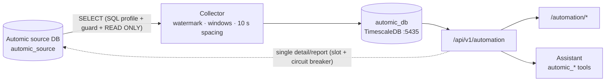

# ainew — UC4 Automic GUIDE

Module `automation`. Menu label **UC4 Automic**. Pulls Automic Workload Automation (UC4) executions, failures and reports into ainew **read-only**; provides an overview, execution list/detail, active jobs and an AI assistant. Nothing is ever written to, started or stopped in Automic.

## Architecture

- **Source adapter** is pluggable (`AutomicSource`): first release `db_oracle` (python-oracledb thin; thick when needed — `ORACLE_CLIENT_LIB_DIR`). `fake` for development.
- **SQL profile** (`services/automic/source/sql/oracle/ae-24.yaml`): queries are rendered from YAML; `sql_guard` accepts only `SELECT`/`WITH` (DML/DDL/PLSQL/`FOR UPDATE`/DB links are rejected).
- **Discovery** derives table/column/version capabilities on connect; missing capabilities show up as "out of scope" in the UI and assistant.
- **Module DB** is separate from the ainew DB: `automic_executions` (hypertable), `automic_active`, `automic_failed_index`, `automic_report_excerpts`, `automic_daily_aggregates`, chat tables.

## Menus

| Menu | Path | Module | Actions |
|------|------|--------|---------|
| Overview | `/automation` | automation | KPIs, status mix, volume, widgets 8–16 (AI insight, expected tonight), integration health |
| Executions | `/automation/executions` | automation | Filters (time, status class, type, object, agent, client), sort, paging |
| Execution detail | `/automation/executions/:system/:client/:runId` | automation | Context, reports (masked), children, restarts, "Ask assistant" |
| Active jobs | `/automation/active` | automation | Running now; jobs above object p95 highlighted |
| Object | `/automation/objects/:system/:name` | automation | Stats, duration trend, script/diff, usage/dependency (JPP) |
| Assistant | `/automation/chat` | automation | Natural-language Q&A |
| Integration | `/integrations/automic` | integrations / automation | Add/edit system (wizard), test, discover, manual collect, circuit reset |

## Connection wizard

Source type → connection (host, port, service name, user, password; stored encrypted) → test + discovery → clients (at least one; client 0 not recommended) → collection windows / blackout → source guard (min. request spacing, session slots, query timeout) → status classes (default: failed 1800–1899 except 1850/1851; cancelled 1850/1851; ok 1900–1999) → report excerpts → retention → storage projection → masking packs → general → summary.

- Schema-owner/privileged users such as `master`, `uc4`, `system`, `sys` are rejected; use a SELECT-only service user.
- Retention is hybrid: raw executions short, failure index and daily aggregates long; on quota overflow the oldest raw data goes first. Sample policy: `docs/internal/automic/automic-retention-policy.yaml`.

## Masking and LLM security

**Policy:** Even when the LLM runs internally (`llm_deployment=internal`, default), secrets never reach the LLM, UI, chat history, or logs. Masking runs **before** LLM send, module DB write, audit write, and UI response.

| Rule | Behavior |
|------|----------|
| Always | Passwords, tokens, API keys, private keys, `PWD=` / `password=` / `user/pass@host` connection strings, Authorization |
| Never masked | Automic usernames (`NAME/DEPARTMENT`) |
| Configurable | IP (`masking.mask_ip`) and hostname (`masking.mask_hostname`) — **default: shown** |
| Country pack | TR: national ID, IBAN, phone, email; `custom_patterns` |

If `llm_deployment=external`, the setup/settings UI shows a warning; the change is audited as `llm_deployment_change`.

## Assistant

`/automation/chat` → `POST /api/v1/automation/chat/stream` (SSE). The model queries the module DB only via `automic_*` READ_ONLY tools; table/chart components are built by the backend. If the LLM cannot answer, tools run deterministically and a short summary is returned. Details: AI Architecture GUIDE → Automic.

## RBAC

- Viewing and assistant: `automation`.
- Add/edit/delete system, test, discover, collect: `integrations` (writes require operator role).
- Module access is assigned manually; grant it only to users who already have Automic access.

## Setup notes

- Module DB: `docker-compose.automic.yml` (`automic_db`, `127.0.0.1:5435`, data `${DATA_DIR}/automic/postgres`). Password `AUTOMIC_DB_PASSWORD`, falling back to `POSTGRES_PASSWORD`.
- The backend image must include the `oracledb` package (requirements). For thick mode: Instant Client + `ORACLE_CLIENT_LIB_DIR`.
- Diagnostics: `scripts/automic-diagnose.sh` (module DB, network reachability, driver, API status; prints no secrets).
- Development: `AUTOMIC_FAKE=1` or source type `fake` for synthetic data.

## Phase 2

- Overview widgets 8–14 (duration outliers, duration trend+p95, heatmap, month-end, active/blocked workflows, agent activity, storage quota).
- Object page: OH header, masked script, version list and diff.
- Agent detail page: `/automation/agents/:system/:name`.
- (i) info panel on every Automic page (`GET /automation/info`).
- Unified Admin chat opens `automic_*` tools on Automic keywords (`admin` / `ai_automation` / `executive` is enough; a separate `automation` grant is not required). Dedicated `/automation/*` pages still require the `automation` module.

## Phase 3

- Widget 15: `GET /automation/overview/insight` — LLM dashboard summary, Redis/in-memory **15 min** cache (`force` to refresh).
- Widget 16: `expected_tonight` — same isodow + night-hours historical pattern; **not a forecast**.
- Object usage: `GET /objects/{system}/{name}/usage` (JPP; needs source `usage_graph`) + chat `dependency_graph` component.
- Async analyses: `POST /analyses` (`failure_pack` / `overnight_review` / `impact_analysis`) → poll `GET /analyses/{id}` (`bulk_job_tracker`).
- RAG: `docs/rag_seed/AUTOMIC-basics.md`, `AUTOMIC-ops-patterns.md` (enabled in manifest).
- (i) info panel: behavior text + setup requirements (ports, firewall, SELECT user, module DB :5435, RBAC).

## Phase 4 — Alignment with the official schema

- **Official 24.4 columns only**: SQL profile (`ae-24.yaml`, `rev: 2`) stays within Broadcom TechDocs *Automic DB Schema* **24.4** SELECT list (`source/sql/official/ae-24.4-columns.yaml` + local `docs/official/24.4/`; accessed 2026-10-10). A column used in code but missing from the YAML fails `test_automic_official_schema.py`.
- **Verified against 24.4**: user `AH_USR_Idnr` → `OH_Name`; platform `AH_HostAttrTypeD`; queue `AH_Queue`; `EH_ActivationTime`/`EH_StartTime`; folder `OFS_Link = 0` (Home Folder); `OH_DeleteFlag` 0/1/2/5; `OT_Type` 0–3; RT message vs memo; ERT/MRT/`EH_Srt` (SRT in Seconds)/`EH_Signal`.
- **UNVERIFIED** (24.4 Task Status / System Return Codes pages not found): active status groups, RH_Type value catalog, object-type catalog — validate against live AE DB (`STATUS_CODES_SEARCH.md`).
- **AE ERT is read**: `AH_ERT`, `EH_Ert`, `EH_ERTEnd`, `OH_Ert`, `EH_ERTCalc`, `EH_Signal` on Active / execution detail.
- Existing installs: a `profile_rev` mismatch is detected by the hourly discovery (or run Integration → Discovery); new module-DB columns are added by `ensure_schema`. New fields stay empty until discovery is refreshed.
- **Find runs by user NAME (not user ID)**: `automic_search_executions user=<name>` / `GET /automation/executions?user=` accept partial names and wildcards (`*`, `?`). Module DB first (`user` = `AH_USR_Idnr → OH_Name` resolved at collection); when empty or when rows with unresolved users exist, the source is queried live: `OH (OH_OType='USER', OH_Name LIKE name) → OH_Idnr → AH_USR_Idnr IN (...)` (`data_source=source_live`, `source_users`). Unknown names return known users (`hint.known_users`). Active jobs: `automic_active user=`; per-user summary: `automic_history user_activity`.
- RAG: `AUTOMIC-ae-db-schema.md` (24.4 official columns), `AUTOMIC-ae-status-metrics.md` (ERT/MRT/SRT official; status/RH_Type/object types UNVERIFIED).
- Official fields ainew does not collect (HOST/ACTEX agent connectivity, `AH_ChildCnt*` …) are described to the assistant as "exists in AE, not in ainew".

## Later releases (not in this branch)

REST adapter (forecast/AE process health; ERT is already read from the DB), hybrid profile, MSSQL and PostgreSQL source adapters — A15 “Later releases”; not implemented here.
