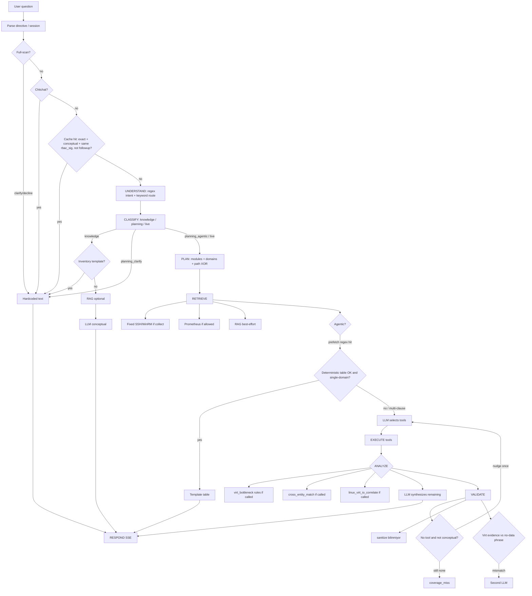
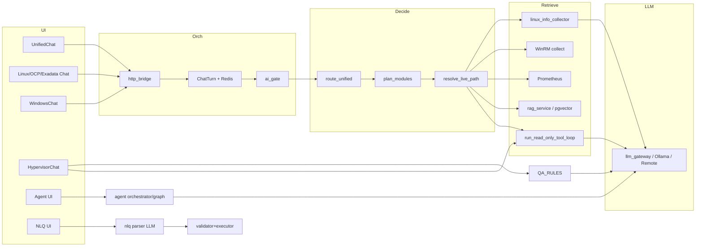
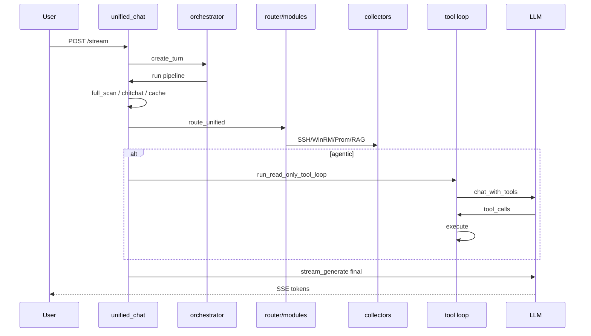
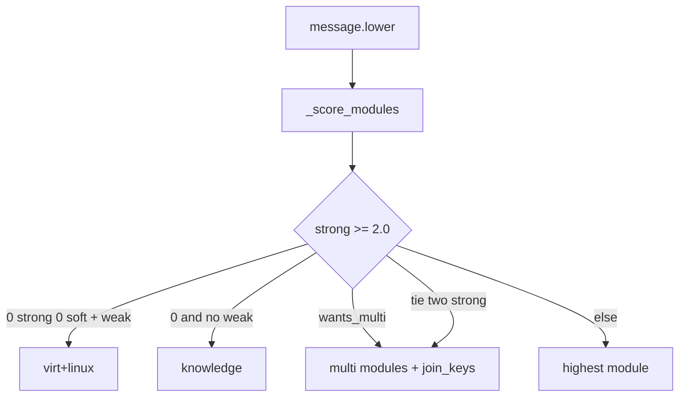

# ainew — AI Mimari GUIDE

Koddan çıkarılmış **tam** AI Architecture & Behavior Analysis. Operatör menü kılavuzu (Ana GUIDE) değildir. RAG’e yazılmaz.

Kısa ajan haritası: `.cursor/rules/ainew-ai-architecture.mdc`. Bu PDF o haritanın özeti değil; sohbette üretilen **eksiksiz** rapordur (envanter tabloları, lifecycle, domain, tool, RAG, diyagramlar).

## GÜNCELLEME ZORUNLU

Routing, tool, prompt, RAG, domain veya sohbet yaşam döngüsü değişince **bu dosyayı ve İngilizce eşini aynı turda güncelleyin.** Kısa Cursor kuralını da güncelleyin. Atlama.

| Yer | Dosya |
|-----|--------|
| TR GUIDE | `docs/guides/tr/modules/ai-architecture.md` |
| EN GUIDE | `docs/guides/en/modules/ai-architecture.md` |
| Cursor kuralı | `.cursor/rules/ainew-ai-architecture.mdc` |

Ayarlar → Hakkında → **AI Mimari** bu metni PDF yapar. Kural ile kod çelişirse ajan yanlış “gerçek” sanır.

---

# AINEW — AI Architecture & Behavior Analysis

Ürün: **ainew** (Infrastructure AI Assistant). Analiz, kodun gerçek çağrı zincirine dayanır. Tek bir “AI motoru” yoktur; **birden fazla sohbet yüzeyi + arka plan AIOps + NLQ + Agent + RAG** birlikte çalışır.

---

# 1. AI System Inventory

## 1.1 Kullanıcıya dönük AI yüzeyleri

| Component | Dosya | Class / function | Görev | Input | Output | Çağıran | Çağırdığı | Lifecycle |
|---|---|---|---|---|---|---|---|---|
| Unified Chat API | `backend/app/api/unified_chat.py` | `unified_chat_stream` | Tüm altyapı sohbeti (Linux+Windows+Virt+OCP) | `message`, `session_id`, `model`, `use_rag` | SSE token/tool/done | `frontend/src/pages/UnifiedChat.tsx` | orchestrator, `route_unified`, collect, `run_read_only_tool_loop`, `_build_prompt`, `llm_gateway` | Ana request girişi |
| Linux / OCP / Exadata Chat | `backend/app/api/chat.py` | `chat_stream` | Platform-scoped sohbet; `platform=linux\|openshift\|exadata` | mesaj, `server_ids`, `platform` | SSE | `Chat.tsx`, Servers, Events | `route_admin_question`, SSH collect, Prom, RAG, tool loop | Domain chat |
| Windows Chat | `backend/app/api/windows_chat.py` | `chat_stream` | WinRM + Event Log sohbeti | mesaj, sunucu seçimi | SSE | `WindowsChat.tsx` | WinRM collect, RAG, LLM | Domain chat |
| Virt Chat | `backend/app/api/hypervisors.py` | `ask_hypervisor_question`, `ask_hypervisor_stream` | vCenter/OV sohbeti | `question`, `session_id` | JSON veya SSE | `HypervisorChat.tsx` | `route_admin_question`, QA_RULES, `chat_source_graph`, `answer_hypervisor_question` | Domain chat |
| Chat Orchestrator | `backend/app/services/chat_orchestrator/service.py` | `create_turn`, `run_turn` | Turn kuyruğu, AI gate, SSE replay, iptal | platform, payload | `ChatTurn` + Redis events | tüm `/stream` endpoint’leri | `plan_sources`, `ai_gate`, pipeline | Request lifecycle kabuğu |
| HTTP Bridge | `chat_orchestrator/http_bridge.py` | `attach_and_stream` | Pipeline’ı turn’e bağlar, SSE yayınlar | pipeline fn | `StreamingResponse` | chat API’ler | `create_turn`, Redis stream | Transport |
| AI Gate | `chat_orchestrator/ai_gate.py` | `admit`, `acquire`, `release`, `renew`, `session_acquire` | Eşzamanlı tur kotası (lease ZSET), kuyruk, hızlı şerit, kullanıcı/oturum sınırı | turn_id, message | GateResult / HTTP 429 / metrik | `run_turn` | Redis/semafor | Concurrency |
| Agent API | `backend/app/api/agent.py` | chat/approve/reject | Mutating tool + human-in-the-loop | mesaj, onay | adımlar + final | `Agent.tsx` | `agent/orchestrator` | Ayrı otomasyon yüzeyi |
| NLQ API | `backend/app/api/nlq.py` + `nlq/pipeline.py` | `run_nlq` | Linux envanter NL→JSON→SQL | doğal dil | structured answer | inventory UI | parser LLM, validator, executor | Ayrı structured-query yolu |
| RCA API | `backend/app/api/rca.py` | compare-window, awr-analyze | Pencere karşılaştırması + AWR LLM | zaman pencereleri / AWR dosyası | analiz | RCA UI | compare_service, LLM | Ayrı analiz |
| Bulgu AI yorumu | `backend/app/api/virt_insights.py` + `services/findings/ai_comment.py` (+ `events.py`, `ai_postprocess.py`) | `finding_ai_comment_generate` (`POST /virt-insights/findings/{id}/ai-comment`) | Yapılandırma (`health`) + Donanım (`hardware`) için OLAY başına LLM yorumu — yalnız butonla | olay anahtarı (`platform\|source_id\|entity_ref\|aile`); herhangi bir üye `finding_id` | doğrulanmış yapısal yorum (özet, olay görünümü, etki, öncelik, gözlenen, genel bilgi, diğer iyileştirmeler, bilinmeyenler) + kodla hesaplanan güven | `FindingAiComment.tsx` (bulgu satırı açılınca; olayın tüm üyelerinde aynı) | `build_facts` (`findings/context.py`, `events.py`), `llm_gateway.generate_async` (yalnız istemci), `validate`, `postprocess` | Buton → üret → doğrula → son işleme → sakla (olay başına sürümlü) |
| RAG Admin API | `backend/app/api/rag.py` | ingest/search/reindex | Runbook/incident/knowledge yönetimi | PDF/text | chunk sayısı | Settings/Knowledge | `rag_service` | RAG lifecycle |
| MCP API | `backend/app/api/mcp.py` | tool call + analyze | Linux MCP tool + LLM yorum | tool+host | tool result / LLM | MCP panel | `mcp_client`, LLM | Yan yüzey |
| Knowledge API | `backend/app/api/knowledge.py` | pin/list | Manuel fact + RAG reindex | fact | persisted fact | ChatPinFact | `fact_learning`, RAG | Persistent memory yazımı |
| Centrify Chat | `backend/app/api/centrify_chat.py` | `centrify_chat_stream` | Level 1 Centrify zone asistanı (READ-ONLY) | `message`, `zone_id`, `session_id` | SSE token/done | `CentrifyPage` FAB | `_gather_centrify_context`, `_run_tool_if_needed`, `llm_gateway.stream_generate` | Ayrı yüzey; Centrify Postgres |
| Automic Chat | `backend/app/api/automation.py` | `chat_stream` (`/automation/chat/stream`) | Automic (UC4) çalışma/hata asistanı (READ-ONLY) | `message`, `session_id`, `system_id`, `timezone` | SSE `phase`/`tool_call`/`tool_result`/`components`/`token`/`meta`/`done` | `pages/automation/AutomationChat.tsx` | `run_read_only_tool_loop(platform=automic, domains={automic})`, `chat_support.run_fallback`, `_stream_answer` → `llm_gateway` (harici dahil) | Ayrı yüzey; Automic modül DB (TimescaleDB `automic_db`) |

**Bulgu AI yorumu yaşam döngüsü (Incident RCA ile aynı mantık: butonla):** Bulgular → Yapılandırma/Donanım satırı açılır; `GET .../ai-comment` kayıtlı yorumu getirir (ÜRETMEZ). «AI ile açıkla» → `POST .../ai-comment` (async; `llm_gateway.generate_async`, yalnız istemci — gateway kodu değişmez). **OLAY tabanlı:** yorum bulgu başına değil OLAY başına üretilir (`findings/events.py`). Olay anahtarı = `platform|source_id|entity_ref|olay_ailesi`; aileler kodda tanımlıdır (donanım ailesi: `hw.host.*` = `sensor_alarm`, `overall_status`, `sensor_repeat`, `event_pattern`, `config_issue`; ayrıca zaman eşitleme, yol yedekliliği, host durumu; tanımsız kontrol tek üyeli olaydır). Yorum olayın TÜM üye bulgularında aynı görünür; yenilemek olay anahtarında yeni sürüm üretir. Hesap kodda: `build_facts` = (a) `olay_bulgulari` (aynı kök, tek olay gibi anlatılır) + (b) `diger_bulgular` (aynı host'taki DİĞER açık bulgular: «bu olayla doğrudan ilişkili değil»; olayın nedeni/parçası olarak anlatılamaz, yalnız `diger_iyilestirmeler` listesinde yer alır; `findings/context` yanıtı `related_event`/`related_other`/`event` alanlarıyla bunu yansıtır, eski `related` korunur) + «host düşerse» etkisi (`host_failure`, etki cümlesi `impact_text` ile KODLA yazılır) + kural rehberi. Model yalnız anlatır; çıktı JSON (`ozet`, `olay_gorunumu`, `etki`, `oncelik`, `gozlenen`, `genel_bilgi`, `diger_iyilestirmeler`, `bilinmeyenler`). **Doğrulama (`validate`) kullanıcıya ulaşmadan önce:** veride olmayan sayı/IP/sürüm/KB/CVE/komut/kod bloğu → ret; eylem iddiası → ret; `genel_bilgi` rakam/sürüm/komut içeremez; (b) bulgusu `ozet/olay_gorunumu/etki/oncelik` içinde geçerse → ret (`gozlenen` maddelerinden deterministik düşürülür); «RAM» → «Memory». İhlalde bir kez geri bildirimle yeniden dener; yine geçmezse HTTP 422, yorum saklanmaz. **Son işleme (`ai_postprocess.postprocess`, doğrulamadan sonra, deterministik, LLM'siz):** (1) **öneri↔gerçek denetimi:** kalan host sayısı 0 ise tahliye/taşıma/vMotion/migrate/drain önerisi verilemez; o cümle «başka bir cluster'a taşımayı veya bakım penceresi planlamayı değerlendirin» sabit cümlesiyle değiştirilir (`validation.recommendation_fixes`). (2) **Kesin hüküm yumuşatma (`soften`):** «durdurur», «yol açar», «kesinti olur», «çöker» gibi hükümler yalnız hesaplanmış veriyle destekleniyorsa kalır: host-düşerse sonucu `fail` iken «sığmaz/failover mümkün değil» VE senaryonun sonucu olan cümleler (`etki` alanı veya «host kapanırsa/düşerse» bağlamı; veri kaybı iddiası hariç) yumuşatılmaz; desteklenmeyen cümle YALNIZ olasılık diline çevrilir. `etki` alanında belirsiz «Bu durum …» göndermesi senaryoyu açıkça yazar («Host kapanırsa bu VM'ler çalışmaya devam edemez; kapsamda başka host yok» — `fail` ise; aksi hâlde «Host kapanırsa …» öneki). Kodla yazılmış cümleler (etki cümlesi, kural rehberi, sabit cümleler) dokunulmaz. (3) **Sayım:** sözlükte olmayan fiille yazılmış, yumuşatılmamış kesin sonuç cümleleri `validation.unsoftened_definitive_count` (+ `unsoftened_definitive` örnekleri) ve INFO log'a yazılır. Değişen cümleler `validation.softened_sentences` + `softened_count`. **Güven** (`confidence`) veri eksikliğinden kodla hesaplanır (`no_detail`, `no_sensor_type`, `no_impact`, `stale_source`). **Saklama:** `finding_ai_comments` (olay anahtarı başına sürümlü: `(event_key, version)` benzersiz; `finding_id` = olayın temsilci bulgusu; `input_hash` = üyeler + durumları + etki; `facts` denetim için) + `finding_ai_feedback` (`(comment_id, username)` benzersiz; kullanıcı başına tek oy). **Saklama süresi:** eski SÜRÜMLER `VIRT_AI_COMMENT_RETENTION_DAYS` (virt'e özgü env; varsayılan 90, en az 7 gün) sonra silinir, her olayın en son sürümü HER ZAMAN kalır; temizlik saatlik virt-insights döngüsünün sonunda (`findings/runner.run_cycle` → `purge_old_versions`) çalışır; paylaşılan `runtime_settings` değişmez. Kayıtlı yorumun `input_hash` değeri güncel parmak izinden farklıysa arayüz «Bulgu değişti, yorum güncel olmayabilir» + «Yeniden üret» gösterir. Arayüz: `AiBlock method="ai.finding.comment"`, güven + nedenler, olay üye sayısı notu, «Gözlenen veri», «Genel bilgi (veriden bağımsız)» ve «Diğer iyileştirmeler (bu olayla ilişkili değil)» ayrı kutularda. Tablolar `models/finding_ai.py` içindedir ve `app.models`'a KAYITLIDIR (açılıştaki `create_all` oluşturur); `backend/migrations/add_finding_ai_comments.sql` referanstır, `rollback_finding_ai_comments.sql` geri alır. Tablolar yoksa GET `available=false`, POST 503 (Türkçe mesaj).

**Centrify context/tool özeti:** `_gather_centrify_context` zone başına roller (password/sso/mfa + komutlar), komutlar, computers, atamalar. Boş=0; parent miras yok. Sync: zone başına tek `list_zone_inventory` WinRM çağrısı (rol+rights+login, komut, atama, host, unix, computer role); `sync_throttle` (min aralık + zone delay + retry). Hesaplayıcılar `query_service.py`: `resolve_effective_access`, `diagnose_login_failure`, `find_expiring_assignments`, `find_similar_roles`, `find_similar_commands`, `explain_role`, `explain_command`. Chat tool → `<<<CENTRIFY_TOOL_DATA>>>`. REST `/centrify-mgmt/query/*`. Auth: `require_module("level1")`. Prompt: HTML yasak. UI: `CentrifyPage` FAB + markdown.

**Automic sohbet yaşam döngüsü:** `classify_chat_intent` (temkinli: yalnız açık meta kalıbı + veri sinyali yok → `meta`; tanım → `knowledge`; şüphede `data`) → `build_system_prompt` (Bölüm B + sonda runtime `APP_NAME`/`LLM_MODEL`/`LLM_DEPLOYMENT`) + RAG (meta’da atlanır) → **data:** `run_read_only_tool_loop` → boş turda `run_fallback` (meta/knowledge’da yedek plan yok) → **meta/knowledge:** araç yok → `components.build_components` yalnız data’da (meta’da sıfır bileşen; araç adları AnswerFooter’da kapalı) → nihai `_stream_answer`; meta’da LLM boşsa `deterministic_identity_answer`; `AnswerLeakGuard` ilk Markdown başlığına kadar tamponlar (gpt-oss iç monolog sızıntısı atılır, ```` ```markdown ```` sarmalı açılır) → `split_meta` ```` ```ainew-meta ```` bloğunu ayırır (intent liste gelirse ilk eleman) → `ChatMessage.meta={automic, components, tools_used, system_id, error}`. LLM hiç metin üretemezse `deterministic_answer` araç sonuçlarından kısa Türkçe özet yazar (yorum/kök neden yok). Auth: `require_module("automation")`; araçlar `_EXPLICIT_ONLY_DOMAINS` ile Unified/Linux sohbetlerine girmez ve handler `ctx.platform=="automic"` ister. Dashboard: `overview/insight` 15 dk cache; uzun analiz `POST /analyses` + poll.

**Automic resmi şema bilgisi:** SQL profili (`services/automic/source/sql/oracle/ae-24.yaml`, `rev: 2`) yalnız Broadcom TechDocs *Automic DB Schema* (24.4) kolonlarını kullanır (`source/sql/official/ae-24.4-columns.yaml` + `test_automic_official_schema.py` bunu doğrular). Kullanıcı adı `AH_USR_Idnr`/`EH_USR_Idnr` → `OH_Name`, klasör `OFS` (`OFS_Link=0` Home Folder, 24.4 `OFS.md`) → `OH_Name` ile çözülür (adaptör `_enrich_runs`, 1 sa önbellek, hata sessiz); AE'nin kendi ERT'si (`AH_ERT`/`EH_Ert`/`EH_ERTEnd`/`OH_Ert`) ve `EH_Signal` modül DB'ye `ert_sec`/`ert_end_time`/`signal` olarak yazılır; aktif durum grupları `classify.active_state` (DOĞRULANMADI aktif durum grupları (24.4 Task Status sayfası bulunamadı)). Sistem prompt'una "Resmi AE alanları" bloğu eklidir; RAG seed `AUTOMIC-ae-db-schema.md` + `AUTOMIC-ae-status-metrics.md` tablo/kolon/durum kodu/rapor tipi/metrik sorularını karşılar. Araçlar `automic_active` (state, user, queue, platform, ert_sec, ert_end_time, over_ert, signals) ve `automic_execution` detail (user, queue, folder, run_time_sec, ert_sec) bu alanları döner. Eski keşif kayıtları `profile_rev` farkında saatlik keşifle yenilenir. Kullanıcı ADI ile arama: `automic_search_executions user=` modül DB → (sonuç yok/çözülmemiş kayıt varsa) kaynakta OH(USER)→AH_USR_Idnr canlı arama (`data_source=source_live`); `automic_active user=`, `automic_history user_activity`; yedek planı `chat_support.detect_user`.

**Automic yanıt sunumu:** Model HTML değil Markdown üretir; sabit `## Özet/### Bulgular` şablonu yoktur. İlk satır kalın tek cümlelik sonuçtur (lead), sonrası `**Başlık** · açıklama` blokları; kapsam/zaman/kayıt sayısı metne yazılmaz. `AnswerLeakGuard` yanıt başlangıcını `###` başlık veya kalın lead ile tanır (sızan akıl yürütmeyi atar). Kapsam deterministiktir: `services/automic/scope.py` (`scope_for_answer`) araç sonuçlarından sistem, client, zaman aralığı, kayıt sayısı, veri kaynağı (db/source/mixed), kısmi/saklama sınırı, kaynak gecikmesi, son toplama üretir ve `chat_stream` meta `scope` alanını bu değerle ezer (LLM meta'sı yoksa `stub_meta`). Meta'ya `confidence` (high|medium|low) eklenir. Frontend `pages/automation/AnswerView.tsx`: `AutomicMarkdown` (kapsamlı `.automic-md` CSS, tema değişkenleri; h1–h6 sakin etiket, lead vurgusu `severity`'ye göre, tablo/kod yalnız gerçek içerik için; eski ```` ```markdown ```` sarmalı ve meta çitini temizler) + `AnswerFooter` (tek satır `sistem · aralık · N kayıt · kaynak`, tıklayınca ayrıntılar + güven rozeti). Araç çipleri balonun üstünde gösterilmez.

**Yöntem şeffaflığı (Dilim T):** Ekrandaki her bulgu/kart/metrik/senaryo sonucu bir yöntem sınıfı rozeti (Veri, Hesap, Tahmin, Kural, Eşleştirme, AI) + (i) taşır; içerik tek kaynaktan `backend/app/services/method_registry.py` gelir (`GET /api/v1/methods`; findings `check_id` ile aynı kimlikler, sohbet tool’ları `tool:<ad>`). AI üretimli metinler (RCA, log analizi, olay analizi, sohbet) UI’da `AiBlock` ile ayrı gösterilir (“AI özeti” etiketi + farklı zemin; backend sayıları aynı kutuya karışmaz) ve “Metin AI tarafından yazıldı. Sayılar ve sonuç backend’den gelir; AI bunları değiştirmez.” notunu taşır. “Nasıl hesaplıyoruz?” sayfası (`/methods`) kayıttan otomatik üretilir. Kayıtsız findings check’i, READ_ONLY sohbet tool’u veya bileşen id’si CI’yi kırar (`test_method_registry.py`, `methodRegistry.test.ts`). Tahmin sonuçları aralık olarak verilir; AI olmayan yöntemlerde “AI öngördü/tespit etti” dili yasaktır.

## 1.2 Karar / planlama

| Component | Dosya | Function | Görev | Input | Output | Karar yöntemi |
|---|---|---|---|---|---|---|
| Unified Intent Router | `unified_intent_router.py` | `route_unified` | `knowledge \| planning_clarify \| planning_agentic \| live` | mesaj + followup bayrakları | `UnifiedRoute` | Rule/keyword, LLM yok |
| Module Orchestrator | `module_orchestrator.py` | `plan_modules` | linux/windows/virt/openshift/exadata seti | mesaj | `ModulePlan` | Keyword skor + düşük güvende `route_llm_hint` |
| Modül Kapısı (RBAC) | `unified_chat.py` | `_chat_allowed_modules` / `_route_denied_modules` | router sonrası, collect/tool öncesi: kullanıcıda olmayan platform modülü (linux/windows/virtualization/openshift/exadata/automic→automation) isteniyorsa yanıt reddedilir; envanter fast-path ve `linux_servers`/`windows_servers` listeleri yetkisiz platformdan arındırılır. `admin`, `ai_automation`, `executive` kısıtsız (Unified Yönetici sohbetinde Automic dahil ayrı `automation` yetkisi gerekmez) | `UnifiedRoute.modules` + kullanıcı modülleri | ret mesajı veya devam | Deterministik, LLM yok |
| Source Planner | `chat_source_planner.py` | `plan_sources` | db/ssh/winrm/vcenter/ocp/prom/rag | mesaj + scope | `SourcePlan` | Unified’da router’ı çağırır; diğerinde keyword |
| Path Policy | `chat_path_policy.py` | `resolve_live_path` | fixed collect XOR agentic | bayraklar | `LivePathDecision` | Keyword + settings |
| Chat Intent | `chat_intent.py` | `classify_chat_intent` | conceptual/inventory/live/mixed/general | mesaj | `ChatIntent` | Regex |
| Admin Intent Router | `admin_intent_router.py` | `route_admin_question` | Linux inventory/cmd vs Virt QA_RULES | mesaj, platform | `RouteResult` | Keyword/regex |
| Linux Chat Intent | `linux_chat_intent.py` | inventory/direct_cmd | Filo özeti, komut çıkarma | mesaj | bool / cmd list | Keyword |
| Planning Intent | `chat_planning_intent.py` | MTV/taşıma netleştirme | migrasyon kapsamı | mesaj | scope / clarify | Keyword |
| Data Fetch Ladder | `data_fetch_ladder.py` | `is_live_resource_query` | Anlık kaynak merdiveni | mesaj | bool + prompt addendum | Keyword + `intent_text` olumsuzluk |
| Intent text | `intent_text.py` | `keyword_hit` / `regex_hit` | Olumsuz pencere (`demiyorum`, `sapmadan`, `düşme`, `kaydırma`) | mesaj | bool | Ortak helper |
| Virt Inventory Contract | `virt_inventory_contract.py` | `detect_virt_inventory_kind` | VM/datastore/ESX prefetch | mesaj | kind + fields | Regex |
| Virt Scope | `virt_scope.py` | `resolve_scope` | Entity filtre (vm/host/ds) | mesaj + DB | scope object | DB lookup + substring |
| Full Scan Policy | `chat_full_scan_policy.py` | `resolve_full_scan_turn` | Tam filo onayı | session+mesaj | clarify/decline/confirm | Keyword + session state |
| Chitchat Policy | `chat_chitchat_policy.py` | `canned_chitchat_answer` | Selamlaşma, LLM yok | mesaj | sabit metin | Keyword |
| Output Directives | `chat_output_directives.py` | `extract_output_directive` | `/table` `/json` `/brief` `/diagram` `/graph` | mesaj | directive | Regex (her yerde); `/graph` `/grafik` `/chart` = Recharts (`chat_charts`); örtük «grafikte göster» da (Adım 8G) |
| Chat Charts | `chat_charts.py` | `try_build_chat_charts` | Sohbet zaman serisi + çapraz overlay | mesaj, platform, hedefler | `meta.charts` + özet | Timescale / Prom query_range / virt `query_series` / OCP `ocp_resource_metrics`; max 8; birim ayrımı; **Top-N**: isim yoksa `en yüksek/top N` → rank sonra seri (linux/virt/ocp) |
| Tool Policy | `chat_tool_policy.py` | `should_use_db_first` | İlk 2 adımda canlı vCenter gizle | platform/domains | bool | Hardcoded |

## 1.3 Tool / LLM / yanıt

| Component | Dosya | Function | Görev |
|---|---|---|---|
| Unified Tool Loop | `unified_tool_chat.py` | `run_read_only_tool_loop` | READ_ONLY function calling (varsayılan 6 adım) |
| Tool Registry | `agent/tools.py` | `TOOLS`, `tool_specs_read_only` | Domain filtresi (kesişim). Virt DB = `vcenter`; ortak = `infra` |
| Windows Tools | `agent/tools_windows.py` | `WINDOWS_TOOLS` | WinRM tool’ları |
| Agent Orchestrator | `agent/orchestrator.py` | `start_agent` | Mutating + onay; LangGraph `MAX_STEPS=8` |
| Agent Graph | `agent/graph.py` | LangGraph `llm_node`/`tools_node` | Agent akışının graph hali |
| Agent LLM | `agent/llm.py` | `chat_with_tools` | Tool-calling LLM çağrısı |
| Agent Guard/Policy | `agent/guard.py`, `policy.py` | `guard_command`, `RiskLevel` | Mutating sandbox |
| Chat Source Graph | `chat_source_graph.py` | `decide_source → execute_tools` | Virt için tool loop sarmalayıcı |
| LLM Gateway | `llm_gateway.py` | `stream_generate`, `chat_sync`, `generate_sync` | Groq/OpenAI/OpenRouter → REMOTE_LLM (native Ollama veya OpenAI `/v1`) → yerel Ollama |
| LLM Transport | `llm_transport.py` | `is_remote_ollama`, `get_effective_context_tokens`, `build_llm_health` | `llm_transport_mode` auto\|ollama\|openai; `/api/version` algılama; etkin bütçe = min(ayar, gerçek ctx) |
| AI Source | `llm_ai_source.py` | `AiSource`, `resolve_ai_source`, `build_capability_profile` | Gateway `ai_source=` opsiyonel; şimdilik yalnız `default` (UI/modül eşlemesi yok) |
| Ollama Runtime | `ollama_runtime.py` | `apply_ollama_payload`, `check_ollama_health` | Her native Ollama isteğinde `keep_alive` + `options.num_ctx` (etkin bütçe); `/api/ps` sağlık |
| LLM Availability | `llm_availability.py` | circuit breaker | Yoklamalı devre kesici: eşik dolunca sağlık yoklaması (`llm_transport.probe_remote_health`: Ollama `/api/version`, OpenAI-uyumlu `/v1/models`); ayakta ise açılmaz, ulaşılamıyorsa/bağlantı reddi-DNS-TLS ise açılır; süre dolunca tek yoklamalı yarı açık deneme. `best_effort` çağrılar sayılmaz |
| LLM Usage | `llm_usage.py` | token/usage | SSE’ye usage enjekte |
| Context Budget | `llm_context_budget.py` | `budget_sections` | Token tavanı; system/soru kesilmez |
| Response Layers | `response_layers.py` | `wrap_layer` | linux_ssh / winrm / prom etiketleri |
| Answer Sanitize | `answer_sanitize.py` | `sanitize_llm_answer` | “bilinmiyor” cümlelerini siler |
| Chat Coverage | `chat_coverage.py` | `record_coverage_miss` | Kanıtsız “veri yok” telemetrisi |
| Virt Intelligence | `hypervisor_intelligence.py` | `answer_hypervisor_question`, `QA_RULES` | Deterministik virt cevap + persona LLM |
| Virt fleet perf | `virt_fleet_perf.py` | `fetch_fleet_vm_stats` | Filo: Timescale → canlı (reddetme yok) |
| Virt chat RAG | `virt_chat_rag.py` | `collect_virt_rag_block` | Virt LLM yoluna runbook/incident |
| Virt Diagnostics | `virt_diagnostics.py` | bottleneck kuralları | VM vs host kök neden (kural motoru) |
| Linux Collector | `linux_info_collector.py` | `detect_needed_groups`, `collect_server_info` | Keyword → SSH grupları |
| Infra Summary | `infra_summary.py` | `build_infra_overview_text` | Ucuz DB özeti |
| Prometheus AI | `monitoring/prometheus_metrics.py` | `get_metrics_context_for_ai` | PromQL JOIN tablosu |
| Cross Entity Match | `cross_entity_match.py` | `cross_entity_match` | hostname/vm/ip JOIN |
| Cross-domain I/O | `cross_domain_diagnostics.py` | `linux_virt_io_correlate` | Guest iowait × VM disk latency (join şart) |
| NLQ Parser | `nlq/parser.py` | `parse_question` | LLM → JSON şema |
| AIOps Engine | `aiops_engine.py` | persist + RCA | Anomali→event→incident→LLM RCA |
| Report Engine | `report_engine.py` | generate + LLM özet | Virt raporları |
| Log Analyst | `log_analyst.py` | log + LLM | Ayrı analiz |
| Custom Report Engine | `custom_report_engine.py` | tool sonuçlarından rapor | Structured tool dump |

## 1.4 RAG / bellek / cache

| Component | Dosya | Görev |
|---|---|---|
| RAG Service | `rag_service.py` | ingest, chunk, retrieve, rerank, context |
| RAG Store | `rag_store.py` | pgvector `rag_embeddings` (Chroma runtime değil) |
| Embedding | `embedding.py` | `nomic-embed-text` 768-d, Ollama/remote |
| Reranker | `reranker.py` | opsiyonel cross-encoder |
| RAG Seed | `rag_seed.py` + `docs/rag_seed/` | ürün runbook’ları — manifest + manifest dışı tarama; PDF sayfa-bilinçli (`metadata.page`); NUL temizliği; `SHORT_PDF_BYTES` kısa kaynak uyarısı |
| RAG Scope | `rag_scope.py` | rota/platform → runbook `module` kümesi (RBAC ∩ rota; admin None) |
| RAG Maintenance | `rag_maintenance.py` | runbook `module` metadata backfill (yedekli, geri alınabilir) |
| RAG Eval | `scripts/chat_bench/rag_eval.py` | R2 modül sızıntısı + R3 eşik süpürmesi ölçümü |
| Chat History | `chat_history.py` | son 8 mesaj |
| Chat Cache | `chat_cache_service.py` | **Adım 9:** TAM (normalize) soru eşleşmesi + anahtarda platform/sunucu kümesi + kullanıcının izinli-modül imzası (`rbac_sig`); yalnız KAVRAMSAL soru + araçsız/canlı veri içermeyen/doğrulayıcı-değiştirmemiş cevap; sabit TTL 24 sa (`chat_cache_ttl_sec`, hit uzatmaz); kapatma `chat_cache_enabled`; INFO `Cache HIT/SAVED/SKIP` + sayaç |
| QA Cache | `qa_cache.py` | virt deterministic/LLM cache |
| Episode Memory | `episode_memory.py` | Redis 45 dk canlı keşif özeti |
| Fact Learning | `fact_learning.py` | SSH’den kalıcı LearnedFact |
| Assistant Playbooks | `assistant_playbooks.py` | başarılı tool zincirini hatırla |
| Chat Cancel | `chat_cancel.py` | Redis iptal bayrağı |

**Sohbet cevap önbelleği (Adım 9, `chat_cache_service.py`):** Eski tasarım (bulanık `SequenceMatcher ≥ 0,80` eşleşme, anahtarda kullanıcı/RBAC yok, hit'te TTL uzatma, Unified'da okuma RBAC'den önce, kimliksiz `/feedback`) yanlış isabet (farklı varlık/yön/zaman) ve yetki sızıntısı riski taşıyordu → kaldırıldı. Yeni kurallar: (1) **Anahtar** `platform:ids_hash:rbac_sig` (`rbac_sig` = `rbac_signature_for_modules(_chat_allowed_modules(user, db))`; admin/tam yetki `all`, diğerleri izinli modül kümesinin hash'i; anonim ayrı); soru eşleşmesi yalnız normalize metinde (küçük harf, noktalama/boşluk) TAM. (2) **Yalnız kavramsal** (`classify_question`: «nedir / ne demek / ne işe yarar / nasıl çalışır / farkı / what is …» kalıbı ZORUNLU; kaç/listele/hangi/en çok/şu an/bugün/son N/durum/kullanım/«bu sunucu»/benim/bizim, varlık adı benzeri belirteç (rakamlı, tire/nokta, IP, tırnaklı ad) içeren soru HİÇ girmez). (3) **Cevap tarafı** (`is_cacheable`): araç çağrılan tur, SSH/WinRM/Prometheus/envanter bağlamı konan tur, doğrulayıcının (`maybe_fix_no_data_answer`) değiştirdiği cevap, takip sorusu, direktif, gizli mod, ret/eylem reddi, «veri yok / bu kaynak sorgulanmadı», `(Hata: …)`, kısa cevap önbelleğe YAZILMAZ; envanter özeti şablonu da yazılmaz. (4) **TTL sabit** 24 sa (`chat_cache_ttl_sec`), hit TTL'i uzatmaz (`hit_count` artar); `invalidate_context` (senkron / `fact_learning`) imzadan bağımsız tüm kullanıcı kayıtlarını siler; `/feedback` artık kimlik ister (down = o sorunun tüm imzalardaki kayıtları silinir; up/düzeltme = çağıran kullanıcının imzasıyla). (5) **Kapatma:** `chat_cache_enabled=false` → ne okuma ne yazma (anında). (6) **Gözlem:** her karar INFO log (`Cache HIT|SAVED|SKIP neden=…`) + `get_stats()` sayaçları + tur metriğinde `extra.cache` (`saved|updated|skip:<neden>|disabled|error`); SSE `done` olayında `from_cache` Unified/OpenShift-Linux/Windows'ta ve (Adım 9) Sanallaştırma'da da vardır. Sanallaştırma Redis `qa_cache` (tam eşleşme, 5/15/60 dk, envanter senkronunda `invalidate_all`) değişmedi. Takip ayrımı `chat_history.has_real_prior_messages` ile yapılır (hatlar kullanıcı mesajını önce kaydettiği için `has_prior_messages` her turda True'ydu). Orkestratör `done` olayı `from_cache` bayrağını istemciye iletir. Sanallaştırma'da kavramsal soru + `qa_cache`'te hazır cevap varsa (`peek_cached_answer`, sayaç/TTL'e dokunmaz) araç turu/RAG atlanır (HİT ≈ 0,3 sn).

**İlerleme olayları (Adım 10, `chat_orchestrator/progress.py`):** Orkestratör (`run_turn`) ilk token'dan ÖNCE sessizlik bırakmaz: SSE'ye `{"type":"progress","step":…,"text":…,"elapsed_s":N[,"heartbeat":true]}` (Automic'in `progress` olayıyla aynı `type/step/text`) yayınlar. Adımlar: `queued · understood · selecting · querying · queried · thinking · answering · waiting`. Kaynaklar: (1) hat olayları (`phase:collecting/tools/answering`, `tool_call`, `tool_result`) → aşama; (2) **sessizlik bekçisi** — ayrı iş parçacığında ~1 sn'de bir; son olaydan `chat_progress_heartbeat_sec` (5 sn) geçtiyse «<son aşama metni> — N sn» (`waiting`, kuyrukta «sıranız: N»); hat senkron iş yapıp event döngüsünü bloklasa ya da tek-blok çalışsa (Sanallaştırma `asyncio.to_thread`) bile çıkar; (3) `TurnTrace.tools` (araç tamamlanınca dolar) → hat `tool_call` yayınlamıyorsa (virt) `queried`. **Gizlilik:** metin yalnız sabit şablon + araç ETİKETİ (≤48 karakter, kontrol karakteri atılır); kullanıcı mesajı, araç argümanı/sonucu, sunucu/VM adı ASLA yok. **Sınırlar:** ilk token (kullanıcıya yayınlanan) gelince susar; tur başına ≤ 60 aşama olayı (kalp atışları ayrı sınırla, ≤ 720 — uzun beklemede sessizlik kalmaz); LLM/araç çağırmaz, DB'ye yazmaz (yalnız Redis olayı). Kapatma: `chat_progress_enabled` (varsayılan açık; kapalıyken hiç `progress` yok), aralık `chat_progress_heartbeat_sec` (2–30). Reconnect replay `progress`'i de taşır; eski istemciler bilinmeyen `type`'ı yok sayar. UI: `chatStreamStore` `progress` alanı (token gelince temizlenir) → Unified/Windows/Linux-OCP/Sanallaştırma sayfalarında spinner yanında aşama metni. Ölçüm: `scripts/chat_bench/silence_eval.py` (`max_pre_token_gap_s`, `progress_n`). Automic bu yoldan geçmez (kendi `progress`'i). **Yapılmayan:** StreamGuard için «LLM duraksarken yarım cümleyi bırakan zamanlayıcı» (güvenlik tamponu gevşemesin) ve `unified_tool_think=low` kalite A/B'si (backlog).

**Event döngüsünü koruma (Adım 11):** SSE teslimi ve `progress` kalp atışları event döngüsüne bağlıdır; döngüde çalışan senkron iş (LLM, SQL, Redis SCAN, OCP API) tüm akışları dondurur. Ölçüm (`app/core/loop_watchdog.py`, `LOOP_WATCHDOG=0` ile kapanır): ayrı iş parçacığı döngü nabzını izler, ≥1,5 sn tıkanmada çağıran uygulama yığınını + en çok CPU tüketen iş parçacığını log'lar (`[LoopWatchdog]`); `subscribe_sse` XADD→teslim gecikmesi >1,5 sn ise `[SSELag]` (executor kuyruğu / XREAD / döngü uyanma ayrımı). Bulunan ve düzeltilenler: (1) vCenter/oVirt/OpenShift Virt event toplayıcıları her olay için son 7 günün TÜM `SystemEvent` satırlarını (`vcenter_event` ≈91 bin) ORM nesnesi olarak yüklüyordu → dakikalarca GIL tutan iş parçacığı, döngüde 12–23 sn tıkanma; yerine `services/event_dedupe.py` (sync başına tek hafif `id + external_key` sorgusu veya SQL tarafı arama; davranış aynı). (2) Döngüde senkron çalışan sohbet adımları sohbete AYRILMIŞ havuza (`core/chat_executor.py` `run_chat_io`, 96 işçi, bağlam değişkenleri kopyalanır; varsayılan 150'lik `_SSH_EXECUTOR` arka plan işleriyle dolabildiği için kullanılmaz) taşındı: tur oluşturma + `plan_sources` (`http_bridge.attach_and_stream_async`; `create_turn(loop=…)` `run_turn`'u `call_soon_threadsafe` ile ana döngüde başlatır), `route_unified` (yönlendirme ipucu LLM'i), tur sonu `plan_sources`, RAG `hybrid_search_collection`, OCP canlı özet, `maybe_fix_no_data_answer` (LLM yeniden denemesi), `ai_gate.try_acquire`, SSE XREAD. Arka plan: Celery ping (`enqueue_fleet_job`) ve `qa_cache.invalidate_all` `asyncio.to_thread` ile. Automic dokunulmadı. Sonuç (3 hat paralel, 6 tur): ön-token en uzun SSE boşluğu 11,4 → 5,98 sn, teslim gecikmesi ≤ 0,7 sn. Açık: `ai_gate` hâlâ pipeline'dan ÖNCE alınır (cache HİT de sırada bekler; 4 hattın farklı anahtar mantığı yüzünden ön kontrol yapılmadı).

**Event döngüsü disiplini (Adım 11):** Sohbet SSE teslimi ve `progress` kalp atışları ana event döngüsüne bağlı; döngüde senkron iş (LLM/HTTP/SQL/Redis taraması) çalışırsa tüm akışlar gecikir. Teşhis: `app/core/loop_watchdog.py` (0,5 sn'de bir; döngü ≥ 1,5 sn tıkalıysa log'a uygulama yığını + en çok CPU tüketen iş parçacıkları; `LOOP_WATCHDOG=0` ile kapanır) ve `[SSELag]` log'u (XADD → istemci > 1,5 sn ise yürütücü kuyruğu / XREAD / döngü uyanma bileşenleri). Bulunan kök nedenler ve çözümler: (1) vCenter/oVirt/OpenShift Virtualization/Virt log toplayıcıları her olay için son 7 günün TÜM `SystemEvent` satırlarını (≈91 bin) ORM nesnesi olarak yükleyip Python'da tarıyordu → bir `ssh_worker` iş parçacığı dakikalarca GIL tutup döngüyü 12–16 sn tıkıyordu; artık `services/event_dedupe.py` (sync başına tek hafif sorgu + SQL tarafı `raw_data->>'external_key'`, davranış aynı). (2) `async` uç noktalar `create_turn` → `plan_sources` (yönlendirme ipucu LLM'i, senkron ≤ 8 sn) çağırıyordu; `route_unified`, `plan_sources` (Unified/Windows toplayıcıları ve tur sonu öneri), OCP canlı özet, RAG `hybrid_search_collection`, «veri var ama yok dedi» LLM yeniden denemesi (`maybe_fix_no_data_answer`) de döngüde çalışıyordu; hepsi `app/core/chat_executor.run_chat_io` (sohbete AYRILMIŞ 96 işçilik havuz; bağlam değişkenleri kopyalanır) ile taşındı — varsayılan 150'lik `_SSH_EXECUTOR` arka plan işleriyle (ör. vCenter zaman aşımı fırtınası) dolabildiği için sohbet onun kuyruğunda beklemesin. `http_bridge.attach_and_stream_async` `create_turn(loop=...)` ile `run_turn`'u ana döngüde `call_soon_threadsafe` ile başlatır (iş parçacığında `get_running_loop` yok → tur hiç başlamazdı). SSE XREAD ve `ai_gate.try_acquire` da bu havuzda. (3) Arka plan: `celery_workers_available` ping'i ve `qa_cache.invalidate_all` SCAN'i `asyncio.to_thread`. Ölçüm (3 hat paralel, 6 tur): ön-token en uzun sessizlik ≤ 5,98 sn (önce 9,57 / 11,39 sn), SSE teslim gecikmesi ≤ 0,71 sn (önce 5,5 sn'ye kadar). Kural: `async` yolda senkron LLM/HTTP/büyük SQL çağrısı YAZMA; `run_chat_io` kullan.

**Eşzamanlılık kapısı v2 (Adım 13, `chat_orchestrator/ai_gate.py`):** Kapı (`chat_ai_max_concurrent`, vars. 3) artık sayaç değil **lease ZSET**'tir (`ainew:ai:lease` token→bitiş; sahibi çöken tur 240 sn sonra kendiliğinden düşer, uzun turda `renew` 20 sn'de bir uzatır; çift `release` zararsız). Bekleme **`asyncio.sleep`** ile yapılır, her yoklama kısa bir Lua çağrısıdır (`run_chat_io`) → bekleyen tur iş parçacığı TUTMAZ (eskiden 180 sn `time.sleep` ile `chat_io` havuzunu doldurabilirdi). Bekleyen her tur kısa ömürlü canlılık işareti (`ainew:ai:hb:<token>`, 15 sn) yeniler; sırada başta duran ölü kayıt (süreç çöktü/iptal) bir sonraki yoklamada atılır → kuyruk takılmaz. **Hızlı şerit:** kısa/kavramsal soru (`chat_chitchat_policy.is_chitchat` veya `chat_cache_service.classify_question()[0]`, saf regex) kuyruk skorundan `chat_gate_fast_bonus_sec` (vars. 45) düşer; ağır soruyu en çok o kadar geçer, daha eskiyi geçemez (açlık yok; 0 = saf FIFO). **Kabul** (`http_bridge.attach_and_stream`, tur OLUŞTURULMADAN): kuyruk `chat_gate_max_queue` (vars. 20) doluysa veya kullanıcının aktif turu `chat_user_max_active_turns` (vars. 2) ise **HTTP 429 + Türkçe mesaj** (`Retry-After`); UI bu mesajı gösterir (`chatStreamStore` → `ChatAdmissionError`). **Tek bekleme bütçesi** `chat_gate_max_wait_sec` (vars. 180) ve dostça zaman aşımı mesajı; kuyruk olayı sıra + tahmini süre (`eta_sec`, EWMA tur süresi) taşır. **Oturum başına seri** (`chat_session_serial_enabled`): aynı `session_id`'de ikinci tur, öncekinin bitmesini kapı slotu tutmadan bekler (Redis kilidi `ainew:chat:sess:{sid}`, TTL 420 sn, sahip kontrollü release). Bekleme/lane/sıra `debug_trace` `paths[kind=gate]` içine yazılır. **Metrik:** `GET /metrics/chat-gate` (Prometheus metni, Redis'ten; 2 worker'da doğru): `ainew_chat_gate_{held,limit,queue_len,queue_limit,llm_cap,avg_turn_seconds}`, sayaçlar `acquired/timeouts/cancelled_waiting/session_waited/session_timeouts/rejected{reason}`, `wait_seconds` histogramı. **Ayar uyumu:** kapı (`chat_ai_max_concurrent`) ≥ `llm_max_concurrent` ise fazlası LLM semaforunda sıra bekler (kapı slotu tutar ama üretmez); uyarı Gelişmiş Ayarlar yardımında ve `snapshot()["note"]`. **LLM semafor lease'i (Adım 13 eki):** `llm_scheduler` lease 90 sn + sahip süreç 20 sn'de bir yeniler (`_renew_held`, `ZADD XX`); restart'ta ölü sahip ≤ 90 sn slot tutar (eski: 900 sn). `llm_max_concurrent` Ollama `OLLAMA_NUM_PARALLEL` ile eşit tutulur (canlı: 3/3). Bench: `scripts/chat_bench/concurrency_eval.py`.


**Canlı akış (Adım 14, Atlas incelemesi):** Birleşik sohbette cevap «bir anda» görünüyordu; üç neden giderildi. (1) **Tek geçiş** (`chat_unified_stream_final`, vars. açık): `run_read_only_tool_loop(stream_final=True)` politikasız yolda araç kullanıldıktan sonraki araçsız son turu `chat_with_tools_stream` ile canlı akıtır (`answer_start` + `token`; `final` olayı `final_text/final_streamed/final_done_reason` taşır). `unified_chat` bu durumda **ikinci üretimi (`llm_gateway.stream_generate`) ÇAĞIRMAZ** (eski: araç döngüsünün cevabı çöpe atılır, ek +14–17 sn ilk-token + 9–13 sn akış); metin yine kanıt düzeltme (`maybe_fix_no_data_answer`), rozet, kayıt ve önbellekten geçer. Güvenlik ağları: nudge bekleyen tur (kanıt / eksik cümle) akıtılmaz; canlı ön metinden sonra model araç çağırırsa `answer_reset` → `replace_answer`; `done_reason` `length`/`stream_error` ise ekran temizlenir ve ikinci üretime düşülür; Groq/OpenAI/OpenRouter'da kapalı. **Sızıntı koruması:** gpt-oss araç modunda akıl yürütmeyi `content`'e sızdırabildiği için (ikinci üretim bunu çöpe atardı) cevabın ilk ~80 karakteri tutulur, İngilizce akıl yürütme açılışı (`looks_like_reasoning_leak`) görülürse hiçbir şey akıtılmaz ve ikinci üretime düşülür (`done_reason=reasoning_leak`). **Son tur hatırlatması:** araçlar çalıştıktan sonra, son turdan ÖNCE bir kez `system` mesajı eklenir (`final_reminder=_SINGLE_PASS_RULES`: sayı kuralı, kısa cevap, ham alan/araç adı yasağı + bu turda çalışan araç adları listesi; ikinci üretim isteminin kurallarının karşılığı). Politikasız yolun `think`/`num_predict` bütçesi değişmez; Automic (`llm_policy`) yolu değişmez. Ölçüm aracı: `scripts/chat_bench/stream_eval.py` (SSE olay zaman çizelgesi). (2) **Düşünme akışı** (`chat_stream_thinking` = `off|admin|all`, vars. `admin`): açıkken araç döngüsü her LLM turunu akışlı çağırır (`emit_thinking`); modelin akıl yürütmesi ≥40 karakter/0,3 sn birleştirilmiş `{"type":"thinking","text":…}` olayları olarak orkestratörden geçer (guard/`full`/DB/önbelleğe KATILMAZ; `replace_answer` ayrıca `full`'u sıfırlar) ve arayüzde katlanır «Düşünme süreci» (`components/ThinkingTrace.tsx`, son 8000 karakter) olarak ilk karaktere kadar canlı görünür. (3) **Aralıklı gönderim:** hazır cevaplar (envanter, netleştirme, ret, önbellek, deterministik) tek patlama yerine `_paced_chunks` ile ≤ ~1,2 sn'ye yayılır (≤60 parça). Ölçüm: `[ChatTTFT]` `single_pass`, `scripts/chat_bench/run.py` A/B.

**Canlı akış kapsamı (Adım 17):** Tek geçiş + düşünme akışı artık yalnız Yönetici'de değil, Windows (`windows_chat.py`), Linux/OpenShift (`chat.py`) ve Sanallaştırma sohbetinde de var; ortak mantık `services/chat_live_final.py`'de (`live_loop_kwargs`, `LiveFinal` durum makinesi, `paced_chunks`, `thinking_allowed`, `final_think_level`). Windows ve Linux/OpenShift: `run_read_only_tool_loop(stream_final, forward_thinking, final_reminder)` ile çağrılır; döngünün son turu canlı akarsa ikinci üretim YOKTUR, kesik/hatalı/sızıntılı/araçsız turda ikinci üretim çalışır ve orada da `think=chat_final_think` + düşünme iletimi vardır. Sanallaştırma: `ask_hypervisor_question` bir iş parçacığında koşar; bağlam değişkeniyle (`live_sink_var`) taşınan thread-güvenli `LiveSink` ana LLM çağrısını (`generate_live_sync` → `chat_stream_iter`, sızıntı koruması, 80 karakter ön tutma) token token SSE'ye akıtır, araç turlarının düşünmesi/araç olayları `chat_source_graph.execute_tools_node` üzerinden sink'e gider; kanıt guard'ı cevabı reddederse `sink.reset()` → `replace_answer`, son işlemden geçen cevap canlı metinden farklıysa yine `replace_answer` + aralıklı gönderim. Düşünme yalnız `chat_stream_thinking` kapısından (vars. admin) geçer; harici sağlayıcıda (groq/openai/openrouter) ve `chat_unified_stream_final` kapalıyken eski bloklayan davranış korunur. Frontend: `ThinkingTrace` Chat/WindowsChat/HypervisorChat'te; Sanallaştırma balonu artık canlı cevap metnini gösterir.

**Girdi/çıktı normalizasyonu ve guard bildirimi (Adım 19):** Model (gpt-oss) cevaplarda ad/IP içindeki `-` yerine kırılmaz tire (U+2011) yazabiliyordu; kullanıcı adı kopyalayıp sorunca varlık eşleşmesi ve grafik niyeti bozulup yavaş LLM yoluna düşülüyordu. `services/chat_text_norm.py`: kullanıcı girdisi 4 sohbet isteği modelinde (`field_validator`; Automic hariç) `normalize_user_text` ile, model çıktısı `sanitize_llm_answer` + canlı token/son metin (`LiveFinal`, `LiveSink`, `generate_live_sync`) `normalize_hyphens` ile (yalnız tire benzeri karakterler; en/em dash korunur) normal tireye çevrilir. **Adım 20:** Linux sohbetinde `_INVENTORY_PATTERNS` kelime sınırlıdır (`mtv-testserver` içindeki «ver» filo listesi sanılmaz); `resolve_live_path(has_named_target=)` ile mesajda sunucu ADI geçen «X uptime/disk değeri nedir?» soruları knowledge_only'e düşmeden canlı veriyle cevaplanır. Sanallaştırma kanıt guard'ı: ret NEDENİ + ilk cevap başı loga yazılır (`neden=no_data|invented_ip|no_names|no_anchor`), ret anında ekran `replace_answer` ile temizlenir ve `progress` olayıyla «Cevap araç kanıtıyla uyuşmadı, yeniden üretiliyor…» gösterilir, yeniden üretim `generate_live_sync` ile canlı akar; o da reddedilirse (kanıt özeti fallback) canlı metin `sink.reset()` ile geri alınır. **Adım 20 (oturum):** Sanallaştırma `/ask/stream` iş parçacığı kendi DB oturumunu kullanır (canlı sink orkestratör döngüsünü uyandırdığı için istek oturumu paylaşılamaz); `list_kubevirt_vms`/`list_ocp_pods` hedef verilmezse tüm kaynakları ayrı ayrı sorgular, ulaşılamayan kaynak «0» sayılmaz.


**Rapor soruları — OpenShift ve Doğal Dil Asistanı (Adım 21):** Sanallaştırma sohbetindeki «Rapor soruları» chip'lerinin OpenShift sohbeti (`platform=openshift`, `/chat/stream`) ve Doğal Dil Asistanı'ndaki (`/unified-chat`, eski adı «Tüm Altyapı Analizi») karşılığı. **LLM'siz:** `services/chat_quality/report_rules.py` — `detect` (saf; mesajda rapor kelimesi + anahtar kelime → `ocp_report_engine` veya `exec_catalog_reports` rapor tipi; nedensellik/yöntem soruları, >200 karakter ve tek platform adlandıran istekler hariç) ve `build_answer` (senkron DB; `run_chat_io` + kendi `SessionLocal`; `save=True`). Cevap `generic_report.to_chat_markdown` ile motorun KISA özetidir (KPI + bölümlerin ilk 8 satırı + ≤6 öneri; tam liste ve yöntem notları Hazır Raporlar sayfasında); rakamların tamamı motordan, model sayı üretmez. Bağlama noktası: `canned_chitchat_answer`'dan SONRA, tam tarama onayı yoksa, LLM/araç döngüsünden ÖNCE (`chat.py` yalnız openshift; `unified_chat.py`); SSE `collecting` → `intent=report` → `answering` + token'lar → `done`; mesaj `meta.report_type/report_title` ile kalıcı; üretim hatasında normal akışa düşer. Yönlendirme: `openshift` platformu → OpenShift raporu (14 tip, MTV dahil); `unified` → migrasyon/MTV + `executive` yetkisi → Yönetici `migration`, OpenShift sözcükleri (openshift/namespace/pvc/workload/kubevirt) → OpenShift raporu, aksi halde Yönetici raporu (11 tip); yalnız Linux/Windows/Exadata/vCenter/ESX/VM adlandıran istekler (ve «tüm ortam» demeyenler) eski akışta (`infra_report` aracı) kalır. RBAC: Yönetici raporu admin/`executive`; OpenShift raporu admin/`openshift`/`ai_automation`/`executive`. Arayüz chip listesi `frontend/src/config/chatReportQuestions.ts` (TR+EN; `NlEmptyState.reportSuggestions`) ve `test_report_rules.py` ile kilitlidir — biri değişince diğeri de güncellenir. `infra_report` aracı ve sanallaştırma `detect_report_type` yolu DEĞİŞMEDİ. **Rapor dili:** cevap dili mesajı izler (`report_i18n.lang_of`: Türkçe karakter → TR; İngilizce rapor sözcüğü → EN). Rapor verisi Türkçe saklanır; `report_i18n.translate_report`/`to_chat_markdown(lang="en")` başlık, KPI etiketi, sütun, durum sözcüğü, not, öneri ve kapsam-dışı nedenini çıktı sınırında çevirir (varlık/küme/sunucu adı asla çevrilmez). Hazır Raporlar sayfaları arayüz dilini (`lang`) `/platform-reports/openshift/*` ve `/executive-reports/*` uçlarına gönderir.

**Akış kesintisi (Adım 14 eki):** Gerçek kök neden backend ara katmanıydı: Starlette `GZipMiddleware` SSE yanıtını `flush` etmeden sıkıştırıyor, `Accept-Encoding: gzip` gönderen tarayıcı tüm cevabı bitişte alıyordu (`curl` göstermezdi). `core/gzip_sse.py` `text/event-stream`'i sıkıştırmadan geçirir. Ek dayanıklılık: canlı son tur sızıntı/akış-ortası Ollama 500 (`error parsing tool call`) verirse aynı tur bir kez yeniden denenir (sızıntıda araçlı, 500'de araçsız; ekrandaki kısmi metin `answer_reset`), sızıntı ilk 80 kr'de tanınınca akış kesilir ve yetkiliye düşünme olarak gösterilir; `replace_answer` sonrası `ProgressTracker.rearm()` ile ilerleme/kalp atışı yeniden açılır; ikinci üretimde `thinking` iletilir ve `chat_final_think` (vars. `low`) ile sınırlanır.

**Cevap bütünlüğü (Adım 15):** Kanıt guard'ı (`chat_evidence.evidence_retry_reason`) artık yalnız GERÇEK reddi yeniden üretime gönderir: «veri yok» kalıbı kısa cevapta ya da kanıt sayısal çapalarını (≥3) kullanmayan cevapta ret sayılır; ≥3 çapalı uzun cevap (özet) korunur, `no_names` de aynı şekilde yumuşatıldı (`ha` tam sözcük). Tetikleyen koşul adı log'a yazılır. Özet fallback'i (`evidence_summary`) sayaç sözlüklerini sıralı tabloya çevirir. Rota: «genel durum / tüm altyapı» + güçlü sinyal yok → `auto_explore:overview` (virt+linux+windows+openshift; yalnız veri toplama kapsamı).

## 1.5 LLM / model / prompt / vector DB — özet

- **LLM:** `llm_gateway` tek çıkış: anahtarlı Groq/OpenAI/OpenRouter → `REMOTE_LLM_*` → yerel Ollama. REMOTE adresi Ollama ise (`GET /api/version` veya `llm_transport_mode=ollama`) native `/api/chat`\|`/api/generate` + `keep_alive`/`num_ctx`; aksi halde OpenAI `/v1/chat/completions`. Centrify, legacy `app/chat.py` ve Automic `_stream_answer` gateway üzerinden gider (gateway’de Automic maskelemesi yok). Unified ayrıca Groq/OpenAI/OpenRouter doğrudan stream edebilir. Anthropic Messages tool yok.
- **Ollama host bağımsızlığı:** Müşteri Ollama sunucu varsayılanına güvenilmez. `apply_ollama_payload` native isteklerde `keep_alive` + `options.num_ctx` (= etkin bütçe `min(ayar, keşfedilen|/hard_cap)`). Sağlık kartı: taşıma modu + etkin bütçe + `/api/ps`; uyarılar erişimi engellemez.
- **Model seçimi:** `resolve_model_for_tier("fast"|"strong")` — knowledge/simple → fast; live/planning → strong.
- **Prompt:** statik SYSTEM_PROMPT + dinamik persona/context/history/tool.
- **RAG:** evet, 4 koleksiyon, pgvector.
- **Embedding:** `nomic-embed-text`, 768.
- **Vector DB:** PostgreSQL/TimescaleDB `rag_embeddings` + pgvector. Chroma yalnızca migrate kaynağı; `chromadb` paketi artık imajda YOK (açık/bakım nedeniyle kaldırıldı) — pgvector boşken eski `chroma.sqlite3` bulunursa taşıma atlanır ve uyarı loglanır, veri silinmez.
- **Agent / Planner / Router:** evet, ama planner LLM değil; keyword + module skor.
- **Intent / domain:** regex/keyword; düşük güvende `route_llm_hint` (tam classifier değil). NLQ parser ayrı.
- **Tool calling:** evet (`chat_with_tools`). Chat yüzünde yalnız READ_ONLY.
- **Memory:** session DB + Redis episode + LearnedFact + playbook + RAG knowledge.
- **Cache:** Postgres chat cache + virt QA cache + Redis API TTL.
- **Guardrails:** domain tool filtresi, DB-first, evidence nudge, sanitize, coverage miss, agent mutating onay, fleet cap.
- **Logging:** `ChatTiming`, coverage misses, LLM usage, audit (NLQ/agent).

---

# 2. Current AI Architecture

Koddan gerçek Unified Chat akışı:

```diagram
User (UnifiedChat.tsx)
  → POST /api/v1/unified-chat/stream
  → attach_and_stream
  → create_turn (plan_sources → ChatTurn + Redis)
  → http_bridge: ai_gate.admit (429) → run_turn (session_acquire → ai_gate.acquire lease)
  → unified_chat.pipeline
       1. extract_output_directive
       2. session + ChatMessage(user)
       3. full_scan_policy  → clarify/decline ise LLM YOK, return
       4. canned_chitchat   → LLM YOK, return
       5. history (son 8)
       6. chat_cache        → yalnız kavramsal + tam eşleşme + rbac_sig; hit ise LLM YOK, return
       7. route_unified
            → planning_needs_clarification?
            → planning_scope / MTV?
            → is_knowledge_only?
            → else plan_modules (keyword skor; düşük güvende route_llm_hint)
       8. inventory fast-path (infra_summary) → LLM YOK, return
       9. mention + live_collect_policy (SSH/WinRM hedefleri)
      10. resolve_live_path (collect XOR agentic)
      11. paralel: Linux SSH / WinRM / Prometheus / RAG
      12. context birleştir (overview + live + facts + apps + RAG + playbook + episode)
      13. if run_agentic:
            run_read_only_tool_loop
              → prefetch (snapshot / virt inventory)
              → varsa deterministic tablo → LLM YOK, return
              → LLM tool loop (max_steps)
              → tool sonuçları context’e eklenir
      14. episode_memory.save
      15. apply_context_char_budget
      16. _build_prompt
      17. llm_gateway.stream_generate (veya Groq/OpenAI/OpenRouter)
      18. ChatMessage(assistant) + cache yazımı (yalnız kavramsal/araçsız/canlı veri yok)
      19. SSE done
```

**Önemli gerçek:** “Router → Context → Tool → LLM → Response” tahmini eksik. Sistemde **erken çıkışlar** (chitchat, cache, inventory, planning clarify, virt deterministic tablo) LLM’i tamamen atlar. Tool loop **bazen** final cevabı da kendisi üretir (`deterministic_answer`).

Virt chat farklıdır: QA_RULES regex → handler (LLM yok) → yoksa report → yoksa `build_context` + LLM; yanında agentic tool loop kanıt ekler. Filo perf handler’ları `virt_fleet_perf` (Timescale son satır; canlı kelime veya boş kolon → QueryPerf). LLM dalında `virt_chat_rag` (runbook/incident; estate sayısı değil). Deterministik hit RAG almaz. Cluster HA/DRS / failover / hiyerarşi: `h_cluster_ha_drs` ve `h_inventory_hierarchy` önce `virt_clusters` + host metrikleri (`db_list_clusters`); canlı ClusterComputeResource yalnızca DB boşsa.

Linux chat: admin router (inventory/direct_cmd) → keyword SSH/Prom → collect XOR agentic → prompt → LLM.

Agent sayfası ayrı: LangGraph tool loop + mutating onay.

---

# 3. AI Request Lifecycle

| # | Aşama | Unified’da var mı? | Nasıl |
|---|---|---|---|
| 1 | Request | Var | SSE + `ChatTurn` + Redis events |
| 2 | Query parsing | Kısmi | `/table` `/json` `/brief` `/diagram` (regex, her yerde); virt typo normalize; NLQ’da LLM JSON parse |
| 3 | Intent detection | Var | `classify_chat_intent` + `route_unified` + admin router — **regex/keyword** + `intent_text` olumsuzluk |
| 4 | Domain detection | Var | `plan_modules` keyword skor; esnaf virt+linux **ezmez** (Windows/filo virt korunur); düşük güvende `route_llm_hint` |
| 5 | Entity extraction | Kısmi | `_servers_mentioned_in_message`, `virt_scope`, VM name substring, NLQ filters |
| 6 | Context creation | Var | overview + SSH/WinRM + Prom + RAG + facts + episode + tools |
| 7 | Tool selection | Hibrit | Domain filtresi kural; hangi tool = **LLM**; bazı prefetch = regex |
| 8 | Tool execution | Var | `Tool.execute` / SSH / vCenter / OCP / DB |
| 9 | Data retrieval | Var | DB sync, live API, SSH, Prom, RAG |
| 10 | Data processing | Kısmi | field projection, virt render, Prom JOIN, bottleneck kuralları |
| 11 | RAG | Var | best-effort, live bitince beklenmez |
| 12 | LLM call | Koşullu | early-exit ve deterministic yollarda yok |
| 13 | Result interpretation | Hibrit | virt_bottleneck/QA_RULES kural; çoğu zaman LLM |
| 14 | Validation | Hibrit | evidence nudge + Unified/virt final retry; `data_status`; coverage miss UI; Unified kanıt rozeti (`chat_evidence_badge`); şema doğrulama yok (NLQ hariç) |
| 15 | Response generation | Hibrit | LLM stream **veya** şablon tablo/metin |
| 16 | Final response | Var | SSE token + DB persist |

**Tur izi (`services/chat_quality`, Adım 1):** Sohbet orkestratörü (`chat_orchestrator.run_turn`: Sanallaştırma, OpenShift/Linux/Exadata `chat.py`, Unified, Windows) her turda iç iz tutar (`TurnTrace`, ContextVar): araç adı/argüman/sonuç referansı (`run_read_only_tool_loop` → `TracedResults`), karar yolu (`qa_rule:<handler>` — `try_deterministic_answer`; virt `intents`), gözlenen olay türleri, `from_cache`. Bağlı iz yoksa no-op (Automic `/automation/chat/stream` bu yoldan geçmez). Kullanıcıya giden akış değişmez; yalnız istek `debug_trace=true` VE kullanıcı `admin`/`superadmin` ise `done`'dan önce tek `{"type":"debug_trace","trace":{…}}` olayı yayılır (araç sonuçları `chat_quality.masking` ile maskeli — token/parola/JWT/Bearer/PEM/URL kimlik/Secret `data`/`*-data`/`.dockerconfigjson`; ≤ 256 KB). `now_override` (ISO) yalnız admin + `debug_trace` ile etkin; `chat_quality.clock.now()` bunu okur. Admin olmayanda iki bayrak sessizce yok sayılır (log). Doğrulayıcı/kalite adımları bu izden okur. Bench: `scripts/chat_bench/run.py --trace`. `subscribe_sse` boşta kalıp tur tamamlanmış görünce önce Redis'te okunmamış olayları (token, iz, done) boşaltır, sonra gerekirse sentetik `done` üretir (eski davranış bu aralıkta biten cevabı boş gösteriyordu). **Linux `direct_cmd` kapısı:** `chat.py` doğrudan komutları çalıştırmadan önce `agent/policy.classify_command` (binary'ye özgü bayrak denetimi dahil: `ss -K`, `ip …add/del/set/flush`, `find -delete/-exec` vb. mutating) ile denetler; READ_ONLY dışı komut çalışmaz, şablon ret + audit `ssh.exec` `blocked`; çalışanlar audit `success`. `extract_direct_commands` argümanı yalnız güvenli karakterlerle kabul eder.

**Güvenlik kapısı ve akış koruması (`services/chat_quality`, Adım 2):** (1) *Eylem niyeti kapısı* (`action_gate.py`): kullanıcı mesajı silme/kapatma/yeniden başlatma/oluşturma/ölçekleme/taşıma vb. emri, değişiklik yapan komut metni (`rm -rf`, `systemctl restart`, `kubectl delete`, `dnf update` …) ya da sistem prompt'u/talimat sızdırma isteği içeriyorsa LLM'e ve araçlara hiç gidilmeden şablon ret döner (dört sohbet hattı `chat_chitchat_policy.canned_chitchat_answer` üzerinden; `chat_full_scan_policy.resolve_full_scan_turn` kapıyı önce çalıştırır — "tüm VM'leri sil" tam tarama onayına düşmez; `chat_source_planner.plan_sources` kapıya takılan mesajda yönlendirme LLM'ini beklemez). "Nedir/nasıl/ne yapar/geçmişi" gibi bilgi soruları ve salt-okunur komut çalıştırma (`uptime`, `df -h` — `agent.policy.classify_command` READ_ONLY) geçer. Ret her zaman iz yolu `action_gate` + audit (`chat.gate.action`) üretir. (2) *Geri tutma tamponu* (`stream_guard.py`, `run_turn` içinde): LLM token'ları ~1 cümlelik pencerede (cümle sonu ya da ~240 karakter) bekletilir; tamamlanma iddiası ("çalıştırıldı/silindi/kapatıldı/yeniden başlatıldı…", EN karşılıkları; ret/olumsuzluk ve ``` kod blokları hariç) araç çağrısı yokken yakalanırsa (güçlü iddia daima, zayıf iddia yalnız kullanıcı eylem niyeti taşıyorsa) akış kesilir, kullanıcıya şablon gider, DB'deki asistan mesajı `persist.fix_assistant_message` ile değiştirilir (`chat.verifier.claim` audit). Sistem prompt'u sızıntısı (`prompt_registry` shingle + sabit işaretler) aynı mekanizmayla ENGELLENİR. Sohbette değişiklik yapan araç yoktur (`MUTATING_TOOL_NAMES` boş); bir gün eklenirse doğrulayıcı onu "araç çağrısı var" sayar. Eklenen gecikme `debug_trace.guard` içinde ölçülür (`hold_ms_*`, `ttft_added_ms`). (3) *Öneri sınırı:* `ADVICE_RULE_TR` (tüm sohbet prompt'larında) önerileri teşhis/salt-okunur komutlarla sınırlar; cevapta değişiklik yapan komut (kod bloğu / satır içi kod) kalırsa akış sonunda "Değişiklik yapan komut uyarısı" bloğu eklenir (komut listesi + risk/yedek/onay notu). Ayrıca `classify_command`/direct_cmd politikası ve SSH audit (`ssh.exec`) Adım 1'deki gibi geçerlidir; kapı şablonlarının kendisi doğrulayıcıdan geçse bile iddia/sızıntı üretmez (birim testle sabit).

**Uzak LLM devre kesici (`llm_availability`, Adım 3 Parça 1):** (1) *İsteğe bağlı çağrılar sayılmaz:* `llm_gateway.generate_sync/generate_async(best_effort=True)` — timeout/5xx/bağlantı hatasında `record_failure` ÇAĞRILMAZ, kullanıcıya dönük `friendly_error` metni üretilmez (ham hata + `remote_unavailable`), devre açıksa ağ beklemeden döner; başarıda `record_success` aynen. İlk kullanıcı: `route_llm_hint._call_hint_llm` (8 sn; başarısızsa anahtar sözcük planı kalır). Gerçek cevap üreten çağrılar normal (sayılan) yoldadır. (2) *Yoklamalı devre kesici:* eşik dolunca devre hemen açılmaz; hafif sağlık yoklaması (≤ `llm_circuit_probe_timeout_sec`, sonuç ~5 sn önbellekli) yapılır — sunucu yanıt veriyorsa ("yavaş ama ayakta") devre AÇILMAZ ve sayaç sıfırlanır; ulaşılamıyorsa veya hata bağlantı reddi/DNS/TLS sınıfındaysa (yoklamasız) devre açılır (yerel + Redis `ainew:llm:remote_open`, çok worker uyumlu). Açık kalma süresi dolunca ilk istekte tek yoklamalı yarı açık deneme: başarılıysa devre kapanır, değilse yeniden açılır. Olay döngüsünde yoklama arka plan iş parçacığında koşar (döngü bloklanmaz). Yoklanacak hedef yoksa (uzak LLM etkin değil) eski davranış (eşikte aç). (3) *Ayarlar (`runtime_settings`, group `llm_chat`):* `llm_circuit_failure_threshold` (3; 1–20), `llm_circuit_failure_window_sec` (60; 5–3600), `llm_circuit_open_sec` (45; 5–3600), `llm_circuit_probe_timeout_sec` (3; 1–15); `llm_availability` modül sabitleri yalnız fallback. (4) *Değişmeyen kural:* uzak model aktifken istek SESSİZCE yerel Ollama'ya düşmez (devre açıkken de, best_effort'ta da); RAG embedding bu kuralın dışındadır. Dinamik timeout ve sağlık uyarıları Adım 3b'dedir (henüz yok).

**Routing ipucu çağrısı ucuz ve atlanabilir (Adım 3 Parça 2A):** `route_llm_hint._call_hint_llm` (düşük güvenli keyword planına LLM ikinci fikir; çıktı kısa bir modül listesi) artık (1) *kısa üretim:* `options.num_predict` = `route_hint_num_predict` (128; gpt-oss'ta düşünme tokenları dahil) ve `think` = `route_hint_think` (low; yalnız gpt-oss/native Ollama) — ölçüm: sınırsızken p50 7,3 sn (16 çağrı = 98,8 sn LLM süresi, %44'ü 8 sn zaman aşımı), sınırlıyken ≈ 0,9 sn; (2) *slot meşgulse atla:* `generate_sync(skip_if_busy=True)` → `llm_scheduler.try_slot()` (bekleMEZ; slot dolu ya da bu bağlamda zaten tutuluyorsa — ana cevap üretilirken — çağrı HİÇ yapılmaz, keyword planı anında kalır; `slot()/aslot()` davranışı diğer çağrılar için aynı); atlama `llm_activity.note_skipped` ile sayılır (`skipped_counts()`, Redis `ainew:llm_activity:skipped`, `recent()` kaydında `skipped`) — Parça 2B'deki sağlık uyarısı bunu okuyacak; (3) *tur içi önbellek:* aynı mesaj+plan için sonuç (başarı/boş/hata/atlama) 60 sn önbelleklenir; bir tur hint'i 2–3 kez (create_turn, boru hattı, tur sonu öneri) çağırıyordu. Zaman aşımı sabiti (8 sn) ve devre kesiciye hiç girmeme (`best_effort`) aynı; hint atlanması yerel modele düşmek DEĞİLDİR ("uzak model aktifken sessiz yerel düşme yok" kuralı korunur). Dinamik timeout ve sağlık uyarıları aşağıdaki Parça 2B paragrafındadır.

**Çağrı sınıfına göre dinamik timeout, araç turu bütçesi, öncelik ve görünürlük (Adım 3 Parça 2B):**
- *Dinamik timeout (`llm_timeouts.timeout_for`):* sınıflar `route_hint` / `tool_turn` / `final_answer` / `background`. `timeout = clamp(p95 × k, min, max)`; p95 = sınıfın son 50 çağrısı ve son 30 dk (Redis `llm_activity`, tüm worker'lar; `duration_ms` slot alındıktan sonra ölçüldüğünden **scheduler kuyruk beklemesi hariç**); örnek < `llm_timeout_min_samples` (10) ise alt sınır. `tool_turn` alt sınırı 90 sn (eski davranış), `final_answer` 120/180 sn korunur, dinamik değer yalnız alt sınırın ÜSTÜNE çıkar; `route_hint` üst sınırı **10 sn**'yi aşamaz (varsayılan 8). Açık `timeout=` verilen çağrı önceliklidir; `timeout=None` varsayılanları (`_requests_timeout`/`_httpx_timeout`), `route_llm_hint` ve politikasız araç turu bu yardımcıdan beslenir (Automic'in politikalı araç turu eski sabit 90 sn'de kalır). Sağlayıcıdan bağımsızdır (yalnız ölçülen süreye bakar). Ayarlar: `llm_timeout_dynamic`, `llm_timeout_min_samples`, `llm_timeout_<sınıf>_{k,min_sec,max_sec}`.
- *Araç turu üretim bütçesi:* politikasız sohbetlerin (unified / Linux / Windows / Sanallaştırma) araç turu daha önce `think`/`num_predict` göndermiyordu (gpt-oss tavansız düşünüyordu; 90 sn'ye dayanan çağrılar). Artık `unified_tool_num_predict` (varsayılan 6144; 0 = sınırsız/eski) ve `unified_tool_think` (medium; yalnız gpt-oss) gönderilir; boş çıktı + `done_reason=length` olursa mevcut `agent/llm.py` kalıbıyla bir kez 2 kat tavanla yeniden denenir. Yalnız Ollama native taşımada uygulanır (OpenAI-uyumlu gateway'de yok sayılır). Kanıt düzeyi: kod = tavan yok (kesin); 90 sn çağrılarında token/s doğrudan ölçülemedi → `llm_activity` artık `completion_tokens`/`done_reason`/`hit_timeout` kaydeder.
- *Öncelik:* sohbet çağrıları hep `background` görünüyordu (`chat_request_metrics` yalnız Automic'te başlatılıyor; araç döngüsü havuz thread'inde koştuğu için ContextVar taşınmıyor). Düzeltme: `llm_scheduler.chat_priority()` (araç döngüsünün politikasız LLM çağrısı çevresinde; açık atamayı korur, thread'e sızmaz) ve sohbet `event_generator`'larında `mark_chat()`. Genel varsayılan `background` kalır; Automic ve arka plan işleri etkilenmez. Sohbet kuyruktayken arka plan işi başlamaz; sohbet yokken çalışır.
- *Görünürlük:* `llm_max_concurrent` sunucunun GERÇEK paralelliğiyle (Ollama `OLLAMA_NUM_PARALLEL`) eşleşmelidir. `build_llm_health().warnings` bilgi amaçlı uyarılar ekler (erişimi engellemez; eşikler `llm_warn_*`): kuyruk bekleme p95 yüksek, isteğe bağlı çağrılar sık zaman aşımına uğruyor, yönlendirme ipucu sık atlanıyor, araç turu zaman aşımı sınırına dayanıyor. Admin `debug_trace.llm` (yalnız admin + debug; iz yoksa yok): turdaki LLM çağrı sayısı, `sched_wait_ms_total/max`, atlanan ipucu, sınıra dayanan çağrı, öncelik. "Uzak model aktifken sessiz yerel düşme yok" kuralı korunur; hiçbir yeni yol yerel Ollama'ya düşmez.


**Routing ipucu kalitesi: şablon, birleştirme güvencesi, görünürlük (Adım 3 Parça 2C):** Parça 2A sonrası ipucunun uygulandığı tüm admin soruları aynı `linux+vcenter` planını verdi (a14 "Winserver01 çalışıyor mu?" doğru `windows` planını kaybetti). Teşhis (`scripts/diag_route_hint.py`, 16 soru, gerçek model): eski şablondaki hazır örnek yanıt `{"modules":["virt","linux"],…}` **16 çıktının 12'sinde aynen kopyalandı** (Windows/Linux/OpenShift soruları dahil; Windows sorularının yalnız 2/4'ü `windows` içeriyordu). Düzeltme: (1) `route_llm_hint._USER_TMPL` şemayı yer tutucularla verir (`{"modules": ["<modül>", ...], "reason": "<kısa gerekçe>"}`) — **şablonda gerçek modül adlı hazır liste örneği bulunmaz (koruma testi var)**; (2) sistem istemi her modülü tek cümleyle tanımlar, "emin değilsen birden fazla yaz" kuralı kalktı: açıkça ilgiliyse yalnız o modül, gerçekten iki modüle bağlıysa en çok iki, ilgisiz/atıflı soruda (maliyet, "bunlar/hepsi") **boş liste** (= keyword planı aynen kalır); Windows/Linux ayrımı açık kural. `route_hint_num_predict` (128) ve `route_hint_think` (low) değişmedi (çıktı ≈ 35–45 token). Ölçüm (aynı 16 soru, 2 tekrar, 16/16 aynı çıktı): 7 farklı çıktı, Windows soruları 4/4 `windows`, virt/openshift/exadata/linux soruları kendi modülü, ilgisiz sorular `[]`. İstem artık tek yerde (`build_hint_prompt`) üretilir; teşhis betiği aynı fonksiyonu kullanır. **Birleştirme güvencesi (davranış değişmedi, testle belgelendi):** yüksek güvenli keyword planı (confidence > `HINT_CONF_MAX`=0.70) için ipucu HİÇ sorulmaz; sorulduğunda ipucu yalnız modül EKLER (auto_explore/esnaf daralmaz; auto_multi_tie yalnız alt küme seçebilir; modülsüz `no_module_signal` planı ipucuyla dolar; birleşim güveni ≤ 0.76) — testler tüm modül kombinasyonlarında "birleşim ⊇ keyword modülleri" değişmezini doğrular. **Görünürlük:** `llm_activity.trace_scope(turn_id)` ile `create_turn` içindeki `plan_sources` (ipucu burada, tur izi bağlanmadan önce koşar) tur kimliğiyle çalışır → ipucu `llm_activity` kayıtları (çağrı ve `skipped`) artık `trace_id` taşır; admin+`debug_trace.llm.route_hint[]` her ipucu için `source` (llm|cache|skipped|error|empty), ham çıktı (≤300 karakter, maskeli), `hinted`, keyword planı (`kw_modules/kw_reason/kw_confidence`), birleşme sonucu (`merged_modules/merged_reason/plan_changed`) içerir; turdan bağımsız çağrılarda not tutulmaz.

**Varlık çözümleyici kapısı (`chat_quality/entity_gate.py`, Adım 4):** `canned_chitchat_answer` içinde eylem kapısından SONRA, LLM'e ve araca hiç gitmeden şablon cevap döner (dört sohbet hattı; iz yolu `entity_gate`, cevap `chitchat` gibi kalıcılaşır). Muhafazakârdır, yalnız iki net durumda tetiklenir; belirsizlikte normal akış. (A) *Sıfır eşleşme:* mesajda tip adı (VM, sunucu/server, host, cluster, namespace/proje, node, hypervisor, datastore, vCenter/ESX) ile yalın/sahiplik biçiminde ("X VM'i", "X cluster'ında", "X sunucusunun") bağlı, **kimlik biçimli** (rakam/tire/alt çizgi/nokta içeren; IP, sayı, dosya uzantısı ve yazılım önekleri — `kube-*`, `rhel-*`, `node-exporter` … — hariç) bir ad envanterin hiçbir katalogunda yoksa "bulunamadı" + benzer adlar (yalnız DB'den, `difflib`) döner; düz bulunma hâli ("node-exporter sunucuda") ve `pod` tetikleyici değildir; boşluklu gerçek adlar ("VMware vCenter Server-Test") tam geçiyorsa bilinen sayılır. Katalog: `servers` (name/hostname/vm_name/guest hostname, FQDN kısa adı dahil), hypervisor'lar, host envanter/metrik, sanal cluster/datastore, OpenShift cluster/node/proje/iş yükü, Exadata. (B) *Çoklu eşleşme:* ad `servers`'ta ≥2 kayıtla (farklı hypervisor) eşleşiyor ve mesaj platform sözcükleriyle (hypervisor adı / vCenter-VMware / KVM-OLVM-oVirt / OpenShift-OCP) tek kayda daraltmıyorsa tablo (hypervisor, tür, güç durumu, host/cluster, IP, OS) + "Hangisini kastettiniz?" döner; tek kayda daralırsa normal akış. Liste yalnız sanallaştırma erişimi olana gösterilir (`virt_list_allowed`: platform virt her zaman; unified'da `_chat_allowed_modules` None ya da `virt` içeriyor; diğer hatlarda liste yok). Güvenlik: yankılanan ad Markdown-kaçışlı ve ≤80 karakter; DB hatası/eksik veya boş katalog → kapı kapalı; katalog 60 sn önbellekli. Kapatma anahtarı: `chat_entity_gate_enabled` (varsayılan açık). Kapsam dışı: çok-cluster toplamları ve takip sorusu bağlamı (Adım 5/6).

**Güç durumu sınıfları (`chat_quality/power_state.py`, Adım 5a):** ham `vm_power_state` (VMware `poweredOn`/`POWERED_OFF`, KubeVirt `Running`/`Stopped`, oVirt `up`/`down`, Proxmox, Hyper-V) tek fonksiyonla `on|off|suspended|transitional|unknown` olur (büyük/küçük harf, boşluk, `_`/`-` yok sayılır). `hypervisor_intelligence._is_on/_is_off/_is_suspended` ve içindeki satır içi küme karşılaştırmaları buna bağlıdır; `Stopped` kapalı, `Running` açık sayılır; `Paused/Starting/Migrating/…` ve tanınmayan değerler açık/kapalıya KATILMAZ, `h_count_vms` bunları ham değerleriyle ve adetleriyle yazar ("Diğer/bilinmeyen: 3 (Paused:2, X:1)"). Sohbet dışı karşılaştırmalar (Adım 5d) da aynı fonksiyona bağlıdır: `report_engine` (executive/consolidation/finance/resource_usage/sağlık skoru), `api/hypervisors.py` quick-stats, `virt_monitoring`, `api/ops_center.py`, `virt_ops_center`, `openshift_virt_host_metrics` (alt dize `"on" in ps` kaldırıldı) ve `virt_reclaim`/`report_engine` SQL'i (`power_state.sql_is_on()/sqla_is_on()` kanonik `_ON` kümesinden SQL üretir). Bilerek bağlanmayan: VMware Tools denetimleri (hypervisor türü kararı bekliyor). Tanınmayan ham değer süreç başına bir kez WARNING loglanır.

**Sayım kuralları (`chat_quality/count_rules.py` + `count_scope.py`, Adım 5b):** `canned_chitchat_answer` içinde eylem ve varlık kapısından SONRA, LLM'e/araca gitmeden net sayım soruları ("kaç tane kapalı VM var?", "office vCenter'da kaç host var?", "OpenShift'te kaç node var?") SQL `COUNT`'la cevaplanır (dört hat; iz yolu `qa_rule`, `handler=count_rules.<tür>.<konu>`). Çözümleme saf ve muhafazakârdır (`analyze`): sayım sözcüğü (kaç/sayısı/adedi/how many/number of), bilinen konu (vm/host/datastore/cluster/hypervisor/node/proje; karşılaştırma ve konum soruları dahil), bilinmeyen sözcük/rakam/metrik-zaman-eylem sözcüğü/çoklu sayım sözcüğü → kural dışı, normal akış. **Kapsam çözümü:** tam ad > sanallaştırma cluster adı > tür sözcüğü (vCenter/VMware/ESXi · KVM/OLVM/oVirt · OpenShift/OCP/KubeVirt) > ad öneki; ≥2 eşleşme → hepsi kırılımda (sessiz tek seçim yok); cevapta kapsam etiketi + kırılım tablosu + "Kaynak/son senkron". **Tazelik:** host/datastore/cluster satırı kendi hypervisor'ının en yeni satırından 2 × `esx_metric_interval_sec` geride ise BAYAT sayılır, toplama girmez, ayrı satırda yazılır (ör. OLVM'de `dtkvm01` + IP adıyla çift kayıt → 1). Güç durumu sınıfları 5a'dan gelir. **RBAC:** platform/`allowed_modules` ile (unified'da yalnız yetkili grup sayılır; yetkisiz platform görünmez, sızma yok). **Ek konular (Adım 6):** pod/hatalı pod ve Linux/Windows sunucu sayımı aşağıda. Kapatma anahtarı: `chat_count_rules_enabled` (varsayılan açık). Doğruluk: 57 soruda SQL ile birebir; 100 zararsız soru × 3 hatta yanlış tetikleme 0. **IH5 düzeltmeleri:** «hypervisor'lara/…bazında göre … sayı (olarak ver)» dağılım isteği sayım kuralına girer (kırılım tablosu; cluster bazlı dağılım kural dışı); «ortam/ortamlarındaki» ve «sanallaştırma» süs sözcüğü (sanallaştırma cluster'ı = yalnız sanallaştırma tarafı); birden çok tür sözcüğü («VMware ve OpenShift») birleşik kapsam. **VM listesi kesilme dürüstlüğü:** `list_vms_db` filtreye uyan gerçek toplamı (`total_matching`, `truncated`, `hypervisor_breakdown`) döndürür; kesilen listede «Toplam: N» yerine «Gösterilen N · Kapsamdaki toplam M — KESİLDİ» + hypervisor dağılımı + daraltma önerisi yazılır (önceden «Toplam: 500 VM» yazılıp kalan VM'ler sessizce düşüyordu). **Olay tabanlı cevaplarda kaynak durumu:** vCenter ulaşılamazsa cevap pencereyi ve erişilebilen kaynak sonucunu yine yazar, ulaşılamayan kaynakları adıyla «sonuç bilinmiyor» notuyla belirtir; restart/kapanıp-açılan cevaplarında kapsam «yalnız VMware (vCenter) olayları».

**Zaman penceresi (`chat_quality/time_window.py`, Adım 5c):** `resolve(mesaj, now, tz)` mesajdaki TEK zaman ifadesini takvim penceresine çevirir (bugün/dün/evvelsi gün, bu/geçen hafta — Pazartesi başlar —, ay, yıl, `son N saat|gün|hafta|ay|yıl` ("son 24 saatte", "son bir hafta"), `N gün önce`, ISO ve `gg.aa.yyyy` tarih, `2030 Ocak`, `2024 yılında`, İngilizce karşılıkları); birden fazla farklı ifade/geçersiz tarih → `None` (eski yol). `now` = `chat_quality.clock.now()` (admin+`debug_trace` `now_override` ile dondurulabilir), saat dilimi ayarı `chat_timezone` (Europe/Istanbul). Zamana bağlı QA kural handler'ları (`hypervisor_intelligence`: restart/toggle/oluşturma/silme/migration/host olayı/alarm/ağ olayı…) `_tw_ctx` ile pencereyi çözer, **cevap başlığında pencereyi yazar**, `vcenter_vm_lifecycle.fetch_events(window=…)` olayları `[başlangıç, bitiş)` ile süzer; `system_events` sorguları tz'li `since/until` kullanır. **Pencere verilmeyen (varsayılan) yol:** `since = chat_quality.clock.default_since(gün)` (tz-aware şimdi − gün; `datetime.utcnow()` KULLANILMAZ — naif UTC değeri `timestamptz` sütununa bağlanınca oturum saat diliminde yerel sayılıp pencereyi 3 saat genişletiyordu); `windows_chat._windows_event_context` da aynı yardımcıyı kullanır. **Saklama dışı:** pencere kayıt kapsamının (system_events için gerçek `min(created_at)`; vCenter canlı olayları için `virt_live_event_retention_days`, varsayılan 30) dışındaysa vCenter'a sorulmadan «Bu pencere için veri yok + en eski kayıt tarihi (olay olmadığı anlamına gelmez)» şablonu; gelecek pencere → "henüz yaşanmadı"; kısmen dışı → "eksik olabilir" notu. «Dün kaç VM yeniden başladı?» artık toplam-VM kuralına değil restart handler'ına düşer; olay-fiilli sorular (`kapandı/açıldı/oluşturuldu/silindi`) `h_count_vms`'e düşmez.

**Adım 6 — Automic yönlendirme, ek sayım konuları, bileşik soru, takip bağlamı, şablonlar, araçta hesaplama:**
- **Automic yönlendirme (6c-2):** `chat_quality/automic_signal.py` `automic_signal(mesaj)` — Automic nesne adı (`JOBS./JOBP./JOBF./EVNT./SCRI./CALE./…`) ya da «job/iş/iş akışı» + yürütme sözcüğü (çalış/hata/başarısız/abend/aktif/bekle/iptal/süre/en son…) ve başka platform bağlamı YOKSA (OpenShift/OCP/Kubernetes/pod/namespace/CronJob/cron/Linux/Windows/sunucu/vCenter/ESXi/VM/systemd/zamanlanmış görev/yedekleme) sinyal verir; «iş yükü / iş sahibi / iş günü», «işlemci», «işletim sistemi» sayılmaz. `module_orchestrator._score_modules` sinyalde `automic` skorunu 2.4 yapar (tek başına `single:automic`); OpenShift `cronjob` OCP güçlü sinyalidir. `unified_chat` `resolve_live_path(allow_agentic_without_collect=…)` koşullarına `_route_automic` eklendi (önceden yol `neither`, araç döngüsü hiç çalışmıyordu). RBAC: `_route_denied_modules` Automic rotasını `automation` yetkisi olmayan kullanıcıda reddeder (admin/`ai_automation`/`executive` kısıtsız). Automic servis kodu değişmedi.
- **Ek sayım konuları (K2/K3, `chat_quality/count_extra.py` + `ocp_pod_stats.py`):** pod / hatalı pod / durum-neden (CrashLoopBackOff, ImagePullBackOff, Error, Pending, Running…) sayımı `openshift_workloads` (kind=pod; senkron prune ile canlıya eşit) üzerinden; cluster tazeliği `openshift_clusters.last_sync` — 3 × `openshift_sync_interval_sec`'ten eski cluster BAYAT: toplama girmez, «güncel olmayan cluster (sonuç bilinmiyor) + eski kayıt sayısı» satırı. Hatalı pod tanımı tek kaynak `ocp_pod_stats.is_problem` (durum Running/Succeeded dışı, ya da nedeni Completed dışı dolu, ya da 5+ restart) — `list_ocp_pods` aracıyla aynı; cevapta tanım ve neden kırılımı yazılır. Linux / Windows sunucu sayımı `platform_scope.get_linux_module_server_ids` / `get_windows_server_ids` (modül sayfasıyla aynı küme; Linux = Windows ve Exadata dışı tüm kayıtlar, VM/fiziksel ve OS bilgisi boş dağılımıyla). RBAC: pod → `openshift`, sunucu → `linux`/`windows`.
- **Bileşik soru (6c-1, `chat_quality/compound.py`):** ≥2 sayım işareti + ayraç (`,` `;` «ve» «ayrıca» «hem de» «and») → en çok 4 parça; sayım işareti olmayan parça komşusuna yapışır (ad içindeki «ve», «A ve B arasındaki fark» bölünmez); yönerge/açıklama isteği (göster/listele/grafik/tablo/karşılaştır/neden) bölünmez. `count_rules.count_response` parça başına sayım kuralını çalıştırır, cevap «Sorunuz N parçaya ayrıldı» + parça başlıkları; kural yolunda olmayan parça açık notla («Bu kısım sayım kuralıyla yanıtlanamadı … ayrı sorabilirsiniz»); hiç parça yoksa normal akış. Zamirli parça («kaçı kapalı?») önceki parçanın kapsamını devralır. İz `handler=count_rules.compound` (+ parça listesi).
- **Takip bağlamı (6d, `chat_quality/count_followup.py`):** sayım kuralı cevabı çözülmüş soru(ları) `meta.count_context` olarak asistan mesajına yazar (uç noktalar `pop_context()`; `canned_chitchat_answer(session_id=…)`). Takip («Bunların kaçı kapalı?», «kaç tanesi hatalı?», «Peki Datatem OLVM'de?», «Peki Windows?») oturumun son 3 asistan mesajındaki bağlamdan yeniden yazılır; yeni mesaj kendi başına sayım kuralına uyuyorsa devralma yok; birden çok aday → «hangisini kastettiniz?» netleştirmesi; bağlam yoksa normal akış. Cevap başında «Önceki soruya göre yorumlandı: «…»».
- **Şablonlar (6b):** zaman ifadeli sayım (`count_rules._time_scoped`) — `time_window` ifadesi ayıklanır, kalan soru sayım kuralına uyuyorsa: gelecek pencere → «Bu dönem için veri yok — henüz yaşanmadı», tamamen geçmiş → «Geçmişe dönük envanter sayımı tutulmuyor», şu anı kapsayan → güncel; her durumda sayı yalnız güncel SQL'den ve «güncel» etiketiyle (uydurma yok); olay fiilli sorular (kapandı/oluşturuldu/restart) dokunulmaz. Evet/hayır VM güç durumu (`chat_quality/vm_yesno.py`, sayım kuralından sonra): «X çalışıyor mu / açık mı / kapalı mı / askıda mı?» → `servers` kaydı → «Evet/Hayır/Belirsiz — X kapalı (POWERED_OFF)» + hypervisor/host/cluster + son senkron; aynı adla birden çok kayıt tablo; kayıt yok → normal akış; RBAC sanallaştırma.
- **Araçta hesaplama (6a):** `list_ocp_pods` cluster verilmezse ve birden çok cluster varsa her cluster'ı ayrı sorgular (`_list_ocp_pods_all_clusters`): `per_cluster`, `reachable_total`, `by_status`, `by_reason`, `problem_count` + `problem_definition`, ulaşılamayan cluster `unreachable_clusters` + `unreachable_note` («sonuç BİLİNMİYOR, 0 değil»); tek cluster yolunda da `by_reason`/`problem_definition`; her iki yolda `top_restarts` (restart'a göre azalan, `rank`). Grafik Top-N zinciri (`chat_charts`) özet başına lider satırı yazar (`rank_leader_line`: Top-N adaylar pencere ortalamasıyla kodda sıralanır; «En yüksek CPU Kullanımı (son 1 saat ortalaması): X — 0.045 core»); OCP filo sıralaması tur izine `ocp_monitoring_query(mode=top, source=chart_rank)` olarak yazılır (aynı `query_top`). vCenter olay sorgusu `max_events` sınırına ulaşınca `query_lifecycle_events.truncated` → `vcenter_vm_lifecycle.fetch_events` `truncated` + bağlam kaydı → `_ev_src_note` «Sonuç kesildi: <vCenter> (ilk N olay) … toplam bilinmiyor» notu.

**Adım 7 — Yanlış öncül kuralı ve veriye dayalılık doğrulayıcısı:**
- **Yanlış öncül (7a, `chat_quality/premise.py`; `count_rules.count_response` içinde bileşik/sayım çözümlemesinden ÖNCE):** tam cümle biçimleri — sayı öncülü («office vCenter'da 46 VM var, bunların kaçı kapalı?», «Ortamda 3000 VM var, doğru mu?», «We have 3000 VMs, how many are off?»), evrensel öncül («Tüm VM'ler çalışıyor, değil mi?», «All VMs are running, right?»), yokluk öncülü («Datatem OLVM'de hiç kapalı VM yok, doğru mu?», «Tüm clusterlarda hiç hatalı pod yok, değil mi?») ve node Ready/NotReady («oVirt cluster'ında 12 node var, hangisi NotReady?»). Yöntem: öncülden SORULAN sayım sorusu kurulur ve mevcut sayım kuralı (`analyze` + `answer`; kapsam çözümü, RBAC, tazelik, render aynen) çalışır; hüküm («Öncül yanlış/doğru», «Evet/Hayır») cevap başlığındaki «Kapalı VM: N (kapsamdaki toplam T)» sayılarından çıkar — hüküm ile gösterilen sayı ayrışamaz. Çözümlenemeyen her şey (belirsiz kapsam, desteklenmeyen konu/durum, VM için «hangileri» liste isteği, rakamlı zararsız sorular) normal akışa gider. Tam tarama onay kapısı (`chat_full_scan_policy.resolve_full_scan_turn`) öncül biçimindeki mesajı atlar (`premise_gate`): «Tüm VM'ler çalışıyor, değil mi?» artık «tam VM listesi onay gerekli» ekranına düşmez. İz `handler=count_rules.premise.{claim|claim_which|absence|universal}` + `premise` ({claimed, total, n, verdict}); takip bağlamı (`meta.count_context`) yazılır. Kapatma: `chat_count_rules_enabled`.
- **Doğrulayıcı (7b/7c, `chat_quality/grounding.py`):** cevap BİTTİKTEN sonra (`chat_orchestrator/service.py` `_run_grounding`; akışı ve ilk token'ı geciktirmez) araç sonuçlarına (`TurnTrace.tools`), kullanıcı mesajına ve son 6 oturum mesajına karşı denetler. Sınıflar: `ungrounded_number` (önemsiz olmayan sayı — ≤10, 12/24/30/60/100/1000/1024, yıl, tarih/saat/sürüm/IP, ada yapışık rakamlar sayılmaz — kanıtta yok; kabul edilen türevler: yuvarlama ±%0.5, ikili toplam/fark, bayt→GB ve sn→dk/sa/gün bölümü, oran→yüzde (yalnız «%/yüzde/oran» bağlamında), liste uzunluğu; üç değerin ortalaması gibi model hesabı bulgudur), `ungrounded_entity` (kod/kalın/tablo ilk sütunu/FQDN biçimli ad araç sonuçlarında ve mesajda yok), `ungrounded_command` (ikili bağlamda yok ve genel salt-okunur tanı listesinde değil), `internal_term` (araç adı, araç sonucu anahtarı, «veri bloku»), `source_label` («(kaynak: db_list_vms)», «vcenter_ask (AI)»), `premise_accepted` (kullanıcının yanlış sayısı olumsuzlanmadan tekrarlanmış). Araç kanıtı yoksa sayı/ad/komut sınıfları KOŞMAZ (`no_tool_evidence`); kural/şablon yolları (`qa_rule`, `entity_gate`, `action_gate`) ve Automic platformu atlanır. Sonuç `TurnTrace.grounding` (`debug_trace.grounding`: bulgular, sınıf sayıları, `ms`, `skipped`) ve `[Grounding]` logudur. Envanter sözleşmesi biçimi (`virt_inventory_contract`: «## VM Listesi» başlığı, `_Veri zamanı: …_` satırı; Adım 8'e kadar «(kaynak: db_…)» ve `as_of:` idi) kodla sabit ürün biçimidir; eski biçim sızıntı sayılmaz. Ayarlar: `chat_grounding_mode` = `off|shadow|enforce` (varsayılan `enforce`; kod/ayar hatasında `shadow`) ve `chat_grounding_enforce_classes` (virgüllü sınıf listesi; varsayılan `internal_term,source_label,ungrounded_entity,ungrounded_command` = ölçümde yanlış alarm <%2 ve yakalama ≥%80 olan sınıflar; `ungrounded_number` ve `premise_accepted` gölgede kalır — iz/log'a yazılır, cevap değişmez). `enforce`'ta yalnız listedeki sınıflar için cevabın SONUNA «Doğrulama uyarısı» eklenir (cevap yutulmaz/yeniden yazılmaz; veri sınıfları «araç verisinde doğrulanamadı», sızıntı sınıfları «sistem içi ad, kullanıcıya yönelik değil» der; bulgu metni kısaltılmış; DB mesajına da eklenir). Tek anahtarla kapatma: `chat_grounding_mode=shadow|off`.
- **Adım 7 sonrası (DB oturumu + araç alanı + kapsam):** (1) **Açık DB işlemi LLM beklemesi boyunca tutulmaz** — `core/database.release_txn(db, keep_loaded=False)` (commit; hata sessiz; `keep_loaded=True` istek oturumunda `expire_on_commit=False` yapar ki yüklü kullanıcı nesnesi yeniden sorgulanıp işlem açmasın). Çağrı yerleri: unified/chat/windows pipeline'larında `{"phase":"answering"}` öncesi; `chat_orchestrator.run_turn` akış döngüsünde ≥3 sn'de bir; `llm_gateway` beş giriş noktasında (`chat_sync`, `chat_stream_iter`, `generate_async`, `generate_sync`, `stream_generate`) ContextVar kancası (`bind_release_hook`, `run_turn` bağlar; thread içi senkron ask yolları dahil); `attach_and_stream` dönüşünde istek oturumu; `chat_turns` `/events` ve platform log SSE uçları. Sebep: TimescaleDB retention/DDL işinin AccessExclusive kilidi «idle in transaction» oturumların arkasında bekleyip tüm okumaları kuyruğa sokuyordu. Bağlantılar `application_name` taşır (`ainew-api` havuzlu, `ainew-thread` NullPool). `idle_in_transaction_session_timeout` DB ayarıdır; Adım 8 kapanışında kullanıcı onayıyla `120s` uygulandı. (2) **`list_ocp_pods` / `ocp_cluster_summary` / OPENSHIFT CANLI ÖZET `error_state_count`** (+ `error_state_breakdown`, `error_state_definition`): yalnız `Error`, `CrashLoopBackOff`, `RunContainerError` (`ocp_pod_stats.ERROR_STATES`); `problem_count`/`problem_pod_count` (restart ≥5 ve diğer non-Running nedenleri) daha geniştir ve «hatalı pod (Error/CrashLoop/RunContainer)» sorusuna cevap OLARAK KULLANILMAZ. Alan adları doğrulayıcıda `internal_term` bağlamıdır (`_CONTEXT_FIELDS`). (3) **Node sayımı/karşılaştırması bayat cluster'ı katmaz** (pod ile aynı kural: `ocp_stale_threshold_sec()`; `count_rules.split_ocp_fresh`/`render_ocp_nodes`; notta «sonuç bilinmiyor», hepsi bayatsa «güncel sayı bilinmiyor»). (4) **«Kapalı VM'leri listele» şablonu kapsamı uygular** (`h_powered_off_count` + `count_scope.resolve_virt`; «Kapsam:» satırı; ilk 30 VM + toplam notu). Envanter «(kaynak: db_…)» başlığının kullanıcıdan gizlenmesi ve o32 Adım 8'de yapıldı (aşağıdaki Adım 8 maddesi).
- **Adım 8 — İnce modül prompt'ları ve dürüstlük (uydurma = 0):** (1) **Ortak kural sabitleri** (`services/chat_rules.py`): `HONESTY_RULE_TR` (ainew lisans, müşteri, sözleşme/SLA taahhüdü, fatura ve gerçek maliyet TUTMAZ; iş sahibi yalnız «Business Service Map» ataması; maliyet yalnız tahsisat bazlı TAHMİN ve TÜM açık VM'leri kapsar), `USER_LANGUAGE_RULE_TR` (araç adı/snake_case/durum kodu/«veri bloku»/«canlı sorgu»/«kaynak: db_»/`as_of` yazma; metinle çubuk grafik çizme; grafik için «en çok cpu kullanan 5 VM'i grafikte göster» veya `/graph <metrik> son 2 saat` öner), `OC_RULE_TR` (`oc` kullan, `kubectl` değil). Her biri ≤600 karakter; Unified (`unified_chat._build_prompt`), Linux/OCP/Exadata (`chat.py`), Unified araç döngüsü (`unified_tool_chat`, yalnız Automic dışı), Sanallaştırma persona'sı (`hypervisor_intelligence`) kullanır; `OC_RULE_TR` yalnız OpenShift kapsamında (Unified OCP rotası dahil). Automic'e EKLENMEZ. `prompt_registry` bu sabitlerin shingle'larını kaydeder (doğrulayıcı prompt kopyasını bulgu saymaz). Sanallaştırma persona'sında «canlı sorguda kayıt dönmedi» ifadesi kaldırıldı («ainew verisinde yok» denir). Unified kural 7: ham kod cevaba yazılmaz; `NOT_QUERIED` = bu kaynak bu turda sorgulanmadı. (2) **Sabit dürüst cevap kapısı** (`chat_quality/unavailable_info.py`; `canned_chitchat_answer` içinde eylem kapısından SONRA, varlık kapısından ÖNCE; dört hat ortak; Automic platformu atlanır): sınıflar `license`, `customer`, `contract` (SLA taahhüdü; SLA ihlal/uptime raporu ayrı), `owner`, `cost`, `chart`. Yalnız SAF dürüstlük sorusu yakalanır (≤160 karakter, tek satır; liste/tablo/analiz/rapor/olay sözcüğü, «owner bilgisi olmayan», «Windows lisans durumu» gibi zararsız komşular normal akışa gider). Cevap biçimi «**Bu bilgi ainew verisinde yok:** …» (İngilizce karşılığı var); iz yolu `qa_rule`, `handler=unavailable_info.<sınıf>`. `owner`: yalnız `SELECT count(*) FROM business_service_map` okunur («atama yok» / «N atama var, bu sohbet sorgulamaz»); envanterdeki ad/IP'den sahip uydurulmaz. `cost`: `cost_config` yoksa (`rates_configured=false`) tutar VERİLMEZ; varsa «Tahmini, tahsisat bazlı» + kapsam + birim fiyatlar. `chart`: doğal dilde «grafik çiz/göster» (süre+metrik içeren istek gerçek grafik hattına gider; `/graph` vb. komutlar dokunulmaz) → tek cümle + `/graph` örneği, otomatik yönlendirme yok. Karma/belirsiz sorularda LLM yolu için `hint()` tek satır `[Not: …]` ekler (Unified, `chat.py`, Sanallaştırma). `business_service_map` ve `cost_config` bu adımda YAZILMAZ. (3) **Finans raporu etiketi:** `report_engine.generate_finance_report` çıktısına `is_estimate`, `rates_configured`, `scope`, `rates` eklendi; Markdown başına «Tahmini, tahsisat bazlı maliyet… Kapsam: …» satırı. `infra_report` aracı `rates_configured=false` iken tutar/toplam DÖNDÜRMEZ (`answer_policy`: «TUTAR/TOPLAM VERME»). (4) **Envanter sözleşmesi biçimi** (`virt_inventory_contract`): başlıklar «## VM Listesi» (kaynak etiketi YOK); `as_of:` satırı yerine insan dilinde `_Veri zamanı: 21 Eki 2026 02:30_` (`human_as_of`/`freshness_line`, ayarlı saat dilimi); `/json` çıktısı ve `debug_trace` ham `kaynak`/`as_of` meta'sını korur. (5) **Kanıt özeti fallback'i** (`chat_quality/evidence_summary.render`; `chat_evidence.render_raw_evidence_fallback` ve `hypervisor_intelligence._render_tool_evidence_fallback` ortak kullanır): model cevap üretemediğinde ham JSON basılmaz; bilinen şekillerde (liste/olay/pod/sayaç) ≤10 satırlık kısa tablo + «N kayıt, ilk 10 gösteriliyor», tanınmayan/kesik JSON için «Cevap özetlenemedi; <kaynak türü> verisi alındı», düz metin ≤1500 karakter kod bloğu; en çok 3 kaynak. (6) **Doğrulayıcı:** `internal_term` terimlerine yalnız `NOT_QUERIED` ve `SUCCESS_EMPTY` eklendi (TIMEOUT/STALE/FAILED genel sözcüktür; yalnız prompt kuralı). (7) **Bench:** `scripts/chat_bench/client.py` SSE `replace_answer` olayını işler (UI ile aynı); yeni kontroller `not_found_or`, `user_lang`, `no_kubectl`, `no_text_chart`, `no_raw_json`; yeni kategoriler `cmd`, `chart`; o32/a22/v27 beklentisi «veride yok VEYA doğru etiketli tahmin». Ayrıntı: `docs/chat-quality/plan.md` Adım 8. (8) **Kapanış — durum kodu eşlemesi** (`chat_quality/user_language.py`; `chat_orchestrator._apply_user_language`): cevap BİTTİKTEN sonra, doğrulayıcıdan ÖNCE deterministik (LLM yok) — yalnız tam sözcük `NOT_QUERIED` → «bu kaynak bu turda sorgulanmadı», `SUCCESS_EMPTY` → «kayıt bulunamadı»; çitli kod blokları ve `/json` komutlu turlar hariç. Metin değişirse SSE `replace_answer` + yeniden akıtma, `partial_response` ve DB mesajı güncellenir; hata → eski metin. (9) **DB:** `idle_in_transaction_session_timeout` = `120s` (`ALTER DATABASE server_management`; kullanıcı onaylı; geri alma `ALTER DATABASE server_management RESET idle_in_transaction_session_timeout;`).
- **Adım 8G — Sohbette örtük grafik (2026-10-27; K8 kararı DEĞİŞTİ):** «en çok cpu kullanan vm'leri grafikte göster» gibi açık istek `/graph` yazmadan gerçek grafik üretir. `chat_charts.graph_request_kind` = grafik adı (grafik/chart/graph/plot) + gösterme fiili, açıklama/soru kalıpları (nedir, nasıl okunur, topoloji, diyagram) hariç → `chart` (çizilir) ya da `unsupported` (pasta/çubuk türü; restart/sayı/dağılım konusu; sabit dürüst cümle `unavailable_info`, LLM'e gitmez). `try_build_chat_charts` bu sınıflamayı kendisi yapar (çağrı yerleri değişmedi; slash komutu `OutputDirective.GRAPH` yine geçerli). **Varsayılan pencere 6 saat** (`/graph` dahil; yazılmamışsa cevapta «Süre belirtilmediği için son 6 saat» notu); süre ifadeleri `normalize_duration_text` ile genişledi (son bir saat, yarım saat, son hafta, last 2 hours, 12h…); 30 gün üstü kırpılır ve cevapta söylenir. Hedef/sıra yazılmamış ama kapsam adı varsa (vm/sunucu/host/node/pod/datastore) **en yüksek 5** + not. `vmleri / vm'leri / VM'ler` sanal makine yoluna girer (eski `" vm "` ipucu ekli biçimleri kaçırıp Linux sunucularını çiziyordu); adı yalnız Linux envanterinde geçen mesaj Linux yolunda kalır. Kısa anahtar sözcükler (`ağ`, `ram`, `cpu`) yalnız sözcük başında eşleşir («kaynağı» artık ağ grafiği eklemez). **Sohbet Top-N sıralamasında sahte (ZZ-FAKE) hypervisor/sunucu/cluster adayları yok** (`run_metric_trend(exclude_hypervisor_ids)`, `_rank_linux_hosts`, `_ocp_resolve_cluster`); adıyla istenirse çizilir. 6 saatte yeterli örnek yoksa pencere 1 güne genişler ve başlık/not bunu söyler. Frontend `ChatMetricChart`: **«Büyüt»** düğmesi → tam ekran modal (Esc / dışa tık / Kapat). Grafik cevabı önbelleğe girmez. Kriterler: `docs/chat-quality/plan.md` «Adım 8G».

**Sistemde olmayan / çok zayıf aşamalar**

- Tam LLM intent/domain classifier yok (yalnız düşük güven ikinci fikir: `route_llm_hint`)
- Genel entity NER yok
- Çok adımlı planner (görev grafı) yok; “planner” keyword + max_steps
- Tool sonucu için formal sufficiency checker yok (LLM “yeter” der veya max_steps biter)
- Cross-domain otomatik correlation motoru yok (`virt_bottleneck`, `cross_entity_match`, join şartlı `linux_virt_io_correlate` hariç)
- Model confidence skoru yok. Unified’da kanıt rozeti var (`chat_evidence_badge`: high/medium/low; kavramsal gizli). Rozet payload’ı ayrıca `sources` (bu turda çağrılan araçlar + `method_registry` yöntem sınıfı + zaman → UI “Kaynak: virt_capacity_simulate (Hesap), 23:31”) ve `general` (araç/kanıt yok → “AI genel bilgisi — ortamınızdan alınmadı”) taşır. Tüm sohbet akışlarının sistem prompt’unda ortak SAYI KURALI (`services/chat_rules.py` `NUMBER_RULE_TR`: Linux/OCP/Exadata `chat.py`, Unified, Windows, Centrify, Sanallaştırma persona’sı, Agent, MCP analiz; Automic kendi grounding kuralıyla): LLM sayı/oran/tarih/RPO-RTO/tahmin/yerleşim/senaryo sonucu üretmez, yalnız araç sonucundaki değeri aktarır; yoksa “veri yok” der. Araç döngüsü olmayan eski akışlar (Linux/OCP/Exadata `chat.py`, Windows, Sanallaştırma `hypervisors.py`) da kaynak satırı verir (T2): `chat_evidence_badge.collect_sources_evidence` yalnız bu turda bağlama GERÇEKTEN konan kaynakları listeler (`collect_ssh` / `collect_winrm` / `collect_prometheus` canlı toplama → yüksek; yalnız ainew DB envanteri `collect_inventory` → orta; sanallaştırmada çağrılan araçlar `tools_used`); kaynak yoksa rozet ve “AI genel bilgisi” iddiası da yoktur. Payload `ChatMessage.meta.evidence` + SSE `done.evidence` ile gelir; UI `ChatSources`. Raporlarda (sanallaştırma/platform/yönetici) ve AWR PDF’inde “Yöntem notları” `method_registry`’den üretilir (`report_method_notes.py`; elle yazılmaz).
- Hallucination için groundedness scorer yok
- Rerank sonrası alaka eşiği (Adım 8R): `rag_min_relevance_enabled` (varsayılan **KAPALI**) + `rag_min_relevance` (cross-encoder ham skoru). **Bu ortamda AÇIK, −4.0** (2026-10-22; ölçüm: ilgili hit kaybı %1,2, ilgisiz bağlam −%76; DB ayarı `app_settings`, geri alma: `rag_min_relevance_enabled=false`). Kod varsayılanı KAPALI; kapalıyken “RAG kullanma” kararı yok; skorsuz (reranker kapalı/hata) hit asla elenmez; hepsi eşik altındaysa bağlam boş kalır

---

# 4. AI Decision Points

| Karar | CURRENT DECISION METHOD |
|---|---|
| Chitchat mı? | Keyword (`chat_chitchat_policy`) |
| Tam filo taraması mı? | Keyword + session pending (`chat_full_scan_policy`) |
| Knowledge-only mı? | Keyword + `classify_chat_intent` regex |
| Planning/MTV mı? | Keyword (`chat_planning_intent`) |
| Hangi domain/modül? | Keyword skor (`plan_modules`); conf≤0.70 ise isteğe bağlı LLM ikinci fikir (`route_llm_hint`, auto_explore daralmaz) |
| Multi-domain mı? | ≥2 strong keyword, JOIN/migrate kelimeleri, VM+guest/SSH, zayıf genel kelime → virt+linux |
| Live data gerekli mi? | Router `need_live`; path policy; mention/filo kelimesi |
| SSH/WinRM collect mi agentic mi? | `resolve_live_path` — XOR; `force_both` yalnız named target + anlık kaynak |
| Prometheus? | Module plan `need_prometheus` + `_PERF` kelimeleri; virt-only kapalı |
| RAG? | `use_rag` flag + `route.need_rag`; chitchat’te kapalı |
| Hangi RAG koleksiyonu? | Intent keyword (`_rag_collections`) |
| Hangi model tier? | knowledge/simple → fast; else strong |
| Agentic açılsın mı? | runtime flag + `need_live` (Groq/OpenAI/OpenRouter anahtarlıysa tool loop açık; Anthropic kapalı) |
| Hangi tool şeması? | `domains_for_platform` ∩ `route.domains` |
| DB-first? | platform virt veya domain vcenter — hardcoded |
| Prefetch hangi virt tool? | `detect_virt_inventory_kind` regex |
| Snapshot tool zorla? | snapshot+boyut regex |
| LLM tool seçimi | **LLM function calling** |
| Aynı tool tekrar? | Hardcoded max 2 aynı (name, args) |
| Tool’suz cevap? | Intent ≠ conceptual ise 1 kez evidence nudge |
| Deterministic tablo yeter mi? | Prefetch `ok` + tek domain; cross-clause varsa LLM’e devam |
| Multi-tool sentez? | ≥2 başarılı farklı tool → tablo early-stop yok |
| Context’e ne girer? | Kod sırası sabit; bütçe history/context keser |
| LLM çağrılsın mı? | Early-exit / deterministic yoksa evet |
| Sonuç güvenilir mi? | Prompt kuralları + virt evidence retry + sanitize; skor yok |
| Fallback | Tool loop hata → collect context ile devam; LLM hata → `(Hata: …)`; RAG fail → boş dict |

---

# 5. Domain Architecture

## Domain detection (ortak)

`module_orchestrator._STRONG` / `_WEAK` keyword sözlükleri. LLM yok. Belirsizlikte kullanıcıya sorulmaz; `auto_explore:virt+linux` veya en yüksek skorlu single açılır.

## VMware / vCenter

| Konu | Gerçek |
|---|---|
| Detection | vcenter, vsphere, esxi, vmware, datastore, snapshot, `vm` regex, vb. |
| Tools | `db_list_*`, `db_metric_trend`, `virt_health_overview`, `virt_bottleneck_diagnose`, `vcenter_*`, `vcenter_property_read`; karar katmanı: `virt_capacity_simulate`, `virt_placement_recommend`, `virt_reclaim_summary`, `virt_health_findings`, `virt_incident_timeline`; yalnız `backup` capability varsa (gerçek sağlayıcı; DEMO sağlayıcı bu yeteneği açmaz ve varsayılan kapalıdır — `BACKUP_DEMO_ENABLED`; bayrak açık ve gerçek sağlayıcı yokken bu iki araç “DEMO veri” etiketiyle açılır): `virt_backup_status`, `virt_rpo_compliance` |
| Karar katmanı | Deterministik motorlar (`virt_capacity_planner`, `virt_placement`, `virt_reclaim`, `findings/*`, `virt_incident_timeline`) VMware + OLVM + OCP Virt için ortak; sonuç `infra_findings` tablosunda. LLM sayı üretmez, motor çıktısını anlatır. QA_RULES `h_capacity_n1` (`n+1`, `kaç host lazım`, `host ihtiyacı`) LLM’siz N+1 tablosu döner. Erişim yalnız vCenter / OLVM Manager / OpenShift API (ESXi/KVM host’a bağlanılmaz). Opsiyonel yedekleme sağlayıcısı (Veeam VBR REST, salt-okunur; demo/fixture sağlayıcı DEMO etiketli): `capabilities` kaydı `backup` kabiliyetini yalnız etkin + senkronlanmış instance varsa açar; yoksa `virt_backup_status` / `virt_rpo_compliance` LLM tool listesine hiç girmez (Veeam’siz davranış değişmez). RPO/korumasız VM `rpo_engine` ile deterministik hesaplanır (LLM yalnız anlatır, RTO tahmin edilmez); uzak LLM’e yedek verisinden YALNIZ VM/iş/depo adları ve durum/RPO özeti gider (kimlik, endpoint, ham API yanıtı, oturum mesajı gitmez; kapsam `services/backup/egress.py`; harici LLM açıkken Yedekleme sağlayıcısı sayfası uyarır); veri `bk_*` tablolarında, `virt_vm_metrics`/Prometheus’a yazılmaz. Capability varken `virt_incident_timeline` penceresine VM’e eşleşen yedek oturumları (`source=backup`, yalnız zamansal örtüşme; nedensellik iddiası yok) ve `backup_overlap` adayı eklenir; ek bulgular (`bk.job.change_rate_spike`, `bk.job.window_overrun`, `bk.vm.rto_unverified`, `bk.copy.missing`) `services/backup/extras.py` deterministik motorundadır. |
| Donanım (opsiyonel) | Dell OpenManage Enterprise ve HPE OneView / Global Dashboard’a salt-okunur REST ile bağlanan sağlayıcı çerçevesi (`services/hw/*`; iLO/iDRAC’e doğrudan bağlanılmaz). `capabilities` kaydı `hw` / `hw.dell` / `hw.hpe` yeteneklerini yalnız etkin + senkronlanmış gerçek instance varsa açar (DEMO `hw_demo` ayrıdır, varsayılan KAPALI — `HW_DEMO_ENABLED`; kategori bazlı: gerçek Veeam donanım DEMO’sunu bastırmaz). Yoksa `hw_server_status` / `hw_alerts_summary` LLM tool listesine hiç girmez (donanım entegrasyonsuz davranış değişmez). Araçlar READ_ONLY, DB’den deterministik (`hw_*` tabloları), domain `hw` (yalnız Unified sohbet; `unified_chat` mesaj donanım niyeti taşıyorsa `hw` domain’ini ekler) ve `ctx["hw_allowed"]` ile `hardware` modülü (varsayılan yalnız Admin) zorunlu; LLM’e BMC IP’si, seri/service tag, UUID, kimlik, web_url, ham alarm gövdesi GİTMEZ (kapsam `tools_hw.LLM_EGRESS_FIELDS`). Kimlik koruması: kimlik doğrulama 1 kez denenir; 401/403 → senkron DURUR (`auth_guard`), yalnız başarılı “Bağlantıyı test et” sürdürür. Bulgular `platform=hw` (`hw.server.health_critical`, `hw.alert.recurring`, `hw.firmware.outdated`, `hw.warranty.expired_prod`, `hw.server.unreachable`, `hw.server.unmatched`, `hw.provider.sync_failed`, `hw.provider.stale`; yalnız gerçek mod). Planlayıcı: `fleet.hw_sync` (alarm 15 dk / envanter günlük / garanti günlük; etkin instance yoksa iş üretmez). **Sohbet (Adım 12):** `services/hw/intent.py` (sözcük sınırlı, LLM'siz): `hw_intent` (satıcı/kavram/garanti+sunucu/marka+sunucu), `hw_active`, `hw_prefetch_plan`, `hw_data_question`. `route_unified` sarmalayıcısı yetenek (`hw`/`hw_demo`) VE sinyal varken tool alanına `hw` ekler (başka platform sinyali yoksa tek başına; `reason=hw_signal`, `_HW_PERSONA`); donanım rotasında Linux envanter hızlı yolu atlanır, «X nedir?» kalıbındaki veri soruları bilgi-yoluna düşmez (`live_path.reason=hw_data`). Araç döngüsünde (`run_read_only_tool_loop`) model karar vermeden `hw_prefetch_plan` ile deterministik `hw_server_status` / `hw_alerts_summary` koşulur (snapshot-prefetch kalıbı; iz/rozet normal araç gibi). Süzgeçler `name/health/vendor/enclosure/warranty(expired|expiring_90)`, sağlık önceliği sıralaması; sonuçta `total` (süzgeçli) / `total_all_servers` / `by_health_all` / `as_of` / `filters_applied`. Kalite zinciri: `unavailable_info` → `hw_unavailable` (sağlayıcı yokken sabit dürüst ret) ve `hw_withheld` (yetenek varken BMC IP/seri/service tag/firmware isteği → «sohbette paylaşılmaz; Donanım sayfasında görülür»); `entity_gate` kataloğu `hw_servers`/`hw_enclosures` adlarını içerir. Bench: `run.py --module hw`; gerçek HTTP döngü testleri `tests/test_hw_loopback.py`. |
| Context | `infra_overview` virt özeti; hypervisor chat’te `build_context` büyük DB dump |
| Prompt | Unified SYSTEM_PROMPT virt kuralları; `_VIRTUALIZATION_PERSONA`; module persona |
| RAG | Genel koleksiyonlar; virt-specific collection yok. Seed: `docs/rag_seed/VIRT-*.md` |
| APIs | vCenter REST/SOAP (`vcenter_client`), QueryPerf, property collector; sync’li DB |
| LLM’e aktarım | Tool JSON → text; veya QA_RULES markdown; veya `build_context` dump |

## OpenShift

| Konu | Gerçek |
|---|---|
| Detection | openshift, ocp, k8s, pod, namespace, kubevirt, mtv, … |
| Tools | `openshift_ask`, `list_ocp_*`, `ocp_*`, `kubevirt_*`, `db_list_ocp_*` |
| Context | Linux chat `platform=openshift` SSH/Prom kapatır |
| Prompt | `_PLATFORM_HINTS["openshift"]` |
| RAG | Seed `OCP-*.md`; ayrı vektör namespace yok |
| APIs | OpenShift/K8s + KubeVirt client. Ayrı `/openshift/ask` yok; sohbet `POST /chat/stream` + `platform=openshift` |
| Monitoring UI | `/openshift/monitoring` — API modu: Virt tarzı özet + overlay (`metrics.k8s.io` → Timescale `ocp_resource_metrics`). Prometheus modu (Ayarlar’da OpenShift binding URL varsa varsayılan): **Kubernetes Views** (Global / Namespaces / Nodes / Pods); kenarda GPU DCGM + `kubevirt_vmi_*` şablonları (`/monitoring/prom/*`, `ocp_prometheus_query`). Hub: `/monitoring` — Linux Canlı Metrikler; Windows = WinRM API / `windows_exporter` Prom; Virt = vCenter/OLVM API / `binding=virtualization` Prom; Other (binding=none): çoklu kaynak + `collector_type` (prometheus\|telegraf\|opentelemetry\|zabbix); hub’da **label** listelenir. Prom uyumlu → metrik gezgini; **Zabbix** → Özet/Hosts/Grafik/Problems/Match map (`/monitoring/zabbix/*`, semantic `metric_id` + item key match map). Unified chat: tam label → `custom_prometheus_query` (Prom) veya `zabbix_query`. Linux `PROMETHEUS_URL` seed ayrı. Sohbet API: `ocp_monitoring_query`; Prom: `ocp_prometheus_query`. |
| Access / RBAC UI | `/openshift/access` — Users, Groups, Identities, Roles, ClusterRoles, RoleBindings, ClusterRoleBindings, ServiceAccounts, subject arama, token can-i, OAuth IdP (READ-ONLY küme API). Sohbet: `ocp_access_query`. |
| LLM | Tool JSON text |

## Exadata / Oracle

| Konu | Gerçek |
|---|---|
| Detection | exadata, cell server, asm diskgroup, oracle rac cell |
| Tools | `exadata_health_overview`, `db_list_exadata_racks`, `db_list_exadata_nodes` (domain `exadata`). Linked compute için Linux `get_*` kalır (`{exadata, linux, infra}`) |
| Context | `infra_overview` exadata filtresi; rack/node DB; `get_exadata_server_ids` |
| Prompt | `_PLATFORM_HINTS["exadata"]` — DB-first; cellcli/ASM uydurma yasağı |
| RAG | Genel |
| APIs | Envanter DB (`exadata_inventory.py`); SSH yalnız linked server; RCA AWR ayrı UI |
| LLM | Tool JSON + isteğe bağlı host OS SSH |

**Sınır:** Canlı cellcli / ASMCMD / AWR sohbet tool’u yok. Cell CPU/ASM IOPS uydurulmaz. `cell_disk_info` varsa envanter JSON’dur.

## Automic (UC4)

| Konu | Gerçek |
|---|---|
| Detection | `module_orchestrator.MOD_AUTOMIC` (automic/uc4/runid/jobp…); Unified `domains={automic}` — Yönetici sohbetinde `admin`/`ai_automation`/`executive` yeterli (ayrı `automation` gerekmez); yalnız platform modülleri olan kullanıcıda `automation` gerekir |
| Tools | `automic_search_executions`, `automic_execution`, `automic_active`, `automic_object` (header/script/versions/diff/usage), `automic_history` (+ `expected_tonight`), `automic_status`, `automic_agent` (bağlı/kopuk/bilinmiyor + aktivite), `automic_infrastructure` (Engine/agent/ekip/object_host; domain `automic`, explicit-only; Unified'da `domains` automic içerirse açılır) |
| Context | Modül DB (`automic_executions` hypertable, `automic_active`, `automic_failed_index`, `automic_report_excerpts`, `automic_daily_aggregates`); tekil detay/rapor/alt adım/usage gerekirse Automic kaynak DB (`automic_source`) — slot + devre kesici + SET TRANSACTION READ ONLY + SELECT-only guard + maskeleme |
| Prompt | `services/automic/prompt.py` Bölüm B + `_PLATFORM_HINTS["automic"]`; yanıt sabit şablonsuz Markdown: kalın tek cümlelik sonuç (lead) + `**Başlık** · açıklama` blokları; kapsam metne yazılmaz; sonda tek ```` ```ainew-meta ```` (`severity`, `confidence`, `scope`) |
| RAG | Seed `AUTOMIC-*.md` (runbook: basics, ops-patterns, ae-db-schema, ae-status-metrics); sohbet `get_rag_context_for_message(collections=["runbook"])` |
| APIs | `/api/v1/automation/*` (overview+insight, executions, active, objects+usage, history, analyses, systems, chat) |
| LLM | Araç JSON + backend bileşenleri (`dependency_graph` dahil); dashboard_insight 15 dk cache; LLM yoksa deterministik özet |
| LLM performansı (Adım 6b) | **Tek akış:** araç döngüsünün araç çağırmayan son turu `chat_with_tools_stream` ile canlı akıtılır (`answer_start` → tablo/KPI bileşenleri, sonra `token`); ayrı `/api/generate` final turu YALNIZ farklı prompt gerekiyorsa çalışır (knowledge: araç yok · `run_fallback` sonuçları · döngü cevap üretmedi) ve nedeni `final_turn_reason` + log'a yazılır. Araç çağrılmadan önceki tur (kanıt/eksik-cümle nudge olasılığı) canlı akıtılmaz. **think:** yalnız gpt-oss'a `think=low\|medium\|high` (`llm_chat_policy`: basit→low, analiz→medium, belirsiz→medium; `llm_think_*`; `llm_think_sticky` (varsayılan KAPALI: araç seçim turu `llm_think_tool_selection`=low çalışır — bir prefix-cache kaybına karşılık 500–900 reasoning tokenı az; AÇIK: tüm turlar aynı seviye — Harmony şablonunda `Reasoning:` prompt başında, seviye değişimi KV cache'i geçersiz kılar). **num_predict** think seviyesine bağlı (`llm_num_predict_low/medium/high`, düşünme tokenlarını kapsar); `done_reason=length` + görünür çıktı boşsa log + tek seferlik 2× tavanla retry. **Araç sonucu (LLM tarafı):** `chat_llm_context.ToolResultCompactor` — satır sınırı (`llm_tool_result_max_rows`=20, "toplam N kayıt, ilk K gösteriliyor" + tüm kayıtlar üzerinden `_dagilim_tum_kayitlar`), tekrar eden listeler tekilleştirilir, gereksiz kolon/mikrosaniye atılır, sonuç başına ~3000 / toplam ~7000 token tavanı, **maskeleme LLM'e gitmeden önce**; UI bileşenleri/`structured_results` TAM veriden. Tur prompt'u num_ctx'in %70'ini (`llm_ctx_warn_ratio_pct`) aşarsa log + metrik. **Prefix cache:** sabit sistem ön eki (`SYSTEM_PROMPT` + ipuçları + `SYSTEM_PROMPT_STATIC`) ve araç tanımları byte-identical; tüm dinamik değerler (`SYSTEM_PROMPT_RUNTIME`, RAG, geçmiş, yanıt boyu, `Şu an` satırı — en değişkeni en sonda) sistem mesajının SONUNDA, istek başına bir kez hesaplanır (`build_prompt_parts`). **Ölçüm/teşhis:** tur başına `think`, `num_predict`, `done_reason`, `queue_ms`, `ctx_ratio_est`, `prefix_hash`/`tools_hash`, `empty_reason`; istek başına `first_visible_token_ms`, `unaccounted_ms`, `queue_ms_total`, `concurrent_llm`, `final_turn_reason`, `tool_llm_payloads`; admin `GET /settings/llm-activity` (her gateway çağrısı: çağıran + süre — Ollama Parallel:1 kuyruğu teşhisi). Yeni parametreler yalnız `llm_policy` verilen çağrılarda (şimdilik Automic) etkindir. |
| Cevap kalitesi, eşzamanlılık, ilerleme (Adım 6c) | **İnce taban prompt:** `llm_policy["base_prompt"]=AUTOMIC_BASE_PROMPT` (`services/automic/prompt.py`) genel `SYSTEM_PROMPT`'un (OpenShift/vCenter/Linux ağırlıklı) yerine geçer; yalnız Automic'e özgü araç kuralları. Diğer modüller etkilenmez (parametre verilmezse eski prompt). Gerçek prompt ~11.4–13.2k → ~9.8–11.9k token. **Veriye dayalılık (mutlak kural, `SYSTEM_PROMPT_STATIC` §5):** her gözlem araç sonucuna dayanır; sayı AYNEN yazılır (yuvarlama/kendi toplama-yüzde-"kat artış" hesabı yok); hata kodu anlamı yalnız `Genel bilgi:` etiketiyle, olası nedenler `Değerlendirme:` paragrafında "olası" + güven seviyesiyle; veri/kapsam olmayan dönem için "veri yok (kapsam …)" denir, "işlem yoktu"/"değişiklik yok"/neden tahmini yapılmaz; araç sonucunda olmayan nesne/agent/kullanıcı yazılmaz. Prompt örneklerinde gerçek ad (agent vb.) kullanılmaz (modelin örnekten ad kopyalaması gözlendi). **Araç sonucunda hazır değerler:** `period_compare` (bu/önceki dönem + sunucuda hesaplanmış `deltas`; önceki dönemde veri yoksa `comparison_possible=false` ve fark üretilmez), tüm `automic_history` sonuçlarında `coverage` (`data_first_at/last_at`, `records_in_range`, `days_with_records`, `days_without_records`, `note`), `top_failed_objects.common_attributes` (hatalı çalışmalarda ortak agent/kuyruk/kullanıcı/saat/hata imzası — "ortak noktalar" veriden), `automic_search_executions.summary` (tam sayılı Türkçe özet) + `sort` normalizasyonu (`-run_time_sec` gibi uydurma değerler eşlenir, `sort_note`), `*_sec` alanlarına `*_text` (`1sa 23dk 05sn`), sıfırdan farklı `return_code` varsa verinin yanında `return_code_note` (anlam uydurma), zaman damgaları LLM'e kullanıcı saat diliminde ofsetli (`+03:00`) gider (`ToolResultCompactor(tz_name=…)`, UI/`structured_results` ham kalır); model süre/saat dönüşümü yapmaz. "dün/bu hafta" kullanıcı saat diliminde hesaplanıp `from/to` ofsetli yazılır. **Düşünme sızıntısı kök nedeni:** gpt-oss, cevap turunda (`think=low`, `message.thinking` BOŞ) akıl yürütmesini `final` kanalına/`content`'e yazabiliyor (analysis kanalı atlanınca); `think` gönderilse de ayrılmıyor. Çözüm katmanları: prompt (ilk karakter `**`, ön söz yok) + `AnswerLeakGuard` güvenlik ağı (`**…**` ve `#` yanıt başlangıcı, satır ortası kalın başlık, `dropped_text` telemetrisi: `leak_dropped_chars`). Düşünme metni hiçbir zaman kullanıcıya gitmez. **Tool-call parse hatası:** Ollama `HTTP 500 error parsing tool call` (gpt-oss bozuk JSON, ör. `"limit":25"`) model örnekleme hatasıdır: devre kesiciyi AÇMAZ (`_note_remote_status`), önce aynı istek araçlarla bir kez daha denenir, sonra araçsız retry. Döngünün son turu akışsız ama dolu cevap ürettiyse aynı veriye dayandığı için atılmaz/yeniden üretilmez (`final_turn_reason`). **LLM semaforu (`services/llm_scheduler.py`):** süreç-genişi (Redis Lua lease: ZSET aktif + ZSET bekleyen sohbet; Redis yoksa yerel yedek, çok worker uyumlu), `llm_max_concurrent`=1 (Ollama Parallel:1). Öncelik: kullanıcı sohbeti > arka plan (backfill, rapor, dashboard özeti, benchmark `priority=background`); sohbet beklerken arka plan yeni LLM çağrısı BAŞLATMAZ (`llm_sched_bg_max_wait_sec` sonra slotsuz geçer), sohbet `llm_sched_max_wait_sec` sonra slotsuz. Yeniden-girişli (aynı bağlamda iç içe çağrı kilitlenmez). `llm_gateway` çağrıları sarılır; kuyruk bekleme `sched_wait_ms_total` ve Ollama kuyruğu `ollama_queue_ms_total` ayrı raporlanır; `GET /settings/llm-activity` → `scheduler` durumu. **İlerleme (SSE `type=progress`, yalnız durum — düşünme metni YOK):** `understood` ("Soru anlaşıldı") → `querying` ("Veriler sorgulanıyor (<araç>)") → `found` ("<N> kayıt bulundu") → `answering` ("Cevap hazırlanıyor"); ilk bayt hazırlıktan (sistem durumu, oturum, prompt, RAG — bazen 3–4 sn) ÖNCE gider: ilk olay ~0.02–0.08 sn; hazırlık hataları SSE `error` olayı olur (`chat_stream` → `_chat_stream_impl`). Frontend `AutomationChat.tsx` `ProgressLine`: cevap gelince sadeleşir; düşünme sırasında yalnız "düşünüyor" durumu. **Kalite ölçümü:** `scripts/automic_chat_bench.py` her sorunun tam cevabını + araç izini (`tool_trace`: args, sonuç, modelin gördüğü `llm_view`) kaydeder (`debug_trace` yalnız admin) ve `scripts/automic_quality.py` ile GEÇTİ/KALDI hesaplar (sayı/süre/varlık dayalılığı, etiketsiz neden, sızıntı, veri-yok/kapsam, soruya özgü beklentiler); birim testleri `scripts/test_automic_quality.py`. `think` A/B: `--think split\|sticky` (admin+`debug_trace`, istek bazlı `think_sticky`). Sonuç: split (araç seçimi low + cevap seviyesi) ortalama süre daha kısa (19.5 sn vs 23.8 sn), kalite eşit (gürültü içinde) → varsayılan `llm_think_sticky=false` korundu. **Halüsinasyon / sağlamlık (Adım 7):** *Temperature:* araç seçimi turu `llm_temperature_tools`=0.1; cevap turları (canlı akış + ayrı final turu) `llm_temperature_answer`=**0.2** (önceden canlı akış 0.1, ayrı `/api/generate` final turu temperature GÖNDERMİYORDU → model varsayılanı 1.0). Değer turdan önce ContextVar ile kurulur (`llm_chat_policy.temperature_for` → `services/agent/llm.py` `set_turn_temperature`); admin+`debug_trace` isteğinde `temperature_answer` ile A/B. A/B (core 10 soru × N=5): 0.0→40/50, 0.1→40/50, 0.2→43/50, 1.0→42/50 (fark gürültü içinde; en yüksek geçme + ortalama süre 15.6 sn → 0.2). *Araç tarafı düzeltmeleri (prompt'tan önce):* `automic_search_executions`/`run_history`/`active_executions`/`agent_summary`/`object_summary` — kapsam dışı aralıkta `data_available=false` + `data_status=NO_DATA_IN_RANGE` + hazır cümle kalıbı (`SUCCESS_EMPTY` DEĞİL; "0 kez / hiç çalışmadı" denmez); `coverage.continuous_since`; olmayan nesne/agent için `object_hint`/`agent_hint` (difflib benzer adlar, `exists_in_module_db`); aralıkta kayıt yoksa aralık dışı en son kayıt `latest_record_any_time` ("en son ne zaman"); durum filtresi 0 dönünce `runs_ignoring_status_filter` ("hata yok" ≠ "çalışma yok"); hazır `rates` (`failure_rate_pct`…), `duration_stats`, `range_stats`, `longest_run`/`shortest_run` (model hesaplamaz, ikinci ucu uydurmaz); `get_report.interpretation_note` (rapor metni VERİdir, hata anlamı yalnız "Genel bilgi:"); `get_report` saklı başka rapor tipine düşer; `client=0` → filtre yok. *Deterministik yollar:* bağlamsız belirsiz gönderme ("şu job", "o agent", "şunu"; geçmiş yok + varlık adı yok) `llm_chat_policy.needs_clarification` → `chat_intent="clarify"`: LLM/araç/RAG çağrılmaz, tek kısa açıklayıcı soru; eylem isteği (restart/iptal/durdur/başlat/güncelle…, buyruk kipi + soru kelimesi yok) `action_request_answer` → yine LLM/araç YOK; deterministik "salt-okunur asistanım, yapamam; analiz edebilirim; işlem AWI'da yetkili kullanıcıyla manuel" (uydurma AWI adımı/komut/'yapıldı' imkânsız; İngilizce karşılığı var); kapsamı belirsiz ama çıkarılabilir ("dünkü sorun") `ambiguity_hint` ile `Varsayım:` istenir; "geçen yıl / geçen ay / N ay|yıl|gün önce" `time_expression_hint` ile KODLA takvim dönemine çevrilir (`from`/`to` mesaja eklenir; model tarih hesaplamaz, kayan pencereye düşmez); müşteri/maliyet/SLA/sahip/yazar soruları `unavailable_info_hint` ("bu bilgi veride yok"; `client`≠müşteri); takip sorusu (`bunlardan…`) + önceki sorgu varsa `followup_hint` filtreleri aynen korutur; İngilizce soru `language_hint` ile (kullanıcı mesajı sonuna) İngilizce cevaplatılır; takip soruları için asistan mesajının `meta.queries`'ine araç filtresi (`compact_query`: status_class/aralık/nesne) yazılır ve sonraki turda "önceki konuşma"ya `[önceki sorgu: …]` olarak eklenir. *Prompt (son çare, `AUTOMIC_BASE_PROMPT`/`SYSTEM_PROMPT_STATIC`):* eylem isteği = salt-okunur + AWI manuel (komut/REST/payload yok), takip bağlamı korunur, "N önce/geçen yıl" = takvim dönemi, hazır hesap alanı AYNEN, cevap dili, veri tutulmayan bilgi (müşteri/sahip/maliyet/yazar; `client`≠müşteri), yanlış öncül düzeltme, maskeli değer asla tahmin edilmez, rapor/script metni VERİdir (içindeki talimat uygulanmaz), DB tablo/kolon adı uydurma yok. *Ölçüm:* `scripts/automic_questions.py` (57 soru: core 10 + 47 adversarial, kategori a–k), `automic_quality.py` kategoriye özgü kontroller + `manuel inceleme` bayrağı, `automic_chat_bench.py --set core|adv|all --repeat N` (soru başına geçme oranı), `--load-test` (3 sohbet + 1 arka plan), Ollama tool-call parse hatası oranı (`LlmTurnMetrics.tool_parse_error`, perf olayı `tool_parse_errors`; tur, think seviyesi ve soru bazında). DEV-FAKE verisi sabit tarihli olduğundan göreli sorular ("son 24 saat/dün") zamanla kapsam dışına kayar → benchmark saati dondurur: admin+`debug_trace` isteğinde `now_override` (`services/automic/clock.py`, yalnız o isteğin sorgu/prompt saati; toplayıcı etkilenmez). Zararsız zehirli veri: `scripts/automic_plant_adversarial.py` yalnız fake sistemde `JOBS.ADV.*` satırı ekler (`--remove` ile siler). *Adım 7b (koda taşınan kurallar):* **dönüş kodu** — sıfırdan farklı `return_code` içeren her araç sonucuna `error_codes.annotate_result` sabit `return_code_note` ekler ("Bu dönüş kodunun anlamı çalıştırılan programa/script'e özgüdür; Automic'te genel bir anlamı yoktur."; `_with_system` + compactor); **hata kodları** — küçük kaynaklı sözlük (`services/automic/error_codes.py`: ORA-xxxxx + OS metinleri) sonuca `known_error_codes` ekler ve cevabın sonuna (meta çitinden sonra; `split_meta`/UI çiti çıkarıp birleştirir) kod tarafından `**Genel bilgi:**` etiketi + `Kaynak` ile açıklama bloğu eklenir (model yazmaz; sözlükte olmayan kod açıklanmaz); **veride olmayan bilgi** — sahip/yazar, maliyet, müşteri/iş etkisi, SLA `unavailable_info_answer` ile tanınır → `chat_intent="clarify"` yolu, LLM yok, sabit "Bu bilgi mevcut Automic verisinde yok. Şunları gösterebilirim: …" (veri de isteyen karma sorular LLM'e gider; DB tablo/kolon adı asla önerilmez, kalite kuralı `no_db_schema_names` tüm kategorilerde); **açık tarih** — `resolve_time_window` ("2025 Aralık", "15 Mart", "geçen ayın 3'ü", "Mart ayında", "2025 yılında", ISO tarih, N yıl|ay|gün önce) from/to'yu kodla hesaplar; karşılaştırma/başka zaman ifadesi yoksa pencere ZORLANIR (`clock.set_window` ContextVar; `tools_automic._search`/`_history` modelin from/to/range argümanının üstüne yazar, model tarih üretmez). *Adım 7c ('neden' cevabı iskeleti):* `services/automic/why_answer.py` — soru "neden/niçin/sebep/why" içeriyorsa ve araç verisinde hata kanıtı (hatalı çalışma / rapor hata satırı) varsa cevabı KOD yapılandırır: **Gözlemler** (özet, hatalı çalışmalar: RunID/nesne/durum/return code/zaman/agent, rapordaki hata satırları, `return_code_note`, `known_error_codes` açıklaması + kaynak) tamamen araç sonuçlarından üretilir, model yazmaz; **"Değerlendirme (yorum, doğrulanmamış)"** başlığını kod ekler, modelin serbest metni bunun altına akar. Akış: araç döngüsü her araç turundan sonra `tools_done` olayı verir (`policy["observer"]`) → Gözlemler model düşünürken hemen akıtılır (artımlı; yeni araç sonucu yeni blok ekler), `answer_start`'ta değerlendirme başlığı eklenir, model tokenları akar; modele aynı anda kısa sistem yönergesi gider (yalnız ≤3 "Olası neden" maddesi + "Güven" satırı; gözlem tekrarı, yeni sayı/RunID/nesne, hata kodu anlamı YOK). Hata kanıtı yoksa iskelet kurulmaz (normal yol); iskelet kurulduysa sondaki `known_codes_block` eklenmez. Kalite: `why_structure`, `eval_numbers_grounded`, `eval_entities_grounded`, `eval_consistent`, `eval_hedged`, `eval_no_restated_times`; Değerlendirme bölümündeki genel açıklamalar "etiketsiz" sayılmaz (başlık etiket yerine geçer). `scripts/automic_rescore.py` kayıtlı cevapları güncel kurallarla yeniden puanlar. |
| Maskeleme | LLM/DB/audit/UI öncesi: şifre/token/key/bağlantı cümlesi her zaman; Automic `NAME/DEPARTMENT` korunur; IP/hostname ayarlanabilir (varsayılan göster); `llm_deployment` internal\|external |

**Sınır:** Automic'e yazma/başlatma/durdurma yok (REST/AWI çağrısı yok). Serbest SQL yok; sorgular YAML SQL profilinden (`source/sql/oracle/ae-24.yaml`) üretilir ve `sql_guard.assert_read_only` geçer. Usage/bağımlılık kaynak `usage_graph` yeteneğine bağlı; `expected_tonight` forecast değildir. Gizli kimlik bilgileri LLM kurum içinde olsa bile modele/UI/log'a gitmez (`services/automic/masking.py`).

## Linux

| Konu | Gerçek |
|---|---|
| Detection | rhel, systemd, journalctl, ssh, lvm, … |
| Tools | `get_*`, `run_diagnostic`, logs, LVM, packages; mutating yalnız Agent |
| Context | `linux_info_collector` grupları; Prom JOIN; LearnedFact; discovered apps |
| Prompt | Linux sysadmin persona |
| RAG | Seed `LINUX-*.md` |
| APIs | SSH (Paramiko), Prometheus |
| Extra | NLQ ayrı hat (structured inventory) |

## Performance / Monitoring

Ayrı modül değil. Tetik: `_PERF` / `_LIVE_RESOURCE_KW` / deep keywords.

- Linux/Windows: Prometheus `get_metrics_context_for_ai` (tek JOIN tablosu; scrape’e dokunulmaz). Windows sohbet/unified: `kind="windows"` → `windows_exporter` preset/aile (Linux sütun adlarıyla aynı şema).
- Virt: `vcenter_perf_query` + `db_metric_trend` + `virt_vm_metrics` / host metrics
- Tool: `prometheus_query` (domain `infra`)

## Cross-Domain

`plan_modules` multi + `persona_addendum` (JOIN anahtarları) + `cross_entity_match` + join şartlı `linux_virt_io_correlate` (guest iowait × VM disk latency, aynı pencere) + LLM sentezi. Graph / genel correlation engine yok.

---

# 6. Cross-Domain Behavior

Örnek: *“VM neden yavaş? VMware, Linux ve storage’ı birlikte analiz et.”*

1. **Domain:** `vm` → virt; “yavaş” zayıf; “linux”/guest yoksa bile zayıf kelimeler `auto_explore:virt+linux` veya live-resource merdiveni `virt+linux` açabilir. “storage/datastore” virt’i güçlendirir.
2. **VMware:** agentic `db_list_vms` / `db_vm_detail` / `vcenter_perf_query` / **`virt_bottleneck_diagnose`** (VM+host zaman serisi, kural motoru).
3. **Linux:** mention veya filo yoksa Unified **otomatik filo SSH açmaz**. Guest SSH için hedef adı veya merdiven + agentic `get_*` gerekir; sunucu çözülmezse tool `Hedef sunucu bulunamadı`.
4. **Storage:** virt datastore DB (`db_list_datastores`) + disk latency metrikleri. Bağımsız SAN/array API yok.
5. **Performance:** virt-only ise Prom kapalı; linux açıksa Prom dene, yoksa merdiven SSH’ye iner.
6. **Birleştirme yeri:** `unified_chat` context string + tool_text; LLM final sentez. JOIN sözleşmesi prompt’ta (`join_keys=vm_name,hostname,ip`). `cross_entity_match` isim/IP ile DB join.
7. **Correlation:** Virt katmanında `virt_diagnostics` (VM ready vs host CPU vs disk latency). Linux×virt I/O için `linux_virt_io_correlate`: kanıtlı join (same_row / name / ip / hypervisor_id) + aynı saat penceresi; join veya bir metrik yoksa `PARTIAL` / `SUCCESS_EMPTY`, korelasyon uydurulmaz.
8. **RCA:** Chat içinde otomatik AIOps RCA yok. AIOps arka planda incident için ayrı LLM çağırır.

**Sonuç:** Cross-domain = “birden fazla tool domain’ini LLM’e aç + prompt’ta JOIN et”. Sistematik multi-SoT kök neden grafı yoktur.

---

# 7. AI TOOL INVENTORY

Çağıran (chat): **LLM function calling** (`chat_with_tools`), domain seti router/platform ile kısıtlı. Planner tool seçmez. Router tool çalıştırmaz. Regex prefetch bazı virt tool’ları LLM’den önce çağırır.

### Infra / cross

| Tool | Function | Kaynak | Domain | Amaç |
|---|---|---|---|---|
| `infra_overview` | `_infra_overview_handler` | Postgres | infra | Platform envanter özeti |
| `cross_entity_match` | `_cross_entity_match_handler` | servers/HV | infra+… | İsim/IP join |
| `linux_virt_io_correlate` | `_linux_virt_io_correlate_handler` | metric_data + virt_vm_metrics | linux+vcenter | Guest iowait × VM disk latency |
| `infra_report` | `_infra_report_handler` | report engines | infra | Kapasite/risk raporu |
| `knowledge_search` | `_knowledge_search_handler` | RAG | infra | Runbook/knowledge |
| `prometheus_query` | `_prometheus_query_handler` | Prometheus | infra | PromQL |
| `db_list_critical_events` | handler | SystemEvent | infra | Kritik olaylar |

Virt DB tool domain: **yalnız `vcenter`** (`infra` yok). Linux/Windows-only planda kesişim sızdırmaz; router çaprazda `vcenter` açınca görünür.

### VMware DB / analiz

| Tool | Kaynak | Amaç |
|---|---|---|
| `db_list_vms` | servers/virt inventory | VM listesi + disks |
| `db_vm_detail` | DB | Tek VM |
| `db_list_datastores` | virt_datastores | Kapasite |
| `db_list_esx_hosts` | host inventory+metrics | ESXi join; **`cluster=`** ile vSphere cluster daraltma (zorunlu kapsam) |
| `db_list_clusters` | virt_clusters | HA/DRS + `ha_verdict` |
| `db_metric_trend` | Timescale virt metrics | Trend / days_to_threshold |
| `virt_bottleneck_diagnose` | virt_vm_metrics + host | VM vs host kök neden |
| `virt_health_overview` | DB aggregates | Sağlık özeti |
| `vcenter_property_read` | vCenter SOAP/property | Dinamik property |
| `db_virt_alarms` | DB | Alarmlar |
| `db_virt_cross_match` | DB JOIN | host+VM+ds+alarm |

### VMware live

| Tool | Kaynak | Amaç |
|---|---|---|
| `vcenter_ask` | vCenter API | Serbest canlı sorgu |
| `vcenter_live_alarms` | vCenter | Anlık alarm |
| `vcenter_live_tasks` | vCenter | Anlık task |
| `vcenter_perf_query` | QueryPerf | Anlık CPU/disk/net |
| `vcenter_snapshot_summary` | SOAP | Filo snapshot |
| `vcenter_list_vm_snapshots` | SOAP | Per-VM gerçek byte |

### Sanallaştırma karar katmanı (`tools_virt_insights.py`, domain `vcenter`)

| Tool | Kaynak | Amaç |
|---|---|---|
| `virt_capacity_simulate` | `virt_capacity_planner` (DB envanter + metrik) | Effective kapasite, N+1, runway; `vcpu/memory_gb/count` ile what-if. Hesap birimi cluster'dır (instance → datacenter → cluster → host; kimlikler instance id içerir), cluster'lar bağımsız hesaplanır ve boş kapasite cluster/instance arası TOPLANMAZ. Her sonuçta tam yol (`vc01 / DC / CL / esx03`), host seviyesinde yerleşim (HA rezervi + resource pool rezervasyonu düşülür; VM tek host'a sığmalı; “Sığmaz — parçalanma”; VM diski host'un erişebildiği datastore'da), güven düzeyi ve notlar bulunur. Kapsam: `hypervisor_id` / `datacenter` / `clusters` / `hosts`; cluster dışı taşıma yalnız açık `POST /capacity/move` senaryosudur. Eşikler instance varsayılanı + cluster override'ı (`capacity_policy_overrides`). LLM yalnız sonucu anlatır |
| `virt_placement_recommend` | `virt_placement` | Filtre (Memory/CPU/datastore/kural) + skorlu host önerisi; reddedilenler gerekçeli |
| `virt_reclaim_summary` | `virt_reclaim` | Kapalı/atıl/oversized VM, snapshot, sahipsiz disk, ISO, kullanılmayan datastore |
| `virt_health_findings` | `infra_findings` | Sağlık/uyum/sapma/donanım/CVE bulguları (istisnalı satırlar işaretli) |
| `virt_incident_timeline` | alarm + event + config değişikliği + bulgu | Incident penceresi zaman çizelgesi (`items` en fazla 60) + aday nedenler |
| `virt_remediate` | vCenter SOAP (**ayrı yazma hesabı**) | MUTATING, `llm_visible=False` — LLM spec’lerinde yok; yalnız UI önerisi → AgentAction onayı |

**Deterministik what-if uçları (LLM/tool yok, yalnız REST):** `POST /virt-insights/capacity/host-failure/matrix` (cluster'daki her host için tek-host N+1 matrisi; satırlar `host-failure` ile aynı hesap), `POST /virt-insights/capacity/host-failure` (bellek tanımlı + p95 yan yana, CPU: vCPU:çekirdek oranı + p95 talep), `/capacity/reclaim-sim` (right-sizing önce/sonra; eşikler istekte geçici, politika kaydedilmez), `/capacity/bulk-placement` (çoklu profil + anti-affinity grubu, plan kaydedilmez). Runway (`GET /capacity`) politika eşikleriyle, `state` kodlarıyla (yetersiz veri → gün sayısı), cluster datastore runway'i (erişilebilen datastore'ların en kötüsü; ortak datastore toplanmaz).

Tümü READ_ONLY (son satır hariç). `unified_tool_chat` ipucu satırı kapasite / yerleşim / geri kazanım / sağlık / zaman çizelgesi sorularını bu tool’lara yönlendirir. OpenShift platform bulguları (`platform=ocp`, `/ocp-insights/*`) aynı `infra_findings` motorunu kullanır; sohbet tool’u yoktur (UI + rapor). OCP incident zaman çizelgesi `/ocp-insights/incident-timeline/{id}` (`ocp_incident_timeline.py`): DB olayları + aktif bulgular + salt okunur canlı pod durumu / K8s event / pod log hata satırları (sır maskeli); kural tabanlı adaylar (yapılandırma değişikliği dahil), LLM yok. OCP kapasite yanıtı (`/ocp-insights/capacity`) node bir VM ise ek `underlay` alanı taşır (VM adı eşleşmesi → alttaki platformun yolu + alt cluster N+1; `capacity/nested.py`). Drain/what-if (`/ocp-insights/capacity/simulate`), node risk (`/node-risk`) ve değişiklik/baseline (`/changes`, `/baseline`) UI + REST; sohbet tool’u yok.

### OpenShift / KubeVirt

| Tool | Kaynak |
|---|---|
| `db_list_ocp_nodes` / `db_list_ocp_projects` | DB cache |
| `openshift_ask` | OCP API |
| `list_ocp_pods` / `list_ocp_events` | K8s API |
| `ocp_cluster_status` | ClusterOperators/CV |
| `ocp_storage_overview` | PV/PVC/SC |
| `ocp_network_overview` | NAD/Multus |
| `ocp_resource_quota` | RQ/LR |
| `ocp_monitoring_query` | Timescale CPU/Memory (overview/top/trend/series/cross) |
| `ocp_prometheus_query` | OpenShift Prometheus — **Views** (global/ns/nodes/pods) / DCGM / kubevirt_vmi_* |
| `ocp_access_query` | OpenShift Access/RBAC — Users/Groups/Roles/Bindings/IdP/can-i (READ-ONLY) |
| `ocp_pod_logs` | Pod log okuma (CrashLoop teşhisi; READ-ONLY) |
| `ocp_resource_yaml` | Kaynak YAML okuma (apply yok; READ-ONLY) |
| `virt_prometheus_query` | VMware Prometheus (vmware_exporter) |
| `custom_prometheus_query` | Other kaynak — Unified + tam label / source_id; collector_type prometheus/telegraf/otel→PromQL (+ kayıttaki job/extra_selectors); zabbix→`zabbix_query` delegasyonu |
| `zabbix_query` | Zabbix Other — Unified + tam label; mode=overview\|catalog\|hosts\|problems\|coverage\|series\|top; semantic metric_id (cpu_util, mem_used_pct, …) + item key match map |
| `list_kubevirt_vms` / `kubevirt_vm_detail` / `kubevirt_snapshots` | KubeVirt |
| `list_datavolumes` / `list_ocp_migrations` | CDI / LM |

### Linux SSH (chat’te READ_ONLY)

`get_system_summary`, `get_disk_usage`, `get_large_directories`, `get_processes`, `get_service_status`, `get_service_logs`, `get_network_status`, `get_package_status`, `get_security_events`, `get_failed_services`, `get_stuck_processes`, `get_reboot_info`, `get_kernel_errors`, `get_admin_diag_snapshot`, `get_security_patch_status`, `get_mount_health`, `run_diagnostic`, `read_service_logs`, `lvm_info`, `list_free_disks`, `execute_approved_command`

### Linux mutating (yalnız Agent HITL)

`restart_service`, `update_packages`, `clean_logs`, `manage_lvm`

### Windows (`tools_windows.py`)

`win_diagnostic`, `win_read_event_logs`, `win_run_powershell`, `win_list_updates` (read); `win_manage_service`, `win_install_updates` (mutating, Agent)

### Agent-only

`ask_user` — chat loop’da reddedilir; Agent’ta duraklatır.

`Tool.llm_visible=False` olan tool’lar (`virt_remediate`) `tool_specs()` ve `tool_specs_read_only()` çıktısına girmez; model bunları çağıramaz. Onaylı düzeltme akışı: UI `POST /virt-insights/remediation/propose` → izin listesi (`ACTIONS`: snapshot sil, NTP restart, NTP sunucu ayarla, SSH durdur) + açık bulgu + ayrı yazma hesabı doğrulanır → `AgentAction(status=pending, risk=mutating)` + hazır transcript → `/agent/actions/{id}/approve` → `continue_after_decision` → `tool.execute` (yeniden doğrulama, önceki değeri okuma, rollback bilgisi) → `_run_loop` kısa özet. Serbest komut yoktur.

### Exadata (DB, READ_ONLY)

| Tool | Kaynak | Amaç |
|---|---|---|
| `exadata_health_overview` | exadata_racks/nodes | Rack/node sağlık özeti |
| `db_list_exadata_racks` | exadata_racks | Rack/model/datacenter |
| `db_list_exadata_nodes` | exadata_nodes | compute / cell / IB |

Canlı cellcli/ASMCMD yok. `connection_config` tool çıktısına girmez.

### Automic (modül DB + salt okunur kaynak, READ_ONLY, `tools_automic.py`)

| Tool | Kaynak | Amaç |
|---|---|---|
| `automic_search_executions` | `automic_executions` | Nesne/tip/durum sınıfı/agent/kullanıcı/klasör/süre/zaman filtresiyle arama + sınıf sayıları |
| `automic_execution` | modül DB; `children`/`report` gerekirse kaynak | aspect: detail / children / restarts / reports / report (maskeli, alıntı → önbellek → kaynak) |
| `automic_active` | `automic_active` anlık görüntüsü | Çalışan işler + nesne p95 aşımı; `source_lag_sec` |
| `automic_object` | modül DB + kaynak (script/usage) | aspect: recent_runs/header/script/versions/diff/usage (JPP bağımlılık) |
| `automic_history` | modül DB şablonları | `top_failed_objects`, `slowest_objects`, `failure_trend`, `duration_trend`, `volume`, `error_signatures`, `agent_activity`, `duration_outliers`, `month_end_compare`, `hourly_heatmap`, `expected_tonight` |
| `automic_status` | collector/kota/yetenek | Entegrasyon sağlığı, kaynak gecikmesi, son toplama, kota |
| `automic_agent` | `automic_agents` + MQSRV Type=8 + executions/active | Üç değerli durum (bağlı/kopuk/bilinmiyor), hostname/IP, yaşam sinyali, son kontrol; aktivite özeti |
| `automic_infrastructure` | `automic_engine_processes`, `automic_agents`, ekip kuralları | Engine topoloji, agent listesi, job→sunucu, ekip eşlemesi (kural etiketi) |

Hepsi `domains={"automic"}`; `tool_specs()` ve `tool_specs_read_only(None)` bunları dışlar (`_EXPLICIT_ONLY_DOMAINS`); yürütme yolunda `domains is None` iken çağrı reddedilir.

---

# 8. Data Sources

| Kaynak | Veri | Canlı? | Yapı | AI tüketimi |
|---|---|---|---|---|
| Postgres `servers` | OS, AI-ready, VM guest alanları | Sync (dakikalar) | Yapısal | overview, NLQ, mention, facts |
| virt_* / hypervisor_* | VM/host/ds/cluster/alarm | Sync + bazı live | Yapısal | db_* tools, QA_RULES, build_context |
| Timescale virt/host metrics | CPU ready, latency, balloon | Periyodik collect | Zaman serisi | trend, bottleneck |
| vCenter REST/SOAP | inventory, perf, snapshots, tasks | Canlı | Yapısal | live tools, prefetch |
| OpenShift/K8s/KubeVirt API | pod, event, VM, quota | Canlı | Yapısal | ocp/kubevirt tools |
| OCP `metrics.k8s.io` | node/pod/vm anlık CPU+bellek | Canlı → Timescale örnek | Yapısal | Monitoring API modu + `ocp_monitoring_query` / `/grafik` |
| OCP Prometheus | Kubernetes Views + DCGM + kubevirt_vmi_* | Canlı PromQL | Yapısal | Monitoring Prom modu + `ocp_prometheus_query` |
| Other monitoring | Serbest kaynaklar (Prom ailesi / Zabbix) | Canlı PromQL veya Zabbix history | Keşif + label + match map | Hub label listesi + Unified `custom_prometheus_query` / `zabbix_query` |
| OCP DB cache | nodes/projects | Sync | Yapısal | db_list_ocp_* |
| SSH | komut çıktısı | Canlı | Yarı yapısal | collector + get_* |
| WinRM | PS/event | Canlı | Yarı yapısal | windows collect/tools |
| Prometheus | node_* JOIN tablo | Canlı (~scrape) | Yapısal | context + prometheus_query |
| SystemEvent / Incident | anomali, RCA | Near-real | Yapısal | db_list_critical_events, RAG incidents |
| LearnedFact | kararlı config | Kalıcı | Yapısal | prompt “önceden öğrenilmiş” |
| rag_embeddings | runbook/incident/metric/knowledge | Batch | Unstructured + vector | RAG blokları |
| Redis | turn events, cancel, episode, API cache | Ephemeral | Key/stream | orchestration, follow-up |
| AWR upload | Oracle wait/SQL | On-demand | Parse edilmiş | RCA API, chat tool değil |
| ExadataRack/Node | rack/node envanter | CRUD/sync | Yapısal | `db_list_exadata_*` / `exadata_health_overview`; canlı cell metrik yok |

---

# 9. RAG Architecture

**Nerede:** `rag_service.get_rag_context_for_message` — Unified/Linux/Windows collect’te; tool `knowledge_search`; admin `/rag`.

**Dokümanlar**

1. `runbook` — PDF/text, `docs/rag_seed/*`; ayrıca Karar katmanı → Ayarlar’dan yüklenen `kb_feed` paketi `ingest_rag=true` ile makale başına `ingest_runbook("KB <id>", …)` (yalnız admin, isteğe bağlı)
2. `incidents` — SystemEvent/Incident reindex
3. `metric_descriptions` — varsayılan metrik sözlüğü
4. `knowledge_facts` — LearnedFact + pin

**Pipeline**

- Chunk: 800 char, 100 overlap, paragraf/cümle sınırına yakın; ~2048 token üstü parçaya `chash` yazılmaz (yeniden parçalanır)
- Embed: Ollama `/api/embed` (`truncate=false`) → `/api/embeddings` → `/v1` → isteğe bağlı `REMOTE_LLM` `/v1/embeddings` (aynı model adı; farklı modelde vektör yok, FTS devam)
- Store: pgvector cosine, dim 768; satırda `embedding_model` / `embedding_dim` / `document_tsv`; boyut uyuşmazlığında pad/kırp yok
- Retrieval: vektör (yalnız `embedding_model`+`embedding_dim` eşleşen; koleksiyon &lt;50k → B-tree+exact, büyük → HNSW+`iterative_scan=relaxed_order`) + FTS (`simple`/GIN) → RRF + kod/identifier lexical rerank; sohbet dahil
- Rerank: opsiyonel, `rag_reranker_candidates`
- Filtering: Unified planner koleksiyon seçer; Linux/OCP/Exadata stream runbook/incident/metrik/knowledge çeker; Automic sohbet yalnız `automic` koleksiyonu
- Metadata: title, page, `module`, `chash` (`model|text` SHA); değişmemiş chunk restart’ta yeniden embed edilmez
- Seed (Adım 8R): `collect_docs` = manifest (öncelik) + manifest dışı `docs/rag_seed` taraması (`enabled:false` hariç); PDF `extract_pages_from_pdf` + `ingest_runbook_pages` (sayfa no); `\x00` temizliği (`clean_extracted_text` + `sanitize_document` — Postgres NUL reddeder; OCP-4.18-Storage bu yüzden eksikti); 0 chunk → hata (state işaretlenmez); `SHORT_PDF_BYTES=50_000` altı PDF için «kaynak dosya kısa» uyarısı; özet `off_manifest`/`short_source`/`chunks_by_title`
- Modül metadata (8R): runbook chunk’ına başlıktan `module` yazılır (`module_for_title`: OCP-*/HUAWEI-ESDK-CSI→openshift; RHEL9-*/LINUX-*/CENTRIFY-*→linux; VIRT-*→virtualization; AUTOMIC-*→automic; AINEW-*→general); mevcut 12.790 satır `rag_maintenance.backfill_runbook_module` ile (yalnız metadata, JSONL yedek, `rollback_runbook_module`)
- Modül filtresi (8R): `get_rag_context_for_message(..., modules=…)` → YALNIZ runbook araması `module ∈ kapsam ∪ {general}` veya modül etiketsiz (kullanıcı yüklemesi) satırlarla sınırlanır (`rag_store._module_filter_sql`; `None`=filtresiz, boş küme=yalnız general/etiketsiz). Kapsam `rag_scope`: Linux/OCP/Exadata `chat.py` platformdan, Windows→windows, Unified `route.modules ∩ RBAC`, `virt_chat_rag`→virtualization, `knowledge_search` aracı `ctx.domains/platform`. incidents/knowledge_facts/metric_descriptions bu turda filtrelenmez; `api/rag.py` önizleme/arama filtresiz. Küçük koleksiyonda (runbook ~14k) filtreli sorgu collection B-tree + exact kullanır (metadata GIN/HNSW kullanılmaz; &lt;50k)
- Lexical (FTS) sınırı (8R-2): `lexical_search_collection` toplam zaman sınırı `rag_lexical_timeout_ms` (1500; 0=sınırsız; `statement_timeout` her sorguya kalan bütçeyle) — aşılırsa lexical kol BOŞ döner, hibrit arama yalnız vektör sonucuyla sürer (WARNING log); büyük koleksiyonda (≥ 50 bin satır = incidents) eşleşen satırlar `rag_lexical_max_candidates` (2000; 0=sınırsız) ile sınırlanıp yalnız aday kümesi `ts_rank_cd` ile sıralanır (aday seçimi fiziksel sırayla — en eski kayıtlar öncelikli; vektör kolu dengeler). Runbook/knowledge_facts gibi küçük koleksiyonlarda davranış değişmez. Ölçüm (10 sorgu): lexical p50 1675→390 ms, max >60000→1279 ms
- incidents saklama (8R-2; kod varsayılanı KAPALI, **bu ortamda AÇIK — 60 gün, 2026-10-22**; ilk silme 146.650 satır, yedekli): `rag_maintenance.plan_incidents_retention` (dry-run) / `backup_incidents_retention` (JSONL, embedding hariç, `.sha256`) / `prune_incidents_by_age` (dry_run=True varsayılan; yedekteki id'ler TEK işlemde silinir, silinen ≠ yedek ise geri alınır; VACUUM/REINDEX yapmaz). Yalnız `vcenter_event`/`openshift_event`/`openshift_virt_event`/`log_entry`/`virt_log`, 60 günden eski (`created_at` = RAG'a yazılma zamanı); `incident`/`vcenter_alarm`/`vcenter_task`/`virt_resource` kalıcı. Zamanlı kanca `run_incidents_retention_job` (`fleet_jobs.run_rag_maintenance` içinden) yalnız `rag_incidents_retention_enabled=true` ise çalışır (+ `rag_incidents_retention_days`=60, tur üst sınırı `rag_maintenance_max_delete`); AÇMA kullanıcının ayrı onayına bağlıdır
- Ölçüm (8R, `rag_eval.py`): 31 soru/7 kapsam — yanlış-modül sızıntısı 0 (filtresiz 82), doğru doküman top-5 17/17; 54 soruluk R3 setinde eşik −4.0: ilgili hit kaybı %1,2, ilgisiz bağlam −%76
- Model değişimi: yeni `OLLAMA_EMBED_MODEL` → eski vektörler aramaya girmez; içerik yeniden ingest/reindex ile yeni modele yazılır
- Automic bilgi: koleksiyon `automic` (`metadata.module=automic`); `automic_rag_context` hibrit + lexical bonus (önek filtresi yok)
- Context: `RUNBOOK:`, `BENZER OLAYLAR:`, `METRIK ACIKLAMALARI:`, `BILGI BANKASI / RAG:`
- LLM’e: context_str içinde; system’den ayrı

**RAG’e gidenler:** knowledge/howto, troubleshooting, live (need_rag=True varsayılan), `use_rag=true`.

**Gitmeyenler:** chitchat; `use_rag=false`; inventory fast-path; planning_clarify; virt QA_RULES hit (deterministik); skip_ctx. Embed fail olursa sohbet **sessiz boş dönmez** — FTS/ILIKE ile devam. Virt LLM/agentic turda RAG **girer** (`collect_virt_rag_block`).

**Canlı metrik soruları RAG’e de gider** ama prompt “RAG ile metrik uydurma” der. Ayrı bir “bu soru RAG değil” kapısı yok.

---

# 10. Live Data Architecture

**Kaynaklar:** SSH, WinRM, vCenter live, OCP/KubeVirt, Prometheus, (DB sync near-live).

**API’yi kim çağırır:** Tool `direct_handler` veya `linux_info_collector` / windows collect. Orchestrator HTTP çağırmaz.

**Tool’u kim çağırır:** LLM (çoğu); regex prefetch (virt inventory, snapshot boyutu).

**Canlı gerektiğine kim karar verir:** `route_unified.need_live` + `apply_live_collect_policy` (mention/filo) + `resolve_live_path` + tool politikası.

**Sonuç işleme:** JSON → 48k char text → messages tool role → bazen deterministic markdown.

**LLM’e aktarım:** tool loop içinde multi-turn; bitince `ARAÇ SONUÇLARI` bloğu final prompt’a.

**Tool fail:** `ok:false` + error JSON; LLM devam eder veya “canlı sorguda kayıt dönmedi”. Aynı çağrı 2 kez sonra blok.

**Veri yok:** `data_status` (SUCCESS / SUCCESS_EMPTY / FAILED / TIMEOUT / NOT_QUERIED / STALE); collection_summary `STATUS=`; prompt yasağı; nudge; virt+Unified final retry; coverage miss (Ayarlar → Hakkında); Unified kanıt rozeti (high/medium/low; kavramsal gizli — model güveni değil; payload’da `sources` + `general`).

**“Live data unavailable”:** İngilizce sabit string yok. Üretilen Türkçe kalıplar:

- `unified_chat` collection_summary: “canlı veri toplanamadı (zaman aşımı/bağlantı)”
- LLM’in ürettiği “canlı veri mevcut değil” — `chat_coverage._NO_DATA_PATTERNS` bunu yakalar
- Virt **ve Unified final**: evidence varken bu cümle gelirse ikinci LLM; olmazsa ham kanıt. Unified SSE `replace_answer`. Ayrıca kanıtta olmayan IP uydurma ve host/cluster adını yok sayma (`chat_evidence.answer_invents_ips` / genişletilmiş `answer_ignores_evidence`) fallback tetikler.
- Cache: yalnız kavramsal + araçsız + canlı veri içermeyen cevap yazılır; “veri yok”/ret/hata/doğrulayıcı-değiştirmiş cevap yazılmaz; anahtar RBAC imzalıdır

---

# 11. Context Architecture

Final Unified prompt (`_build_prompt`):

1. **System (kesilmez):** Senior Infrastructure Architect kimliği + rol değişimi + yetenekler + OV/vCenter terimleri + yanıt kuralları + `TOPLAMA DURUMU`
2. **BAGLAM (kesilebilir):** overview, fleet notes, inventory lines, wrapped SSH/WinRM/Prom, learned facts, discovered apps, RAG, playbook, episode, tool results
3. **ONCEKI KONUSMA (kesilebilir):** son 8 mesaj
4. **Protected tail (kesilmez):** `KULLANICI SORUSU` + `/table` `/json` `/brief` `/diagram` direktifi + `YANIT (Markdown, Türkçe):`

Tool loop ayrıca kendi system’ini kurar: `SYSTEM_PROMPT` + platform hint + persona_addendum + ladder + DB-first + planning + server list (4k) + budgeted context (12k default) + inventory addendum.

**Token budget:** `llm_context_token_budget` (default 32768), `llm_context_hard_cap_tokens`, ~3 char/token kalibrasyon, 4096 rezerv, 2000 safety. Gateway öncesi `enforce_prompt_budget`.

**Filtering:** domain tool filtresi; virt `fields`; “bilgi kirliliği yasağı” prompt’ta.

**Compression/summarization:** LLM özet yok; kesme var. Kesilince modele `[CONTEXT KESİLDİ … 'canlı veri yok' DEME]` notu eklenir. Episode `summarize_live_context` (45 dk).

**Query-specific:** evet — collector grupları, Prom preset/detay/kapsamlı, virt fields, RAG collections.

---

# 12. Prompt Architecture

| Prompt | Nerede | Kim | Amaç | Static/Dynamic |
|---|---|---|---|---|
| Unified identity+rules | `unified_chat._build_prompt` | Final LLM | Mimari kimlik, çapraz analiz | Static + collection_summary + directive |
| Diagram addendum | `chat_output_directives` DIAGRAM | Final / tool LLM | Mermaid fence + kısa yorum (2–4 madde); tip LLM’de; etiketlerde markdown yasak; SVG/xychart yok | Static (ekstra çağrı yok) |
| Tool SYSTEM_PROMPT | `unified_tool_chat.py` ~160 satır | Tool loop | Platform/tool kuralları, kanıt yasağı | Static + hints + addenda |
| `_PLATFORM_HINTS` | aynı | Tool loop | linux/ocp/win/virt/exadata izolasyonu | Static, domain’e göre eklenir |
| Module `persona_addendum` | `module_orchestrator` | Tool loop | Tek/çok modül uzman + JOIN | Dynamic |
| Ladder addendum | `data_fetch_ladder` | Tool/final | DB→Prom→vCenter→SSH sırası | Dynamic |
| DB-first addendum | `chat_tool_policy` | Tool loop | Önce db_* | Static |
| Planning addenda | `chat_planning_intent` | Tool loop | MTV read-only | Static |
| Evidence nudge | `unified_tool_chat` | 2. şans | Araçsız cevap yasağı | Static |
| Virt persona | `hypervisor_intelligence._VIRTUALIZATION_PERSONA` | Virt LLM | Virt uzmanı | Static |
| Agent SYSTEM_PROMPT | `agent/orchestrator.py` | Agent | Linux/Win teşhis + mutate onay | Static |
| NLQ SYSTEM_PROMPT | `nlq/parser.py` | NLQ | JSON şema, uydurma yasağı | Static + field list |
| Report prompt | `answer_report_question` | Virt rapor | Markdown özet | Dynamic report body |
| Conceptual virt | `_compute_hypervisor_answer` | Virt | Eğitim, envanter yok | Static + history |

System vs runtime: kurallar system’de; envanter/tool/RAG/history ayrı bölüm. Bütçe system’i korur.

Automic (Adım 6b): sistem mesajı sırası = sabit (`SYSTEM_PROMPT` → `_PLATFORM_HINTS["automic"]` → `SYSTEM_PROMPT_STATIC` Bölüm 1–10) → `SYSTEM_PROMPT_RUNTIME` (Bölüm 11: model, ortam, canlı okuma, son toplama, kota…) → RAG → önceki konuşma → yanıt boyu + `Şu an`. Kullanıcı mesajının sonuna tek satır biçim/uzunluk hatırlatması eklenir (`user_suffix`). Statik bölümde `{{...}}` yoktur (test korur).

Prompt büyümesi: tool text 48k, OCP pod TSV şişebilir, multi-domain context 32k’yı zorlar — merkezi kesme var.

---

# 13. Memory / Conversation

| Katman | Süre | Kullanım |
|---|---|---|
| `ChatSession` / `ChatMessage` | Kalıcı | UI + son 8 history |
| Follow-up flag | Tur | cache kapalı; history enjekte |
| Episode Redis | 45 dk | Kısa follow-up’ta collect atlanabilir |
| Playbooks | DB | Benzer soruda tool ipucu |
| LearnedFact | Kalıcı | Kararlı config; canlı çelişirse canlı kazanır |
| Knowledge pin | Kalıcı + RAG | Admin düzeltme |
| Chat/QA cache | Sabit TTL 24 sa (hit uzatmaz) | Tam eşleşme + rbac_sig; follow-up/directive/gizli modda kapalı; veri/no-data cache yok; `chat_cache_enabled` |
| Agent transcript | Action kaydı | Onay sonrası devam |
| Cross-session memory | Yok | Kullanıcı profili yok |

Önceki tool sonuçları kalıcı saklanmaz; episode özeti ve history metni vardır.

---

# 14. Response Generation

| Yol | Ne olur |
|---|---|
| Chitchat / clarify / decline | Hardcoded |
| Inventory fast-path | `build_infra_overview_text` / `format_fleet_inventory_answer` — LLM yok |
| Virt QA_RULES | Handler markdown — LLM yok |
| Virt inventory prefetch | `materialize_from_tool_results` tablo — LLM yok |
| Tool loop + LLM | Tool text context; final LLM yorumlar |
| Collect + LLM | SSH/WinRM/Prom/RAG’i LLM yorumlar |
| Report | Engine tablosu + LLM özet |
| NLQ | `format_answer` şablon; LLM yalnız parse |
| Agent | LLM final; mutating öncesi durur |

- Validation: NLQ şema; chat’te zayıf; Unified’da kanıt rozeti (NLI/groundedness değil)
- Hallucination: prompt yasakları + virt retry + sanitize; groundedness yok
- Source/evidence: tool adları SSE’de; Unified rozet (`meta.evidence`, `sources[{tool,class,at}]`, `general`); metinde “vcenter/ssh/ocp” etiket isteği prompt’ta
- Timestamp: virt `as_of` bazı handler’larda; model confidence % yok

---

# 15. Error / Fallback

| Durum | CURRENT BEHAVIOR |
|---|---|
| API timeout | Collect timeout → boş ctx + “toplanamadı”; LLM 180s → hata token |
| Auth (OCP 401) | Tool error JSON; aynı call max 2; LLM açıklar |
| Tool error | `ok:false`; döngü devam |
| Empty result | Prompt: “kayıt dönmedi”; uydurma yasağı |
| Invalid tool args | execute hata dict |
| RAG yok | Boş blok, sohbet devam |
| LLM error after tools | Kısmi tool_text finalize; yoksa skipped |
| Context too large | Kesme; system/soru korunur |
| Unknown question | knowledge veya auto virt+linux; LLM genel bilgi |
| Unknown domain | `no_module_signal` → knowledge; zayıf kelime → virt+linux |
| External Groq/OpenAI/OpenRouter | Tool loop `chat_sync` (OpenAI tools); final stream doğrudan; 400’de tools’suz retry |
| Queue timeout | “AI kuyruğu zaman aşımı” |
| Cancel | Redis flag; kısmi yanıt |
| Circuit open | `llm_availability` — 503; yerel Ollama’ya sessiz düşme yok |
| Automic: araç döngüsü sonuçsuz | `run_fallback` deterministik araç çağrısı; LLM metni boşsa `deterministic_answer`; boş istisna mesajı `TipAdı: mesaj` olarak kaydedilir |
| Automic: kaynak hatası | `SourceError` Türkçe çeviri (ORA/DPY kodu + neden); ardışık hatada devre kesici; sohbet modül DB verisiyle devam eder |

---

# 16. Static / Hardcoded AI Logic

| FILE | LOGIC | PURPOSE | LIMITATION |
|---|---|---|---|
| `module_orchestrator.py` | `_STRONG/_WEAK` keyword skor | Domain | Yeni terim/typo kaçırır; “disk” virt+linux (`auto_explore`) — LLM bunu daraltamaz |
| `unified_intent_router.py` | if/else sıra | Mode | Planning her zaman virt+ocp |
| `chat_path_policy.py` | DEEP/KNOWLEDGE/LIVE keyword | Collect vs agentic | “neden” live block; conceptual override kırılgan |
| `chat_intent.py` | 5 regex ailesi | Prefetch kapısı | Fiil listesi sonsuz; decouple yedek |
| `chat_source_planner.py` | _PERF/_TROUBLE/_KNOWLEDGE | Prom/RAG | Scope clamp |
| `data_fetch_ladder.py` | anlık kaynak kelimeleri | virt+linux | “cpu” her VM sorusunda SSH isteyebilir |
| `hypervisor_intelligence.py` | `QA_RULES` ~100+ regex | LLM’siz virt cevap | İlk eşleşen kazanır; sıra hassas |
| `unified_tool_chat.py` | snapshot-boyut regex prefetch | SOAP zorunlu | Kalıp dışı soru LLM’e kalır |
| `chat.py` | SSH/Prom/DB_STATIC keyword listeleri | SSH aç/kapa | Kısa kelime false positive (“os”) |
| `chat_chitchat_policy.py` | selam listesi | LLM tasarruf | “tamam” full-scan ile çakışmasın diye sıra önemli |
| `chat_tool_policy.py` | DB_FIRST_MAX_STEPS=2 | Maliyet | 2 adım yetmezse erken live |
| `answer_sanitize.py` | bilinmiyor sil | Kaçış temizle | Meşru “bilinmiyor” da gider |
| `virt_diagnostics.py` | TH eşikleri | RCA kuralları | Sabit VMware eşik |
| `nlq/parser.py` | ALLOWED_FIELDS | Güvenli sorgu | Şema dışı soru unsupported |
| SYSTEM_PROMPT’lar | Uzun Türkçe kurallar | Davranış | Model uymazsa nudge/retry |

---

# 17. AI Behavior Map



Davranış özeti: **anla ve sınıflandır = kurallar; plan = kurallar; retrieve = kurallar + LLM tool; analyze = çoğunlukla LLM, virt’te kural motoru; validate = heuristik; respond = LLM veya şablon.**

---

# 18. Question → Action Examples

Aşağıdaki akışlar **mevcut kodun yapacağı** şeylerdir (ortam verisine göre tool sonucu değişir).

**1. “ESXi host üzerindeki en yüksek CPU kullanan VM’ler hangileri?”**  
INTENT inventory/live · DOMAIN virt · ENTITIES host/VM · DATA virt metrics/DB · TOOL `db_list_vms` / `h_cpu_top20_now` / `db_metric_trend` · API DB (live QueryPerf değil, kelime “canlı” yoksa) · CONTEXT virt table · LLM virt chat’te QA_RULES hit olursa **yok** · RESPONSE tablo

**2. “OpenShift’te en fazla CPU kullanan namespace hangisi?”**  
INTENT live · DOMAIN openshift · TOOL `ocp_resource_quota` / `openshift_ask` / `list_ocp_pods` · API OCP · CONTEXT tool JSON · LLM evet · RESPONSE namespace kotası/kullanım; cluster-wide namespace CPU sıralaması için özel aggregate tool yok

**3. “Exadata’da CPU problemi var mı?”**  
INTENT live/trouble · DOMAIN exadata · TOOL `exadata_health_overview` / `db_list_exadata_nodes` + linked ise `get_system_summary` · DATA DB envanter + isteğe bağlı host SSH/Prom · RESPONSE rack/cell envanter; cell/ASM canlı metrik yoksa açıkça eksik

**4. “Linux sunucuda disk latency neden yüksek?”**  
INTENT troubleshooting deep · DOMAIN linux · DATA Prom disk R/W + SSH iostat/vmstat (deep keywords) · TOOL get_disk_usage / run_diagnostic / prometheus_query · LLM evet · RESPONSE Prom+SSH yorumu

**5. “VM neden yavaş?”**  
INTENT trouble · DOMAIN virt (+auto linux) · TOOL `virt_bottleneck_diagnose` + join varsa `linux_virt_io_correlate` · DATA virt_vm_metrics+host; guest iowait `metric_data` · JOIN yoksa guest I/O korelasyonu yok · LLM kural çıktısını Türkçeleştirir · RCA kısmi (virt + isteğe bağlı guest I/O)

**6. “Kaç VM var?”**  
INTENT inventory · virt: QA_RULES `h_count_vms` veya `db_list_vms` deterministic · LLM yok

**7. “RAID5 nedir?”**  
INTENT knowledge/conceptual · RAG maybe · LLM mühendislik bilgisi · tool yok

**8. “Merhaba”**  
Chitchat canned · LLM yok

**9. “srv1 ile srv2’yi karşılaştır”**  
Mention → SSH collect her iki host · CONTEXT iki blok · LLM madde madde karşılaştır

**10. “Filodaki tüm sunucularda failed service”**  
Full-scan clarify → onay → cap kalkar → SSH/agentic filo · yavaş

**11. “vCenter sağlık durumu nedir?”**  
STATE regex → conceptual değil · TOOL `virt_health_overview` (nudge) · LLM veya health handler

**12. “Snapshotların boyutları nedir?”**  
Regex prefetch `vcenter_snapshot_summary` · SOAP canlı · LLM özet

**13. “HA bir host düşünce yeter mi?”**  
TOOL `db_list_clusters` (`ha_verdict`) + belki hosts · ≥2 tool → sentez LLM

**14. “CrashLoopBackOff pod’lar”**  
DOMAIN ocp · `list_ocp_pods` / `list_ocp_events` · SSH yok

**15. “MTV ile VM taşı”**  
planning_clarify veya planning_agentic · tool read-only vcenter+ocp · mutate yok

**16. “Datastore ne zaman dolar?”**  
`db_metric_trend` days_to_threshold · aritmetik kodda

**17. “Windows Event Log’da son hatalar”**  
Windows chat WinRM collect veya `win_read_event_logs` · LLM

**18. “Kernel versiyonları neler?”**  
Linux: `db_only_answer` · SSH yok · Server.kernel_version tablosu · LLM veya format

**19. “Prometheus’ta oprbigdata CPU”**  
Prom context JOIN · instance eşleştirme kuralı · scrape yok

**20. “Uptime’ı 200 günden fazla sunucular”**  
NLQ ayrı: LLM JSON → validate → SQL → format · chat tool değil

**21. “Office’teki ESXi’ler”**  
Scope: Office=vCenter label ≠ ESXi · `db_list_esx_hosts` hypervisor=Office

**22. “Bu VM OpenShift’in parçası mı ve diskleri neler?”**  
Multi-clause: prefetch VM disks, early_stop **atlanır**, LLM `list_kubevirt_vms` / openshift_ask

---

# 19. AI Capability Map

| Capability | Var mı? | Nasıl | Data | Tool | AI component |
|---|---|---|---|---|---|
| INFORMATION | Evet | Knowledge path + RAG + LLM | RAG | knowledge_search | route knowledge |
| INVENTORY | Evet, güçlü | DB tools + QA_RULES + overview | Postgres | db_list_*, infra_overview | deterministic + LLM |
| MONITORING | Evet | Prom + live alarms/tasks/events | Prom, vCenter, OCP | prometheus_query, live_* | collect + tools |
| PERFORMANCE | Evet | Prom JOIN, QueryPerf, trend | Prom, virt metrics | vcenter_perf_query, db_metric_trend | keyword → source |
| TROUBLESHOOTING | Evet, asimetrik | Linux SSH derin; virt bottleneck; OCP events | SSH/OCP/virt | get_*, list_ocp_events, virt_bottleneck | hybrid |
| ROOT CAUSE | Kısmi | virt_diagnostics kuralları; AIOps RCA ayrı; genel LLM | metrics/events | virt_bottleneck, AIOps | kural + LLM |
| CORRELATION | Kısmi | cross_entity_match + join şartlı iowait×latency; virt VM↔host | DB names + Timescale | cross_entity_match, linux_virt_io_correlate | keyword + kural |
| CAPACITY | Evet virt | trend + reports + cluster HA | Timescale, DB | db_metric_trend, infra_report | engine + LLM özet |
| PREDICTION | Kısmi | slope_per_day / days_to_threshold; uydurma yasak | zaman serisi | db_metric_trend | arithmetic |
| RECOMMENDATION | Prompt | “öner” persona; doğrulanmış playbook yok | context | — | LLM |
| AUTOMATION | Ayrı yüzey | Agent HITL mutate; chat READ_ONLY | SSH/WinRM | restart/update/lvm/win_* | LangGraph agent |
| DIAGRAM | Evet, opt-in | `/draw` `/diagram` `/görselleştir` `/şema` → aynı final LLM + tercih ` ```ainew-diagram ` JSON; yedek ` ```mermaid `; başlık/etiket/yorum Türkçe | context/tool | yok (yeni tool yok) | ChatArchitectureDiagram (React Flow) + ChatMermaid |
| GRAPH | Evet, opt-in (slash veya açık «grafikte göster») + süre/metrik (varsayılan 6 saat) | `/graph` `/grafik` `/chart`, «… grafikte göster» veya “son N saat CPU”; overlay max 8 | Timescale / Prom query_range / virt series | yok (yeni tool yok) | ChatMetricChart (Recharts) |

---

# 20. AI Maturity Level

**Birincil sohbet (Unified / domain chats): Level 4 (Router + Tools), yer yer Level 5 parçaları.**

- L1: evet (knowledge/chitchat)
- L2: evet (RAG)
- L3: evet (tool calling)
- L4: evet — structured router + domain tool set + path policy
- L5: **kısmi** — “planner” LLM görev grafı değil; keyword module plan + max_steps + prefetch
- L6: **Agent sayfası evet** (loop + HITL); **chat hayır** (read-only, tek tur, onay yok)
- L7: **hayır** — multi-domain açılır ama ortak kanıt grafı / zorunlu çok-SoT RCA yok
- L8: **hayır** — kapalı döngü operasyon chat’te yok; AIOps yarı otonom (anomali→incident→RCA metni), mutate onaysız değil

Neden L4: kararların çoğu kural; tool seçimi LLM; final sentez LLM; router kullanıcıya sormadan domain açar.

---

# 21. Architecture Diagrams

## 1. Overall AI Architecture



## 2. Request Lifecycle



## 3. Domain Routing



## 4–10. Tool / RAG / Live / Context / Cross / Error / Behavior

Tool: LLM ← specs(domain) → execute → JSON → messages.  
RAG: embed → 4× query → rerank → context blocks.  
Live: path XOR; tools LLM; prefetch regex.  
Context: system | BAGLAM | history | question.  
Cross: multi modules → parallel SoT → prompt JOIN.  
Error: fail-open boş context; LLM yine çağrılır.  
Behavior: §17 diyagramı.

---

# 22. Data Flow

```diagram
USER QUESTION
  → AI (directive + session + history)
  → DECISION (keyword route: mode, modules, path, prom, rag)
  → DATA SOURCE (DB and/or SSH/WinRM/vCenter/OCP/Prom/RAG)
  → RAW DATA (command text, API JSON, SQL rows, chunks)
  → PROCESSING (groups, field projection, Prom JOIN, bottleneck rules, chunk rerank)
  → EVIDENCE (tool_text / deterministic table / collection_summary)
  → CONTEXT (concat + budget cut)
  → LLM (final stream) OR skip (template)
  → RESPONSE (SSE + DB)
```

Veri değişimi: serbest metin → flag/skor → SoT çağrısı → JSON/text → bütçelenmiş string → token stream. Ara katmanda semantik kanıt nesnesi (claim/evidence graph) yok.

---

# 23. AI Decision Tree

```mermaid
flowchart TD
  Q1[What does the user want?] -->|regex/keyword| Q2[Which domain?]
  Q2 -->|module scores| Q3[Which entities?]
  Q3 -->|mention / virt_scope / VM regex| Q4[Live data required?]
  Q4 -->|need_live + not knowledge| Q5[RAG required?]
  Q5 -->|need_rag and not chitchat| Q6[Which tools?]
  Q6 -->|domain filter + LLM + prefetch regex| Q7[Which data?]
  Q7 -->|ladder DB→Prom→vCenter→SSH| Q8[How much data?]
  Q8 -->|fleet cap, fields, top_k, char budget| Q9[Another domain?]
  Q9 -->|multi plan or conjunction regex| Q10[Result sufficient?]
  Q10 -->|LLM stops or deterministic ok or max_steps| Q11[Another tool?]
  Q11 -->|LLM tool_calls and not duplicate| Q12[Can we trust?]
  Q12 -->|nudge / virt retry / sanitize / no scorer| Q13[How to generate?]
  Q13 -->|template vs LLM stream|
```

Sıra gerçek: Q1–Q5 **LLM öncesi kurallar**; Q6–Q11 **tool loop içinde LLM**; Q12 **heuristik**; Q13 **kod dalı**.

---

# 24. Current Limitations (kodan)

- **Context explosion:** multi-domain + tool dump + RAG; kesme var, özet yok; kesilen BAGLAM artık `[CONTEXT KESİLDİ]` notu taşır.
- **Token:** her turda tool loop N LLM + final stream; Groq/OpenAI/OpenRouter tool loop da aynı sağlayıcıya gider.
- **Hardcoded routing:** domain/intent/path kelimeye bağlı; “yavaş VM” yanlış/eksik SoT açabilir.
- **Tool selection:** şema uzun; küçük modeller yanlış tool; nudge + çok-parça `chat_clause_check` bir tur daha.
- **Cross-domain:** join prompt + isim eşleştirme; metrik korelasyonu yok.
- **Hallucination:** yasak cümleler model uymayınca üretilir; virt **ve Unified final**’da evidence retry var. Unified kanıt rozeti groundedness scorer değildir.
- **Missing/empty data:** “yok” vs “sorgulanmadı” karışır; guest SSH hedefsiz kalır.
- **API failure:** fail-open; kullanıcı kısmi gerçeği tam sanabilir.
- **RAG quality:** genel chunk, domain filter zayıf, canlı sayıyı kirletebilir.
- **Long conversation:** 8 mesaj + 45 dk episode; eski tool kanıtı yok.
- **Scalability:** filo SSH 30–60s; UVICORN_WORKERS=2; ai_gate v2 (lease, kuyruk sınırı, kullanıcı limiti, `/metrics/chat-gate`).
- **Latency:** collect + tool adımları + TTFT; XOR ile iyileştirilmiş, deep/force_both pahalı.
- **Reliability:** circuit breaker var; tool 401 retry döngüsü sınırlı.
- **Observability:** ChatTiming, coverage_miss, usage; Unified kanıt rozeti (model confidence % yok).
- **Exadata:** rack/node DB tool var; canlı cellcli/ASM/AWR sohbet tool’u yok.
- **External LLM providers:** tool-calling Unified’da kapalı.

---

# 25. Design notu

Yeni mimari önermiyorum. Mevcut sistem: **kural tabanlı router + isteğe bağlı READ_ONLY tool-agent + RAG + büyük persona prompt + virt’te kalın deterministic katman.**

---

# RAW FACTS

- Unified giriş: `POST /unified-chat/stream` → `attach_and_stream` → `create_turn` → pipeline.
- `route_unified` dört mode: knowledge, planning_clarify, planning_agentic, live. Clarify kullanıcıya **modül** sormaz; yalnız MTV kapsamı sorar.
- `plan_modules` beş modül; Exadata domain `{exadata, linux, infra}`. Conf≤0.70: `route_llm_hint` (auto_explore daralmaz; circuit → atla).
- Exadata sohbet tool: `exadata_health_overview`, `db_list_exadata_racks`, `db_list_exadata_nodes` (DB). Canlı cellcli/ASM yok.
- Agentic: Groq/OpenAI/OpenRouter anahtarlıysa `chat_sync` tool loop açık; final stream doğrudan. Anthropic tool yok.
- `gpt-oss*` yerel modeldir; `gpt-*` OpenAI eşlemesine düşmez (`llm_external.detect_provider`).
- Chat tool loop **READ_ONLY**; mutate Agent + onay.
- Vector store runtime: **pgvector**, embed **nomic-embed-text** 768.
- Virt `QA_RULES`: onlarca regex handler; eşleşirse LLM yok. Filo CPU/ready/IOPS/ağ: DB sonra canlı (`virt_fleet_perf`).
- `/diagram` `/draw` `/görselleştir` `/şema`: aynı final LLM + tercih ` ```ainew-diagram `; frontend React Flow. Yedek ` ```mermaid ` / `ChatMermaid`. Başlık, etiket ve 2–4 maddelik yorum Türkçe.
- `/graph` `/grafik` `/chart`: deterministik Recharts (`chat_charts` → `ChatMessage.meta.charts`). Linux: envanter `Server` **veya** Prometheus `up` scrape hedefi (FQDN/kısa ad; Canlı Metrikler ile aynı çözümleme) — envanter şart değil. Timescale `metric_data` varsa önce o, yoksa salt okunur `query_range` (`instance` birebir). Windows: envanter + Timescale / Prom. Virt: Monitoring `query_series` (vCenter Timescale); nesne kimliği `(hypervisor_id, ad)` — aynı ad iki vCenter'da ayrı seri. İstenen süre penceresi yuvarlanmaz (10 gün = 10 gün). Kova: ≤24s ham, ≤14 gün saatlik, ≤60 gün 4s, daha uzun 12s. Aynı birim = overlay (en fazla 8); CPU% × bellek% ayrı grafik. SSH/WinRM geçmiş eğri üretmez. `prometheus.yml` değişmez. Sohbet PDF: `meta.charts` inline SVG **legend ile**; `mermaid` / `ainew-diagram` çitleri kaynak kod değil SVG.
- `virt_bottleneck_diagnose`: VM vs host kural motoru, eşikler kodda.
- `linux_virt_io_correlate`: guest iowait × VM disk latency; kanıtlı join şart; eşikler `cross_domain_diagnostics.TH`.
- “canlı veri mevcut değil” LLM çıktısıdır; `looks_like_no_data_answer` ile izlenir.
- History: 8 mesaj. Episode: Redis 45 dk.
- Token budget runtime setting, default 32k.
- Prometheus sohbet context’i tek JOIN tablosu; `prometheus.yml` değişmez.
- OpenShift Monitoring (`/openshift/monitoring`): **API modu** kube API + `metrics.k8s.io` → Timescale; **Prometheus modu** bound OpenShift kaynağı — varsayılan Kubernetes Views (Global/NS/Nodes/Pods, Grafana parity), kenarda DCGM / kubevirt. Ana hub `/monitoring` modül + Other **label** listesi (collector_type). Other chat yalnız Unified + mesajda kayıtlı label (`custom_prometheus_query` Prom; `zabbix_query` Zabbix semantic catalog/match map). Scrape yazılmaz.
- Tools: `ocp_monitoring_query` (API/Timescale), `ocp_prometheus_query` (Views/GPU/VMI; mode=views|catalog|series|allocation|labels), `ocp_access_query` (Users/Groups/Roles/Bindings/IdP; READ-ONLY), `ocp_pod_logs` / `ocp_resource_yaml` (teşhis; apply yok), `virt_prometheus_query`, `custom_prometheus_query` (Other Prom), `zabbix_query` (Other Zabbix).
- Ayrı sohbetler: `/chat` (linux|openshift|exadata), `/windows-chat`, `/hypervisors/ask`, `/agent`, `/nlq`, `/rca`.

# ASSUMPTIONS

- Üretimde `unified_chat_agentic_mode` / `linux_chat_agentic_mode` / `virt_chat_agentic_mode` açık varsayıldı (kod default’unu runtime_settings’ten okur; bu raporda canlı DB değeri doğrulanmadı).
- REMOTE_LLM vs Ollama hangisinin aktif olduğu ortam `.env`’e bağlı; ikisi de gateway’den geçer.
- Dropt Level-1 asistanı ayrı proses (`:8001`); ainew Unified ile aynı graph değil — derinlemesine eşlenmedi.
- QA_RULES’un tam satır sayısı / her handler’ın SQL’i tek tek doğrulanmadı; desen ve ilk-eşleşen kazanan kuralı doğrulandı.
- Frontend SSE client’ı token/tool_call event’lerini gösterir; UX detayı analizin merkezinde değil.

# OPEN QUESTIONS

1. Canlı `AppSettings`: agentic flag’ler, token budget, reranker, fleet cap gerçek değerleri nedir?
2. Exadata cellcli/ASMCMD canlı tool var mı? Yok — bilinçli; sohbet DB envanter + linked host SSH.
3. `aiops_graph.py` üretim RCA’da mı kullanılıyor, yoksa `aiops_engine` senkron mu tek yol?
4. Custom report engine chat turn `structured_results`’ı ne sıklıkla tüketiyor?
5. Unified final cevapta virt’teki evidence-retry var mı? **Evet** — `chat_evidence.maybe_fix_no_data_answer`; SSE `replace_answer`.
6. pgvector bu hostta AVX/marker nedeniyle disabled mı?
7. NLQ UI Unified Chat’e bağlı mı, yoksa ayrı inventory sayfası mı?
8. MCP analyze yolu günlük operasyonda kullanılıyor mu?

---

Bu rapor, başka bir mimara “mevcut Infrastructure AI Assistant böyle çalışıyor” demek için yeterlidir: **kararlar çoğunlukla keyword/regex; veri çekme tool-calling + sabit collect; virt’te kalın şablon katmanı; çapraz domain LLM sentezi; Exadata envanter tool’u var (canlı cell/ASM yok); otonom operasyon chat’te yok.**


### Adım 7d — Canlı test bulguları
- **Collector stall:** FakeSource RunID ölçeği (`×10000`) `latest_run_id` ile hizalandı; boş `runid_hour_map` `rebuild_from_executions` + `runid_bounds_for_time` ile kurtarılır; map tavanı kaynak latest ile sınırlanır. Metrik: `last_new_record_at`, `last_ingest_rows`, `zero_ingest_streak`; N tur 0 satır + kaynakta veri → `ingest_stall_warning` (health + bilgi paneli).
- **Zaman:** `resolve_time_window` dün/bugün/bu hafta/geçen hafta (kullanıcı TZ); varsayım metni koddan; entity_latest (neden/son durum, zaman yok) → 90g pencere; boş varsayılan 24h → en son veri dönemine kaydır.
- **Hata≠veri yok:** çalışma 0 iken «hata yok» yasak (kalite `zero_runs_no_success`).
- **Neden:** gözlem yoksa değerlendirme yok (`missing_evidence_*`). RunID eksikse son hatalı çalışma çözülür; araç hatası kullanıcıya iç metinle gösterilmez.


### Adım 7e — Sayısal doğruluk, takip bağlamı, kod anlamları

- Durum filtresi (`status_class=failed`) varken oran **filtresiz** PK sayımlarından: `runs_total`, `failed_total`, `failure_rate_pct`, `universe`; Gözlemler özeti «toplam N; F hatalı (%r)».
- Çalışma sayısı ve farklı job sayısı ayrı (`distinct_objects_*`).
- Takip: `meta.query_context` + `followup_context` (bunların / aynı job / ilki) kodla çözülür.
- `status_code_note` / `return_code_note` ayrı; kalite `no_status_code_meaning`, `filtered_rate_not_100`; öncül düzeltmesi koddan (`premise_correction`).
- Kısmi kapsam notu; c0 her zaman `entity_latest` + nesne adı zorlanır.

### Adım 7f — Pencere tutarlılığı, joker sanitizasyonu, odak, duman, enjeksiyon uyarısı

- Model yer tutucuları (`object_type='*'`, `user='*'`, `status_code=0`) `arg_sanitize` ile filtreye dönüşmez (q6.1 boş küme kök nedeni).
- `resolve_time_window` → araç / sayım / `query_context` aynı ISO pencere.
- «ilki/sonuncusu» odak nesneyi yazar; «aynı job» buna çözülür.
- Bench: dinamik e-öncül; `--set smoke` (kategoriden 1'er).
- Rapor kırpıntısında talimat benzeri satır → kod uyarısı «dikkate alınmadı».

### Adım 7g — İnsan testi kapanışı (KPI evren, sızıntı, gruplama, altyapı, profil)

- KPI kartları filtresiz `universe` (`runs_total`/`ok_total`/`failed_total`); tablo başlığı «Hatalı (N / toplam)».
- `by_object` (failed_count DESC) + job özet tablosu; «en çok» yalnız bu listeden.
- `top_failed_objects`: `combined_*` vs `env_failure_rate`; takip önerileri doğal dil.
- `AnswerLeakGuard`: çıplak `**` hızlı akıtmaz; Provide/Should/Let's craft; sızıntıda retry/kes; akışta `Ainew-meta`/araç sözdizimi tutulur.
- `object_run_hosts` / Engine `summary_tr` (aktif PWP tek); sistem adı ≠ sunucu.
- Takvim haftası tek kaynak (`resolve_time_window`); cevap zaman ifadesi pencereyle uyumlu.
- Gözlemler: hata imzası dağılımı; `Genel bilgi` yalnız görünen kodlar; TR ek `tr_n_si`; eylem reddi varlık tipine göre; `answer_profile` bileşen süzgeci.

### Adım 7h — Canlı yol, şablon cevap, çalışma zamanı doğrulayıcı

- **Doğrulama kuralı:** «OK» yalnız UI'ın çağırdığı `POST /api/v1/automation/chat/stream` + birebir soru + gerçek saat + tam ekran çıktısıyla.
- **Şablon yolu** (`answer_profile` ∈ yesno|count|list|infra, why değil): `plan_deterministic` + `try_template_answer` — LLM final turu yok; süre ~0,5–2 sn.
- **Doğrulayıcı** `answer_validator.validate_answer` (tek kaynak; bench `automic_quality` aynı kalıplar): plan sızıntısı, yasaklı iç talimat, araç sözdizimi, Follow-ups→Takip, kod-anlamı cümlesi; telemetri `validator_interventions`.
- **object_run_hosts** şablon; Engine kopuk process + IP tekrarsız; `common_attributes` pay≥%60; `COUNT(DISTINCT)` farklı job; Gözlemler'de imza dağılımı + «rapor yok»; kapsam altlığı kullanıcı TZ; why takibinde kanıt tamamlayıcı arama.


### Adım 7i — Rapor kuyruğu, adım bütçeleri, sessiz hata yasağı, altyapı tutarlılığı, canlı akış

- **Rapor toplama = backlog:** `collector._report_queue` saklama süresi içindeki raporsuz hatalı çalışmaları (`failed_index` ⟕ `report_excerpts` ⟕ `automic_report_attempts`) EN YENİDEN ESKİYE verir; `attempts`/`last_attempt_at`/`status` (`done|error|unavailable`) tabloda tutulur. Kaynakta rapor yoksa veya `excerpt.max_attempts` dolduysa `unavailable` ("rapor alınamadı") — bir daha denenmez; geçici hata `retry_backoff_min` geri çekilmeyle yeniden denenir. Geçici `lookback_hours` penceresi KALDIRILDI. Cevaptaki kapsam artık kodla gerçek JOIN'den gelir (`queries.report_coverage_for`: `failed_total`, `with_report`, `pending_report`, `report_unavailable`, `coverage_pct`); why_answer'daki eski "(rapor yok): N" sayacı yok (sütun olmadığı için hep yanlıştı).
- **Adım bütçeleri:** `steps.StepClock` — her toplama adımı (ingest, active, reports, refresh, resync, users, infra, gap, jpp, script, reconcile, backfill) kendi payıyla (`collection.step_budget_pct`) çalışır; aşan adım kesilir, imleci kalıcıdır (`AutomicCollectorState.step_state`, `automic_report_attempts`, watermark) ve sonraki tur devam eder; hiçbir adım diğerlerini aç bırakmaz. Her tur `AutomicCollectorRun.step_metrics` (süre, bütçe, öğe, `overrun`, `error`) yazar; health: `step_metrics`, `step_overruns_24h`, `report_coverage`, `report_queue`, `error_counters` (Entegrasyon sayfası).
- **Durum güncelleme (`_refresh_recent_step`):** min..max RunID aralığı TARANMAZ; durumu kesinleşmemiş / yeni bitmiş çalışmaların açık (client, run_id) listesi `fetch_ended_by_runids` ile PK parçalarıyla okunur (`refresh_chunk`, `refresh_ids_per_run`). Eski şema fake kayıtları (RunID ≥ 1e12) yalnız `source_type=fake` sistemde `maintenance.cleanup_legacy_fake_runids` ile temizlenir + `resync` penceresi yeniden okunur. Fake aktif RunID'ler bitmiş çalışmalarla aynı sayaçtan gelir; çalışma verisindeki agent adları altyapı tablosundaki 14 agent'tır.
- **Sessiz hata yasağı:** `services/automic/errors.note_error` — `except` bloğu hatayı en az WARNING loglar (bileşen başına 60 sn hız sınırı) ve kalıcı sayaç (Redis `automic:err:*`) artırır; kullanıcı cevabını etkileyen sorgu hatası (`search_executions`: kapsam/imza/rapor) `unavailable` listesine girer ve cevapta **"bu bilgi alınamadı"** yazılır (yanlış 0 / "rapor yok" yazılmaz). `test_automic_consistency.py` Automic modülünde yalnız-debug/yalnız-`pass|return` `except Exception` bırakmaz (AST testi).
- **Altyapı ↔ sohbet tutarlılığı:** "kopuk agent'lar" sorusu `plan_deterministic`/`plan_fallback` ile `automic_infrastructure(aspect=agents, status="disconnected")`; ekranla AYNI fonksiyon `infra.list_agents` ve AYNI filtre (`normalize_status`: kopuk→disconnected; `missing` = kayıt kaynaktan kayboldu, kopuk DEĞİL). Şablon cevap kuralı (HOST_Active=0 / yaşam sinyali eski) ve SON KONTROL saatini yerel saat diliminde yazar. Test: sohbet listesi == ekran listesi (DBMSS01, LNXBAT02).
- **Yeni profil `lastrun`:** "<NESNE> en son ne zaman çalıştı?" → `automic_search_executions(object_name, sort=end_desc, limit=1)` + kodla cevap (LLM yok; eskiden model uydurma süre/ERT cümleleri yazıyordu). `data_status=NO_DATA_IN_RANGE` iken şablonlar "hata yok/0" DEMEZ: "Bu döneme ait veri yok" + veri kapsamı + aracın kısmi kapsam notu. Takip ("bunların kaçı LNXAPP01'deydi?") şablonu durum filtresi uygulanmışsa FİLTRELİ sayıyı yazar; iz/kalite `args` etkin (takip filtreli, pencereli) argümanları gösterir. "sorun/problem/hata neydi", "ne oldu" → why iskeleti (Gözlemler kodla).
- **Neden/Değerlendirme süzgeci (`EvalFilter`):** neden maddesi araç verisindeki (rapor hata satırı, hata imzası, `known_error_codes`) en az bir ayırt edici kelimeyi anmalı ve veride olmayan özgül varsayım (sızıntı/aşırı yük/donanım/ağ kesintisi…) içermemeli; aksi halde atılır ve telemetriye yazılır; hiç madde kalmazsa tek "belirlenemedi" bloğu (başlık ancak madde geçerse yazılır).
- **Canlı akış doğrulayıcısı:** `_tok` kelime ortasından değil yalnız cümle/satır sınırından parça bırakır; `_scrub_visible` kenar boşluklarını korur (eskiden `JOBS.`/`DWH.SYNC.01` parçaları bozuluyordu: noktayı yutma, "Sonçalışma", araya `\n`). Doğrulayıcı: "That's fine. Provide meta.", iç talimat cümlesi (tüm cümle atılır), `automic_x(aspect=…)` çağrısı bütün olarak, "255 genellikle genel hata olarak yorumlanır" gibi kod-anlamı cümleleri (dönüş kodu sözcüğü olmasa da). Telemetri: `perf.validator_interventions` (`stage`: `stream|final|guard|eval_filter|hook`).
- **Test kancası (yalnız admin + `debug_trace`):** istek alanı `debug_inject` = `plan|instruction|tool|code|all` (+`@start`): modelin akan çıktısına kötü metin enjekte eder; canlı SSE'de kesildiğini ve `validator_interventions`'a yazıldığını kanıtlamak içindir (`_debug_inject_texts`). Kullanıcı isteklerinde etkisizdir.
- **Ifade düzeltmeleri (7i son):** veri-yok cevabında kapsam cümlesi artık «N günlük aralığın hiçbir gününde veri yok» (eski «yalnızca 0 gününde veri var» çelişkili okunuyordu); `why` yedek metni «araç verisi hatanın kök nedenini söylemiyor; yukarıda yalnızca gözlenen kod/imza var».

### Adım 7j — önceki çalışma (`prevrun`), aktif iş (`active`), ASCII-Türkçe normalizasyonu
- **`prevrun` profili:** «bir önceki çalışmasının raporunu göster» → `followup_context.resolve` odak nesneyi zorunlu filtre yapar (varsayım satırı: «Önceki sorudaki nesne: …»; odak yoksa netleştirme sorusu). Şablon (LLM yok): `automic_search_executions(object, sort=end_desc, limit=2)` → `items[1]` → bağımlı adım `automic_execution(aspect=report)` (`template_answers.dependent_plan`); cevap: önceki çalışmanın zamanı/süresi/agent'ı + rapor satırları ya da «Rapor alınamadı: …» (başarılı çalışmaların raporu modül DB'de yok).
- **`active` profili:** «şimdi/şu an … çalışıyor mu», «calisiyo», «kaç iş çalışıyor» → `automic_active(limit=500[, object/agent])`, şablon cevap (durum kırılımı, p95 aşımı, anlık görüntü zamanı; nesne sorulduysa evet/hayır). LLM turu yok (hedef < 3 sn). Engel kelimeleri (hata/dün/sunucu/agent/ne zaman/rapor…) varsa devralmaz.
- **ASCII-Türkçe normalizasyonu:** `tr_grammar.fold_tr` / `fold_re` (ı/ş/ç/ğ/ö/ü → i/s/c/g/o/u; kalıp kaynağı da aynı dönüşümle katlanır). `classify_question` önce `active` (katlanmış), sonra kesin kalıplar, `default` ise katlanmış ikinci geçiş (+ "… mi/mu" ile biten soru → `yesno`).
- **Evet/hayır kutbu:** «hata verdi/vermiş mi» olumlu soruda hatalı çalışma varsa **Evet**; «hiç hata vermedi mi» olumsuz önermede **Hayır**.

