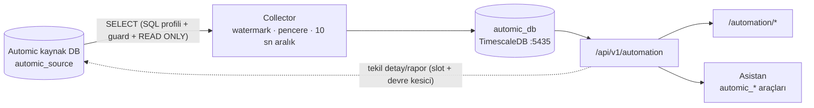

# ainew — UC4 Automic GUIDE

Modül `automation`. Menü adı **UC4 Automic**. Automic Workload Automation (UC4) çalışmalarını, hatalarını ve raporlarını ainew'e **salt okunur** çeker; genel bakış, çalışma listesi/detayı, aktif işler ve AI asistanı sunar. Automic'e hiçbir yazma/başlatma/durdurma işlemi yapılmaz.

## Mimari

- **Kaynak adaptörü** takılabilir (`AutomicSource`): ilk sürüm `db_oracle` (python-oracledb thin; gerekirse thick — `ORACLE_CLIENT_LIB_DIR`). Geliştirme için `fake`.
- **SQL profili** (`services/automic/source/sql/oracle/ae-24.yaml`): sorgular YAML'dan üretilir, `sql_guard` yalnız `SELECT`/`WITH` kabul eder (DML/DDL/PLSQL/`FOR UPDATE`/DB link reddedilir).
- **Keşif** bağlantıda tablo/kolon/sürüm yeteneklerini çıkarır; eksik yetenek UI ve asistanda "kapsam dışı" olarak görünür.
- **Modül DB** ayrıdır (ainew DB ile karışmaz): `automic_executions` (hypertable), `automic_active`, `automic_failed_index`, `automic_report_excerpts`, `automic_daily_aggregates`, sohbet tabloları.

## Menüler

| Menü | Yol | Modül | İşlem |
|------|-----|-------|-------|
| Genel bakış | `/automation` | automation | KPI, durum dağılımı, hacim, widget 8–16 (AI özeti, bu gece beklenenler), entegrasyon sağlığı |
| Çalışmalar | `/automation/executions` | automation | Filtre (zaman, durum sınıfı, tip, nesne, agent, client), sıralama, sayfalama |
| Çalışma detayı | `/automation/executions/:system/:client/:runId` | automation | Bağlam, raporlar (maskeli), alt adımlar, yeniden başlatmalar, "Asistana sor" |
| Aktif işler | `/automation/active` | automation | Şu an çalışanlar; nesne p95 süresini aşanlar vurgulu |
| Nesne | `/automation/objects/:system/:name` | automation | İstatistik, süre trendi, script/diff, usage/bağımlılık (JPP) |
| Asistan | `/automation/chat` | automation | Doğal dil soru-cevap |
| Entegrasyon | `/integrations/automic` | integrations / automation | Sistem ekle/düzenle (sihirbaz), test, keşif, elle toplama, devre sıfırlama |

## Bağlantı sihirbazı

Kaynak tipi → bağlantı (host, port, servis adı, kullanıcı, şifre; şifre şifreli saklanır) → test + keşif → client'lar (en az bir; client 0 önerilmez) → toplama pencereleri / blackout → kaynak koruması (istekler arası min. aralık, oturum slotu, sorgu zaman aşımı) → durum sınıfları (varsayılan: hatalı 1800–1899, 1850/1851 hariç; iptal 1850/1851; başarılı 1900–1999) → rapor alıntıları → saklama → depolama projeksiyonu → maskeleme paketleri → genel → özet.

- `master`, `uc4`, `system`, `sys` gibi şema sahibi/ayrıcalıklı kullanıcılar reddedilir; yalnız SELECT yetkili servis kullanıcısı kullanın.
- Saklama karma: ham çalışmalar kısa, hatalı çalışma indeksi ve günlük özetler uzun tutulur; kota aşılırsa en eski ham veri önce silinir. Örnek politika: `docs/internal/automic/automic-retention-policy.yaml`.

## Maskeleme ve LLM güvenliği

**Karar:** LLM kurum içinde (`llm_deployment=internal`, varsayılan) çalışsa bile gizli bilgiler hiçbir koşulda LLM'e, UI'a, sohbet geçmişine veya loglara gitmez. Maskeleme; LLM gönderimi, modül DB yazımı, audit kaydı ve UI yanıtından **önce** uygulanır.

| Kural | Davranış |
|-------|----------|
| Her zaman | Şifre, token, API anahtarı, private key, `PWD=` / `password=` / `user/pass@host` bağlantı cümleleri, Authorization |
| Maskelenmez | Automic kullanıcı adları (`NAME/DEPARTMENT`) |
| Ayarlanabilir | IP (`masking.mask_ip`) ve hostname (`masking.mask_hostname`) — **varsayılan: gösterilir** |
| Ülke paketi | TR: TCKN, IBAN, telefon, e-posta; `custom_patterns` |

`llm_deployment=external` seçilirse kurulum/ayar ekranında uyarı gösterilir; değişiklik audit'e `llm_deployment_change` olarak yazılır.

## Asistan

`/automation/chat` → `POST /api/v1/automation/chat/stream` (SSE). Model yalnız `automic_*` READ_ONLY araçlarıyla modül DB'yi sorgular; tablo/grafik bileşenleri backend'de üretilir. LLM yanıt veremezse araçlar deterministik çalıştırılır ve kısa bir özet döner. Ayrıntı: AI Mimari GUIDE → Automic.

## RBAC

- Görüntüleme ve asistan: `automation`.
- Sistem ekleme/düzenleme/silme, test, keşif, toplama: `integrations` (yazma işlemleri operatör rolü ister).
- Modül erişimi elle atanır; yalnız Automic'e erişimi olan kullanıcılara verin.

## Kurulum notları

- Modül DB: `docker-compose.automic.yml` (`automic_db`, `127.0.0.1:5435`, veri `${DATA_DIR}/automic/postgres`). Şifre `AUTOMIC_DB_PASSWORD`, yoksa `POSTGRES_PASSWORD`.
- Backend imajı `oracledb` paketini içermelidir (requirements). Thick mod gerekiyorsa Instant Client + `ORACLE_CLIENT_LIB_DIR`.
- Teşhis: `scripts/automic-diagnose.sh` (modül DB, ağ erişimi, sürücü, API durumu; sır yazdırmaz).
- Geliştirme: `AUTOMIC_FAKE=1` veya kaynak tipi `fake` ile sahte veri.

## Faz 2

- Overview widget 8–14 (süre sapması, süre trendi+p95, ısı haritası, ay sonu, aktif/bloke workflow, agent aktivitesi, depolama kotası).
- Nesne sayfası: OH başlık, maskeli script, sürüm listesi ve fark.
- Agent detay sayfası: `/automation/agents/:system/:name`.
- Her Automic sayfada (i) bilgi paneli (`GET /automation/info`).
- Unified Yönetici sohbeti Automic anahtar kelimelerinde `automic_*` araçlarını açar (`admin` / `ai_automation` / `executive` yeterli; ayrıca `automation` yetkisi gerekmez). Dedicated `/automation/*` sayfaları için `automation` gerekir.

## Faz 3

- Widget 15: `GET /automation/overview/insight` — LLM dashboard özeti, Redis/bellek **15 dk** önbellek (`force` ile yenileme).
- Widget 16: `expected_tonight` — aynı isodow + gece saatleri geçmiş örüntüsü; **forecast değil**.
- Nesne usage: `GET /objects/{system}/{name}/usage` (JPP; kaynak `usage_graph` yeteneği gerekir) + sohbet `dependency_graph` bileşeni.
- Asenkron analiz: `POST /analyses` (`failure_pack` / `overnight_review` / `impact_analysis`) → poll `GET /analyses/{id}` (`bulk_job_tracker`).
- RAG: `docs/rag_seed/AUTOMIC-basics.md`, `AUTOMIC-ops-patterns.md` (manifest’te etkin).
- (i) bilgi paneli: davranış metni + kurulum gereksinimleri (portlar, firewall, SELECT kullanıcı, modül DB :5435, RBAC).

## Faz 4 — Resmi şemaya hizalama

- **Yalnız resmi 24.4 kolonlar**: SQL profili (`ae-24.yaml`, `rev: 2`) Broadcom TechDocs *Automic DB Schema* **24.4** SELECT listesi dışına çıkmaz (`source/sql/official/ae-24.4-columns.yaml` + yerel `docs/official/24.4/`; erişim 2026-10-10). Kodda olup YAML'da olmayan kolon `test_automic_official_schema.py` ile kırılır.
- **24.4 doğrulananlar**: kullanıcı `AH_USR_Idnr` → `OH_Name`; platform `AH_HostAttrTypeD`; kuyruk `AH_Queue`; `EH_ActivationTime`/`EH_StartTime`; `OH_CrUserIdnr`/`OH_ModUserIdnr`; klasör `OFS_Link = 0` (Home Folder, `OFS.md`); `OH_DeleteFlag` 0/1/2/5 (`OH.md`); `OT_Type` 0–3; `RT_MsgNr`/`RT_Content` (`RT.md`); ERT/MRT/`EH_Srt` (SRT in Seconds)/`EH_Signal`.
- **DOĞRULANMADI** (24.4 Task Status / System Return Codes sayfası bulunamadı): aktif durum grupları, RH_Type değer listesi, nesne tipi kataloğu — gerçek DB ile kontrol edilecek (`STATUS_CODES_SEARCH.md`).
- **AE ERT okunur**: `AH_ERT`, `EH_Ert`, `EH_ERTEnd`, `OH_Ert`, `EH_ERTCalc`, `EH_Signal` → Aktif İşler / çalışma detayı.
- Mevcut kurulumlar: `profile_rev` farkı saatlik keşifle algılanır (veya Entegrasyon → Keşfi çalıştır); modül DB'ye yeni kolonlar `ensure_schema` ile otomatik eklenir. Keşif yenilenene kadar yeni alanlar boş görünür.
- **Kullanıcı ADI ile çalışma bulma (userID değil)**: `automic_search_executions user=<ad>` / `GET /automation/executions?user=` kısmi ad ve joker (`*`, `?`) kabul eder. Önce modül DB (`user` = toplama sırasında `AH_USR_Idnr → OH_Name`); sonuç yoksa ya da kullanıcısı çözülmemiş (eski) kayıt varsa kaynakta canlı arar: `OH (OH_OType='USER', OH_Name LIKE ad) → OH_Idnr → AH_USR_Idnr IN (...)` (`data_source=source_live`, `source_users`). Ad bulunamazsa bilinen kullanıcılar önerilir (`hint.known_users`). Aktif işler `automic_active user=`; kullanıcı bazında özet `automic_history user_activity`.
- RAG: `AUTOMIC-ae-db-schema.md` (24.4 resmi kolonlar), `AUTOMIC-ae-status-metrics.md` (ERT/MRT/SRT resmi; durum/RH_Type/nesne tipi DOĞRULANMADI).
- ainew'in toplamadığı resmi alanlar (HOST/ACTEX agent bağlantısı, `AH_ChildCnt*` vb.) asistan bilgisinde "AE'de var, ainew'de yok" olarak belirtilir.

## Sonraki sürümler (henüz yok)

REST adaptörü (forecast/AE process sağlığı; ERT DB'den zaten okunur), hibrit profil, MSSQL ve PostgreSQL kaynak adaptörleri — A15 “Sonraki sürümler”; bu dalda uygulanmadı.
